# DIAGNÓSTICO DE ARQUITETURA — da app no aparelho para API real (Go + PostgreSQL)

> Análise **somente leitura** do código em `C:\Users\CLIENTE\Desktop\dia-dia-tudo` (branch `main`, árvore com mudanças locais não commitadas em 05/11/2026). Nenhum arquivo de código foi alterado; `scripts/contrato.mjs` **não** foi executado porque ele **grava** `api-contract/openapi.yaml` (`scripts/contrato.mjs:29`) — os números abaixo foram extraídos lendo `src/core/services/index.ts` com a mesma regra do script.
>
> Convenção de marcação:
> - **[FATO]** — está no código; sempre com `arquivo:linha`.
> - **[HIPÓTESE]** — dedução razoável, não comprovada no código.
> - **[RECOMENDAÇÃO]** — o que eu faria.

---

## 0. Resumo executivo (1 minuto)

| Pergunta do dono | Resposta curta |
|---|---|
| Ligar o front numa API é simples? | **Simples.** As telas já só falam com uma porta (`Backend`) por nome de comando/consulta [FATO `src/core/ports/backend.ts:136-152`, `src/shared/ui/contexto.tsx:72-124`]. Trocar o adaptador não mexe em tela. |
| Montar o banco relacional é simples? | **Moderado.** O modelo tem 20 coleções [FATO `src/core/ports/portas.ts:41-63`], com `Base` uniforme [FATO `src/core/domain/tipos.ts:10-18`], mas há **listas e mapas dentro dos registros** que viram ~30 tabelas filhas, e alguns dados de negócio estão "escondidos" em `config` e `auditoria`. Proposta: **64 tabelas na V1** (58 indispensáveis + 6 que podem nascer como coluna/JSONB), 67 com as de acesso do §11. |
| O backend em Go é simples? | **Complexo.** Toda regra está em TypeScript: **11.343 linhas** em `src/core/services/*.ts` + 1.872 em `domain/` e módulos [FATO: contagem `wc -l`]. São **85 comandos e 92 consultas** [FATO `src/core/services/index.ts:36-138` e `:140-238`]. Em Go tudo isso é **reescrito**, com aritmética exata de dinheiro/câmbio igual à do TS e com concorrência real (hoje um comando roda por vez no aparelho [FATO `src/adapters/noAparelho.ts:68-72,94`]). |
| Os perfis (admin × funcionária/gerente) já estão prontos para a API? | **Sim, na maior parte.** Atualização 05/11/2026 (§10): o que a funcionária vende, vê na agenda e as telas liberadas são **configuração** (`config.funcionaria*`) e são conferidos **no serviço** (`vendas.ts`, `agenda.ts`, `visibilidade.ts`), não só na tela — a API herda isso de graça. Ficam para decidir: liberações **por usuário** (hoje valem para todas as funcionárias) e preferências (tema/idioma) **por usuário no servidor** (hoje no aparelho). |
| Autenticação e permissões vão vir do banco? Muda muito o front? | **Sim, vão para o servidor; o front muda pouco** (§11): as regras já estão no núcleo (`permissoes.ts`, `visibilidade.ts`), não nas telas. No front: 1 adaptador HTTP, 1 hook de permissões no lugar das contas locais em 10 arquivos, e a sessão sempre reconferida no servidor. |
| O QR da etiqueta é seguro? | **No app, sim, para o que dá sem servidor** (§12): o QR leva só um código aleatório (não vaza id, data, medida nem cor), reimprimir invalida o antigo e quem lê sem login vê uma página neutra. Com a API: abrir só com JWT, limite de tentativas, auditoria das leituras inválidas e, se quiser, código assinado (HMAC). |
| **Veredito** | **COMPLEXA** no total (pela reescrita das regras em Go + concorrência multiusuário). A arquitetura atual é boa e reduz o risco: o *encaixe* é simples; o *volume e a exatidão* das regras é o que pesa. |

Top 3 riscos: (1) **divergência de regra/arredondamento** entre TS e Go (dinheiro, câmbio racional, rateios de custo); (2) **concorrência**: hoje a fila única esconde corridas (estoque, contadores de código, comissão a pagar, dia do caixa); (3) **contrato de transporte**: o adaptador atual fala um **envelope cifrado em 2 endereços** (`/v1/k`, `/v1/r`) com token **dentro** do corpo [FATO `src/adapters/api/backendApi.ts:1-12`, `api-contract/openapi.yaml:9-41`], o que conflita com "REST + JWT em cabeçalho" — precisa de decisão antes de começar.

---

## 1. Mapeamento de entidades

### 1.1 O que existe hoje (coleções da porta)

[FATO] Porta de repositório com 20 coleções (`src/core/ports/portas.ts:41-63`). Toda coleção só tem `obter`, `listar(onde por igualdade)`, `salvar`, `salvarVarios`, `limpar` (`portas.ts:32-39`) — **não existe consulta por intervalo, ordenação, paginação nem agregação na porta**; todas as consultas carregam a coleção e filtram em memória (ex.: `vendas.ts:573-608`, `painel.ts:29-40`, `caixa.ts:127-131`).

[FATO] Campos-base de todo registro: `id, empresaId, criadoEm, atualizadoEm, criadoPor, versao, apagadoEm?` (`tipos.ts:10-18`), preenchidos por `novo()` e `tocar()` (`contexto.ts:21-37`). `id` é ULID gerado no aparelho (`domain/ids.ts:16-33`).

### 1.2 Entidades, dependência e campos

Legenda: **I** = independente (existe sozinha) · **D** = dependente (só existe dentro/por causa de outra) · *obrig.* = obrigatório no tipo TS.

| # | Entidade (coleção) | I/D | Campos obrigatórios | Campos opcionais relevantes | Relações | Fonte |
|---|---|---|---|---|---|---|
| 1 | **Pessoa** (`pessoas`) | I | nome, papeis[] | telefone, documento, obs, comissaoBp, localId, cargo, salario{moeda,valor,periodo}, superiorId, acesso, verAgendaEquipe | N:1 Local; auto-relação superior (organograma); papéis N:N | `tipos.ts:22-41` |
| 2 | **Local / Unidade** (`locais`) | I | nome, tipo(salao/ponto/outro) | apelido, endereço (rua…pais), referencia | 1:N pessoas, vendas, mov. caixa | `tipos.ts:43-54` |
| 3 | **Item** (`itens`) — catálogo **e** lote de cabelo | I | moduloId, tipoItem, nome, unidade, controlaEstoque, ativo, **saldo**, campos | precoSugerido, estoqueIdeal, duracaoMin, retornoDias, comissaoBp, insumo{moeda,valor,itens[]}, custoPrincipal, quantidadeInicial, **origem{tipo,id,ids[],pessoaId,compraId,compraIds[]}**, faseTriagem{…}, **triagem{id,codigo,em,por,papel}**, codigo, codigosAnteriores[], etiqueta*(5 campos), reserva{…} | N:1 compra (lote nasce na compra); N:N lote↔lote (genealogia); N:N lote↔compras | `tipos.ts:61-111` |
| 4 | **Transação** (`transacoes`) — **compra e venda na mesma coleção** | I | tipo, moduloId, data, etapa, **linhas[]**, **pagamentos[]**, moedaPrincipal, totalPrincipal, **historico[]**, campos | codigo, codigosAnteriores, compradorId, pessoaId, localId, profissionalId, agendadoPara, obs, viagemId, financiamentoId, **impostosEstimados{…linhas[]}** | N:1 pessoa, local, viagem, financiamento | `tipos.ts:192-221` |
| 4a | Linha (`Transacao.linhas[]`) | D | id, descricao, quantidade, moeda, total, totalPrincipal, campos | itemId, cotacao, custoPrincipal, profissionalId, comissão(3), insumo(4), baseComissao, parteSalao, precoCatalogo, motivoPreco, bruto/desconto/descontoPrincipal | N:1 item | `tipos.ts:133-172` |
| 4b | Pagamento (`Transacao.pagamentos[]`) | D | id, forma, moeda, valor, valorPrincipal | cotacao | N:1 forma | `tipos.ts:123-131` |
| 4c | EventoEtapa (`Transacao.historico[]`) | D | de, para, em | por, porNome, tipo(etapa/correcao), totalAntes/Depois, motivo, ajustes[] | — | `tipos.ts:174-188` |
| 5 | **MovEstoque** (`movEstoque`) | D (de Item) | itemId, data, delta, saldoAntes, saldoDepois, motivo | origemId (polimórfico), corrigeId, descricao, usuario, porNome | N:1 item; origem → compra/venda/lote/triagem | `tipos.ts:225-238` |
| 6 | **Dia do caixa** (`dias`) | I | data, status, **contado{moeda→valor}** | **alteracoesDepois[]** | 1:N mov. caixa (pela data) | `tipos.ts:240-247`; id = a própria data `contexto.ts:227` |
| 7 | **MovCaixa** (`movCaixa`) | D | data, moeda, forma, delta, tipo(11), descricao | origemId (polimórfico), categoria, socioId, valorPrincipal, localId, pessoaId, estornadoPor, estornaId, viagemId | N:1 dia, forma, sócio, local, pessoa; auto-relação estorno | `tipos.ts:262-284` |
| 8 | **MovConta** — conta corrente da pessoa (`movConta`) | D (de Pessoa) | pessoaId, data, moeda, delta, tipo(8), descricao | origemId, forma | N:1 pessoa | `tipos.ts:290-300` |
| 9 | **Cotação** (`cotacoes`) | I | (Cotacao) moeda, valor(**texto decimal**), sentido, data | contra, uso(base/venda/compra), fonte | — | `tipos.ts:302-304`, `dinheiro.ts:86-98` |
| 10 | **TabelaPreco** (`tabelasPreco`) | I | moduloId, nome, moeda, unidadeMedida, fatorPor, **linhas: number[]**, **colunas[]**, **valores{"medida\|coluna"→"3,5"}** | categoria, validaDesde | colunas N:1 pessoa | `tipos.ts:310-326` |
| 10a | **Versão da tabela** | D | numero, em, nome, linhas, colunas, valores | por, nota, categoria, validaDesde | **guardada como linha de `auditoria` com JSON no `resumo`** | `precos.ts:126-146`, `precos.ts:148-151` |
| 11 | **Empréstimo** (`emprestimos`) | I | direcao, pessoaId, moeda, principal, juros{tipo,taxa,fixo}, inicio, **parcelas[]**, situacao | obs | N:1 pessoa; 1:N parcelas; 1:N mov. dívida | `tipos.ts:337-347` |
| 12 | **MovDivida** (`movDivida`) | D | emprestimoId, data, delta, saldoAntes, saldoDepois, tipo | parcelaId, forma, descricao | N:1 empréstimo, parcela | `tipos.ts:349-359` |
| 13 | **Anexo** (`anexos`) | D (de qualquer dono) | donoId (polimórfico), categoria, nome, mime, tamanho | **miniatura (data URL dentro do registro)** | dono = compra/venda/item/pessoa/… | `tipos.ts:363-371` |
| 14 | **Config** (`config`) — chave → valor qualquer | I | valor: unknown | — | ver 1.4 | `tipos.ts:373-375` |
| 15 | **Auditoria** (`auditoria`) | D | acao, resumo | alvoId, usuarioNome, ligados[] | polimórfica | `tipos.ts:378-385` |
| 16 | **Usuário** (`usuarios`) | I | login, nome, perfil, senhaHash, sal, ativo | pessoaId, localId, ultimoAcesso | 1:1 opcional pessoa | `tipos.ts:388-398` |
| 17 | **Viagem** (`viagens`) | I | codigo, nome, **viajantes[]**, inicio, status, rateio, **despesas[]**, **carteira[]** | destino, naBolivia, fim, orcamento(2), encerramento{}, **incorporacao{…lotes[]}**, **incorporacoesDesfeitas[]**, obs | N:N pessoas; 1:N compras (Transacao.viagemId) | `tipos.ts:404-468` |
| 18 | **Financiamento / Adiantamento** (`financiamentos`) | I | codigo, pessoaId, data, moeda, valor, valorPrincipal, forma, **eventos[]** | cotacao, viagemId, prazo, abaterComissoes, obs, encerramento{} | N:1 pessoa, viagem; 1:N compras (entregas) | `tipos.ts:470-511` |
| 19 | **Evento da agenda** (`eventos`) | I | titulo, data | hora, duracaoMin, nota, pessoaId, localId, semanal, repetirAte, **feitos[]** | N:1 pessoa, local | `tipos.ts:524-538` |
| 20 | **Outbox** (`outbox`) | D | comando, dados | enviadoEm | — (hoje só grava, ninguém envia) | `tipos.ts:513-517`, `noAparelho.ts:114-116` |

**Entidades que existem no negócio mas NÃO têm registro próprio** (achado importante):

| Entidade "fantasma" | Onde vive hoje | Fonte |
|---|---|---|
| **Triagem** ("T-0003": quem, quando, o que juntou/separou) | copiada em cada lote: `item.triagem{id,codigo,em,por,papel}` e `item.campos.separacaoId` | `tipos.ts:93-94`, `estoque.ts:231-234`, `triagem.ts:536` |
| **Venda em aberto** (rascunho do caixa) | `config` com id `"vendaAberta:<id>"` | `vendasAbertas.ts:8,37-41` |
| **Cidade cadastrada** | `config` com id `"cidade:<id>"` | `cidades.ts:1-3,10,14-18` |
| **Contadores de código** (P, L, T, V, VG…) | `config` com id `"contador-<letra>"` | `codigos.ts:194-202`, `estoque.ts:188-196` |
| **Sigla da pessoa** (código "por pessoa") | `config.codigos.siglas{pessoaId→sigla}` | `codigos.ts:31-32` |
| **Forma de pagamento**, **Sócio**, **Fluxo de compra/triagem**, **Atributos**, **Categorias de viagem**, **Módulos personalizados**, **Fiscal/impostos** | dentro de `config` (`geral`, `fluxosCompra`, `fluxoTriagem`, `atributosItem`, `categoriasViagem`, `modulosPersonalizados`) | `contexto.ts:65-132,157-165`, `noAparelho.ts:59-66`, `viagens.ts:75-85` |
| **Versão de tabela de preço** | `auditoria` com `acao='tabelaPrecoVersao'` e o JSON inteiro em `resumo` | `precos.ts:142-151`, filtrada da tela em `auditoria.ts:65` |
| **Comissão** (ganha / paga / a pagar) | **derivada**: ganho = linhas de venda; pago = `movCaixa` com `categoria==='Comissões'` + `movConta.tipo==='comissao'` | `comissoes.ts:1-5,30-65` |

### 1.3 Dados duplicados e derivados (calculado × persistido)

| Dado | Persistido? | Verdade | Risco | Fonte |
|---|---|---|---|---|
| `item.saldo` | **Sim (cache)** | soma de `movEstoque.delta` | divergência em concorrência; o diagnóstico confere | `tipos.ts:68`, `estoque.ts:21-37`, consulta `diagnostico` `painel.ts:312` |
| `movEstoque.saldoAntes/saldoDepois` | Sim | cadeia de movimentos | dois movimentos simultâneos com o mesmo `saldoAntes` | `estoque.ts:21-34` |
| `movDivida.saldoAntes/saldoDepois` | Sim | soma dos movimentos do empréstimo | idem | `emprestimos.ts:51-53` |
| `transacao.totalPrincipal` | Sim | Σ `linhas.totalPrincipal` | baixo (calculado no mesmo comando) | `compras.ts:208`, `vendas.ts:284` |
| `linha.totalPrincipal`, `pagamento.valorPrincipal`, `cotacao` | Sim (**foto da hora**) | não recalcular o passado | correto manter persistido | `tipos.ts:128-130,140-141` |
| `linha.comissaoPrincipal/baseComissao/parteSalao/insumo*` | Sim (foto) | regra de comissão na hora | correto manter | `vendas.ts:146-153` |
| `linha.custoPrincipal` | Sim (foto na saída) | custo proporcional do lote | correto manter | `vendas.ts:240-244` |
| `item.custoPrincipal` | Sim | custo do lote (muda com incorporação da viagem) | atualizado por `incorporarCustoViagem`/`reabrirViagem` | `viagens.ts:508-511` |
| `item.origem.compraIds` | Sim (denormalizado) | fecho transitivo da genealogia | mantido por cada triagem | `tipos.ts:86-90`, `triagem.ts:143,162` |
| Saldo da conta corrente | **Não** (soma de `movConta`) | — | consulta varre tudo | `vendas.ts:585` |
| Saldo do caixa ("veio de ontem") | **Não** (soma de todo `movCaixa` < data) | — | **cresce sem limite**: `caixaDoDia` lê todos os movimentos de sempre | `caixa.ts:131-139` |
| Comissão a pagar | **Não** | ganho − pago | corrida ao pagar (ver §7) | `comissoes.ts:91-104` |
| Saldo do financiamento | **Não** (soma de `movConta` pela origem) | — | — | `tipos.ts:487-492` |
| Status de parcela | **Não** | calculado por data | — | `emprestimos.ts:148-155` |
| `pessoa.acesso` × `usuario.perfil` | **Duplicado** | o que vale para permissão é `usuario.perfil` (`noAparelho.ts:83-85`) | dois lugares para "é admin" | `tipos.ts:38`, `CadastroFuncionario.tsx:40,64` |
| `movCaixa.viagemId` × `movCaixa.origemId` (viagem) | Duplicado | gravados juntos | — | `viagens.ts:179-182` |

### 1.4 O que precisa de histórico / auditoria

[FATO] Toda ação chama `auditar()` (`contexto.ts:59-61`) e as **tentativas recusadas** também ficam no log, fora da transação (`noAparelho.ts:119-123,133-145`). Nada é apagado de verdade: `apagadoEm` (soft delete) e estornos (`caixa.ts:64-85`, `vendas.ts:342-369`).

| Precisa de histórico | Como está hoje | Proposta |
|---|---|---|
| Etapas e correções de compra/venda (antes → depois) | `transacao.historico[]` | tabela `etapa_eventos` |
| Estoque, caixa, conta, dívida | razões append-only (`movEstoque`, `movCaixa`, `movConta`, `movDivida`) | mantêm-se razões imutáveis |
| Versões da tabela de preço | linhas de auditoria com JSON | tabelas `tabela_preco_versoes/colunas/medidas/celulas` |
| Códigos trocados (compra/lote) | `codigosAnteriores[]` | tabela `codigos_anteriores` |
| Incorporação de custo da viagem e as desfeitas | `incorporacao` + `incorporacoesDesfeitas[]` | `viagem_incorporacoes` (+ `desfeita_em`) e `viagem_incorporacao_lotes` |
| Dia encerrado alterado depois | `dia.alteracoesDepois[]` | `dia_alteracoes` |
| Quem fez o quê (log geral, linha do tempo de cada registro) | `auditoria` + `ligados[]` | `auditoria` (com `ligados text[]` + índice GIN) |

---

## 2. Estimativa de tabelas e DDL (PostgreSQL)

### 2.1 Motor recomendado

**[RECOMENDAÇÃO] PostgreSQL 16+.** Motivos curtos: transações ACID com `SELECT … FOR UPDATE` e `SERIALIZABLE` (o que estoque/caixa precisam com várias funcionárias); `CHECK`, índices parciais (`WHERE apagado_em IS NULL` para soft delete), `NUMERIC` exato (fatores "3,5" e cotações), `JSONB` com índice para o pouco que deve ficar flexível, arrays + GIN (`auditoria.ligados`), `COMMENT ON` nativo, ótimo driver Go (`pgx`) e geração de código tipado (`sqlc`).

### 2.2 Estimativa

| Grupo | Tabelas V1 | Quantas |
|---|---|---|
| Plataforma/segurança | empresas, moedas, usuarios, refresh_tokens, idempotencia, auditoria | 6 |
| Configuração/referência | modulos, configuracoes, formas_pagamento, socios, sequencias, cotacoes, cidades* | 7 |
| Cadastros | pessoas, pessoa_papeis, locais | 3 |
| Estoque/triagem | itens, item_insumos*, item_origens, item_compras*, triagens, triagem_colunas, codigos_anteriores*, mov_estoque | 8 |
| Tabelas de preço | tabelas_preco, tabela_preco_versoes, tabela_preco_colunas, tabela_preco_medidas, tabela_preco_celulas | 5 |
| Compras/vendas | compras, compra_linhas, vendas, venda_linhas, pagamentos, etapa_eventos, vendas_abertas, venda_aberta_linhas | 8 |
| Caixa/conta corrente | dias_caixa, dia_contagens, dia_alteracoes*, mov_caixa, mov_conta, turnos, turno_valores | 7 |
| Empréstimos | emprestimos, parcelas, mov_divida | 3 |
| Viagens | viagens, viagem_viajantes, viagem_despesas, viagem_carteira, viagem_incorporacoes, viagem_incorporacao_lotes | 6 |
| Adiantamentos | financiamentos, financiamento_eventos | 2 |
| Agenda | eventos, evento_feitos* | 2 |
| Arquivos | anexos | 1 |
| QR da etiqueta (§12) | item_qr_anteriores, qr_leituras | 2 |
| Imposto de Renda | ir_exercicios, ir_exercicio_eventos, ir_obrigacoes | 3 |
| Metas do mês | metas | 1 |
| **Total** | | **64** (58 indispensáveis + 6 marcadas com * que podem nascer como coluna/array/JSONB); **67** com as 3 de acesso do §11 (perfil_permissoes, usuario_permissoes, sessoes) |

Decisões de normalização (as estruturas "JSON dentro do registro"):

| Estrutura hoje | Decisão | Por quê |
|---|---|---|
| `transacao.linhas/pagamentos/historico` | **Tabelas** (`compra_linhas`, `venda_linhas`, `pagamentos`, `etapa_eventos`) | são consultadas (comissão por profissional, vendas por item/forma/moeda — `vendas.ts:591-595`, `comissoes.ts:30-34`) |
| Compra e venda na mesma coleção | **Separar** `compras` × `vendas` | linhas totalmente diferentes (compra: tabela/fator/sem valor; venda: comissão/insumo/desconto); `CHECK` e índices ficam limpos; ids ULID continuam únicos |
| `item.campos` (atributos dinâmicos) | **Promover** a colunas o que tem regra (`estado` 19 usos, `categoria` 16, `separacaoId` 13, `comprimento` 13, `triagemDesfeita` 5 — contagem de `campos.<x>` em `src/core/services`); o resto em `atributos JSONB` | atributos são configuráveis pelo usuário (`modulos.ts:24-28`, `salvarAtributos`) |
| `tabelaPreco.linhas/colunas/valores` + versões na auditoria | **5 tabelas versionadas** | a venda guarda a versão usada (`precos.ts:91-110`); comparar versões (`precos.ts:178-216`) vira SQL |
| Vendas abertas em `config` | **Tabelas** `vendas_abertas` + `venda_aberta_linhas` | precisa achar "em que venda aberta está o pacote X" (`vendasAbertas.ts:99-110`) por índice |
| Fiscal dentro de `config.geral` | **Fica em `configuracoes` (JSONB) na V1** | lido inteiro, raramente muda; normalizar alíquotas com vigência depois |
| Cotação usada (`Cotacao`) | **JSONB de valor imutável** (`cotacao`) nas linhas/pagamentos | foto que nunca é filtrada; 5 colunas × 6 tabelas não compensam |
| `impostosEstimados` | **JSONB** em `compras`/`vendas` na V1 | "só registro, nunca cobrados" (`tipos.ts:219-220`) |
| `viagem.despesas/carteira/incorporacao` | **Tabelas** | são somadas por moeda e desfeitas (`viagens.ts:418-470,525+`) |
| `financiamento.eventos`, `emprestimo.parcelas`, `evento.feitos`, `dia.contado` | **Tabelas filhas** | — |
| Turnos em `config` (`turno:<id>`, `turnos.ts`) | **Tabelas** `turnos` + `turno_valores` (por moeda) | é dinheiro, consultado por pessoa e período (Caixa › Turnos); `EXCLUDE` impede turnos sobrepostos |
| Imposto de Renda em `config` (`irExercicios`, `irObrigacoes`) | **Tabelas** `ir_exercicios`, `ir_exercicio_eventos`, `ir_obrigacoes` | fechamento congelado e histórico com motivo precisam de garantia no banco; somas por mês/obrigação |
| `docFiscal` em `compra.campos` e `movCaixa` | **Colunas** `doc_fiscal*` em `compras` e `mov_caixa` | filtra as compras sem factura (retenções) e os gastos dedutíveis |
| `geral.metas.itens` | **Tabela** `metas` (opções de exibição continuam em `geral`) | a funcionária vê só as dela: filtro por `pessoa_id`/`local_id` com FK |
| `geral.vitrine.ocultos` (lista de ids) | **Coluna** `itens.vitrine_oculto` (o resto da vitrine continua em `geral`) | a página pública lista por índice parcial, sem ler um array |
| `Item.qr` | **Coluna** `itens.qr_codigo` UNIQUE + `item_qr_anteriores` + `qr_leituras` | §12: abrir só logado, "etiqueta antiga", limite e registro de tentativas |
| Metas/vitrine/reposição/o que a funcionária faz (opções) | **Ficam em `configuracoes` 'geral' (JSONB)** | lidas inteiras, mudam pouco |

**Constraints com nome** (`pk_`, `fk_`, `ck_`, `ux_`, `ex_`) nas tabelas novas: o servidor Go traduz a violação pelo nome (`ck_turnos_periodo` → "o fim vem depois do começo") sem depender do texto do Postgres. **[RECOMENDAÇÃO]** levar o mesmo padrão às tabelas antigas na primeira migração.

### 2.3 Convenções do DDL

- `ident`: texto; **ULID** para registros novos. Aceita ids legados que **não são ULID** e já existem nos dados: `"<id>-u"` (lote juntado na triagem, `triagem.ts:515`), `"<id>-corr-N"` (pagamento de correção, `vendas.ts:490`), `"<id>-<n>"` (mov. de dívida por parcela, `emprestimos.ts:128`), dia = `"AAAA-MM-DD"` (`contexto.ts:227`). **[RECOMENDAÇÃO]** no servidor novo, gerar ULID próprio e guardar a chave derivada em `operacao_id`.
- Dinheiro = `BIGINT` na menor unidade (limite 10 bi igual ao app, `contexto.ts:244-248`); quantidade = `BIGINT` (grama/peça); percentuais = pontos-base `0..10000`.
- Datas de negócio = `DATE` no fuso da empresa; instantes = `TIMESTAMPTZ`.
- **Perfil de colunas**: **B** (registro completo: `id, empresa_id, criado_em, criado_por, atualizado_em, versao, apagado_em`); **L** (razão append-only: `id, empresa_id, criado_em, criado_por`); **F** (filha de composição: sem colunas-base, apaga junto com o pai).
- `ON DELETE`: **RESTRICT** como padrão (nada é apagado de verdade — apagar = `apagado_em`); **CASCADE** só em filhas de composição (linhas, colunas, células, papéis…).
- Unicidade com soft delete = índice único **parcial** `WHERE apagado_em IS NULL`.
- Tenancy: toda tabela de negócio tem `empresa_id`; todo índice começa por `empresa_id`. (Opção mais forte, não aplicada aqui para não pesar: FKs compostas `(empresa_id, id)` ou Row-Level Security.)

### 2.4 DDL V1 completo

> **Conferido em 05/11/2026** num PostgreSQL 16 de verdade (PGlite, com `btree_gist` e `pg_trgm`): o bloco abaixo roda
> inteiro, cria as 64 tabelas, toda coluna nova tem `COMMENT`, e 50 casos de teste das constraints novas (turnos, Imposto de
> Renda, metas, QR, documento fiscal) aceitam o certo e recusam o errado pela constraint esperada.
> As tabelas de acesso do §11 ficam no próprio §11 (não entram neste bloco).

```sql
-- =====================================================================
-- 0. EXTENSÕES E DOMÍNIOS
-- =====================================================================
CREATE EXTENSION IF NOT EXISTS pg_trgm;   -- busca por nome/código com ILIKE '%x%'
CREATE EXTENSION IF NOT EXISTS btree_gist; -- EXCLUDE com igualdade + intervalo (turnos da mesma pessoa não se sobrepõem)

CREATE DOMAIN ident        AS text    CHECK (VALUE ~ '^[0-9A-Za-z][0-9A-Za-z_-]{0,63}$');
CREATE DOMAIN dinheiro     AS bigint  CHECK (VALUE BETWEEN -10000000000 AND 10000000000);
CREATE DOMAIN quantidade   AS bigint  CHECK (VALUE BETWEEN -10000000000 AND 10000000000);
CREATE DOMAIN pontos_base  AS integer CHECK (VALUE BETWEEN 0 AND 10000);
CREATE DOMAIN codigo_moeda AS char(3) CHECK (VALUE ~ '^[A-Z]{3}$');
CREATE DOMAIN fator        AS numeric(18,6) CHECK (VALUE > 0);

COMMENT ON DOMAIN ident        IS 'Identificador. ULID (26 caracteres Crockford) nos registros novos; aceita ids legados derivados ("<ulid>-u", "<ulid>-corr-1", "AAAA-MM-DD").';
COMMENT ON DOMAIN dinheiro     IS 'Valor monetário inteiro na MENOR unidade da moeda (centavos; guarani sem casas). Limite ±10 bilhões, igual ao app.';
COMMENT ON DOMAIN quantidade   IS 'Quantidade inteira na unidade base do item (grama, peça, vez de serviço).';
COMMENT ON DOMAIN pontos_base  IS 'Percentual em pontos-base: 10000 = 100%, 5000 = 50%, 1 = 0,01%.';
COMMENT ON DOMAIN codigo_moeda IS 'Código ISO 4217 de 3 letras (BOB, USD, BRL, PYG).';
COMMENT ON DOMAIN fator        IS 'Fator decimal exato (ex.: 3,5 por grama) — o app guarda texto "3,5"; aqui NUMERIC exato.';

-- =====================================================================
-- 1. PLATAFORMA E SEGURANÇA
-- =====================================================================
CREATE TABLE moedas (
  codigo   codigo_moeda PRIMARY KEY,
  nome     text     NOT NULL CHECK (length(btrim(nome)) > 0),
  simbolo  text     NOT NULL CHECK (length(btrim(simbolo)) > 0),
  casas    smallint NOT NULL CHECK (casas BETWEEN 0 AND 4),
  pais     text     NOT NULL
);

CREATE TABLE empresas (
  id              ident PRIMARY KEY,
  nome            text NOT NULL CHECK (length(btrim(nome)) BETWEEN 1 AND 120),
  moeda_principal codigo_moeda NOT NULL REFERENCES moedas(codigo) ON DELETE RESTRICT,
  fuso_horario    text NOT NULL DEFAULT 'America/La_Paz',
  idioma          text NOT NULL DEFAULT 'pt' CHECK (idioma IN ('pt','es')),
  criado_em       timestamptz NOT NULL DEFAULT now(),
  atualizado_em   timestamptz NOT NULL DEFAULT now(),
  versao          integer NOT NULL DEFAULT 1 CHECK (versao >= 1)
);

CREATE TABLE usuarios (
  id ident PRIMARY KEY,
  empresa_id ident NOT NULL REFERENCES empresas(id) ON DELETE RESTRICT,
  criado_em timestamptz NOT NULL DEFAULT now(), criado_por ident REFERENCES usuarios(id) ON DELETE RESTRICT,
  atualizado_em timestamptz NOT NULL DEFAULT now(), versao integer NOT NULL DEFAULT 1 CHECK (versao >= 1), apagado_em timestamptz,
  login            text NOT NULL CHECK (login ~ '^[a-z0-9._-]{3,30}$'),
  nome             text NOT NULL CHECK (length(btrim(nome)) > 0),
  perfil           text NOT NULL CHECK (perfil IN ('admin','funcionario')),
  pessoa_id        ident,            -- FK adicionada depois de "pessoas"
  local_id         ident,            -- FK adicionada depois de "locais"
  senha_hash       text NOT NULL,
  ativo            boolean NOT NULL DEFAULT true,
  sistema          boolean NOT NULL DEFAULT false,
  ultimo_acesso_em timestamptz
);
CREATE UNIQUE INDEX ux_usuarios_login ON usuarios (login) WHERE apagado_em IS NULL;          -- login (entrar)
CREATE INDEX ix_usuarios_empresa ON usuarios (empresa_id, ativo);                              -- tela Usuários; "pelo menos 1 admin ativo"

CREATE TABLE refresh_tokens (
  id              ident PRIMARY KEY,
  empresa_id      ident NOT NULL REFERENCES empresas(id) ON DELETE RESTRICT,
  usuario_id      ident NOT NULL REFERENCES usuarios(id) ON DELETE CASCADE,
  token_hash      bytea NOT NULL UNIQUE,
  familia_id      ident NOT NULL,
  emitido_em      timestamptz NOT NULL DEFAULT now(),
  expira_em       timestamptz NOT NULL,
  revogado_em     timestamptz,
  substituido_por ident REFERENCES refresh_tokens(id) ON DELETE SET NULL,
  user_agent      text,
  ip              inet,
  CHECK (expira_em > emitido_em)
);
CREATE INDEX ix_refresh_usuario ON refresh_tokens (usuario_id) WHERE revogado_em IS NULL;     -- revogar todos ao desativar usuário
CREATE INDEX ix_refresh_familia ON refresh_tokens (familia_id);                               -- detecção de reuso (revoga a família)

CREATE TABLE idempotencia (
  empresa_id  ident NOT NULL REFERENCES empresas(id) ON DELETE RESTRICT,
  usuario_id  ident NOT NULL REFERENCES usuarios(id) ON DELETE RESTRICT,
  chave       text  NOT NULL CHECK (length(chave) BETWEEN 8 AND 200),
  comando     text  NOT NULL,
  hash_dados  bytea NOT NULL,
  status      text  NOT NULL CHECK (status IN ('em_andamento','concluido')),
  resposta    jsonb,
  criado_em   timestamptz NOT NULL DEFAULT now(),
  expira_em   timestamptz NOT NULL,
  PRIMARY KEY (empresa_id, usuario_id, chave),
  CHECK (status = 'em_andamento' OR resposta IS NOT NULL)
);
CREATE INDEX ix_idempotencia_expira ON idempotencia (expira_em);                               -- limpeza periódica

CREATE TABLE auditoria (
  id ident PRIMARY KEY,
  empresa_id ident NOT NULL REFERENCES empresas(id) ON DELETE RESTRICT,
  criado_em timestamptz NOT NULL DEFAULT now(), criado_por ident NOT NULL REFERENCES usuarios(id) ON DELETE RESTRICT,
  acao          text NOT NULL CHECK (length(acao) BETWEEN 1 AND 60),
  alvo_id       ident,
  resumo        text NOT NULL,
  usuario_nome  text,
  ligados       text[] NOT NULL DEFAULT '{}',
  dados         jsonb,
  recusado      boolean NOT NULL DEFAULT false
);
CREATE INDEX ix_auditoria_quando ON auditoria (empresa_id, criado_em DESC);                    -- tela Auditoria / logDetalhado (período, paginado)
CREATE INDEX ix_auditoria_alvo   ON auditoria (empresa_id, alvo_id, criado_em DESC);           -- linhaDoTempo de um registro
CREATE INDEX ix_auditoria_ligados ON auditoria USING gin (ligados);                            -- linhaDoTempo pelos registros ligados
CREATE INDEX ix_auditoria_acao   ON auditoria (empresa_id, acao, criado_em DESC);              -- filtro por ação / área
CREATE INDEX ix_auditoria_usuario ON auditoria (empresa_id, criado_por, criado_em DESC);       -- filtro por usuário

-- =====================================================================
-- 2. CONFIGURAÇÃO E REFERÊNCIA
-- =====================================================================
CREATE TABLE modulos (
  empresa_id    ident NOT NULL REFERENCES empresas(id) ON DELETE RESTRICT,
  id            text  NOT NULL CHECK (id ~ '^[a-z][a-z0-9_-]{1,30}$'),
  nome          text  NOT NULL,
  ativo         boolean NOT NULL DEFAULT true,
  personalizado boolean NOT NULL DEFAULT false,
  definicao     jsonb,
  atualizado_em timestamptz NOT NULL DEFAULT now(),
  versao        integer NOT NULL DEFAULT 1 CHECK (versao >= 1),
  PRIMARY KEY (empresa_id, id),
  CHECK (personalizado OR definicao IS NULL)
);

CREATE TABLE configuracoes (
  empresa_id     ident NOT NULL REFERENCES empresas(id) ON DELETE RESTRICT,
  chave          text  NOT NULL CHECK (chave IN ('geral','codigos','formCompra','fluxosCompra','atributosItem','categoriasViagem','cambioStatus')),
  valor          jsonb NOT NULL CHECK (jsonb_typeof(valor) IN ('object','array')),
  atualizado_em  timestamptz NOT NULL DEFAULT now(),
  atualizado_por ident REFERENCES usuarios(id) ON DELETE RESTRICT,
  versao         integer NOT NULL DEFAULT 1 CHECK (versao >= 1),
  PRIMARY KEY (empresa_id, chave)
);

CREATE TABLE formas_pagamento (
  empresa_id  ident NOT NULL REFERENCES empresas(id) ON DELETE RESTRICT,
  id          text  NOT NULL CHECK (id ~ '^[a-z0-9_-]{1,30}$'),
  nome        text  NOT NULL CHECK (length(btrim(nome)) > 0),
  vivo        boolean NOT NULL DEFAULT false,
  moedas      char(3)[] NOT NULL CHECK (cardinality(moedas) >= 1),
  desconto_bp pontos_base,
  ordem       smallint NOT NULL DEFAULT 0,
  ativo       boolean NOT NULL DEFAULT true,
  PRIMARY KEY (empresa_id, id)
);

CREATE TABLE socios (
  id ident PRIMARY KEY,
  empresa_id ident NOT NULL REFERENCES empresas(id) ON DELETE RESTRICT,
  criado_em timestamptz NOT NULL DEFAULT now(), criado_por ident NOT NULL REFERENCES usuarios(id) ON DELETE RESTRICT,
  atualizado_em timestamptz NOT NULL DEFAULT now(), versao integer NOT NULL DEFAULT 1 CHECK (versao >= 1), apagado_em timestamptz,
  nome      text NOT NULL CHECK (length(btrim(nome)) > 0),
  parte_bp  pontos_base NOT NULL CHECK (parte_bp > 0),
  pessoa_id ident            -- FK depois de "pessoas"
);
CREATE INDEX ix_socios_empresa ON socios (empresa_id) WHERE apagado_em IS NULL;               -- divisão do lucro

CREATE TABLE sequencias (
  empresa_id ident NOT NULL REFERENCES empresas(id) ON DELETE RESTRICT,
  chave      text  NOT NULL CHECK (chave IN ('compra','lote','triagem','venda','viagem','adiantamento')),
  ultimo     bigint NOT NULL DEFAULT 0 CHECK (ultimo >= 0),
  prefixo    text  NOT NULL DEFAULT '',
  digitos    smallint NOT NULL DEFAULT 4 CHECK (digitos BETWEEN 0 AND 10),
  PRIMARY KEY (empresa_id, chave)
);

CREATE TABLE cotacoes (
  id ident PRIMARY KEY,
  empresa_id ident NOT NULL REFERENCES empresas(id) ON DELETE RESTRICT,
  criado_em timestamptz NOT NULL DEFAULT now(), criado_por ident NOT NULL REFERENCES usuarios(id) ON DELETE RESTRICT,
  atualizado_em timestamptz NOT NULL DEFAULT now(), versao integer NOT NULL DEFAULT 1 CHECK (versao >= 1), apagado_em timestamptz,
  moeda       codigo_moeda NOT NULL REFERENCES moedas(codigo) ON DELETE RESTRICT,
  valor       numeric(24,12) NOT NULL CHECK (valor > 0),
  valor_texto text NOT NULL,
  sentido     text NOT NULL CHECK (sentido IN ('basePorMoeda','moedaPorBase')),
  contra      codigo_moeda REFERENCES moedas(codigo) ON DELETE RESTRICT,
  data        date NOT NULL,
  uso         text NOT NULL DEFAULT 'base' CHECK (uso IN ('base','venda','compra')),
  fonte       text NOT NULL DEFAULT 'manual' CHECK (fonte IN ('manual','auto'))
);
CREATE INDEX ix_cotacoes_vigente ON cotacoes (empresa_id, moeda, uso, data DESC, criado_em DESC) WHERE apagado_em IS NULL;  -- última cotação por moeda/uso (cotacoesAtuais)

CREATE TABLE cidades (
  id ident PRIMARY KEY,
  empresa_id ident NOT NULL REFERENCES empresas(id) ON DELETE RESTRICT,
  criado_em timestamptz NOT NULL DEFAULT now(), criado_por ident NOT NULL REFERENCES usuarios(id) ON DELETE RESTRICT,
  atualizado_em timestamptz NOT NULL DEFAULT now(), versao integer NOT NULL DEFAULT 1 CHECK (versao >= 1), apagado_em timestamptz,
  nome         text NOT NULL CHECK (length(btrim(nome)) BETWEEN 2 AND 80),
  departamento text,
  pais         text NOT NULL DEFAULT 'Bolívia',
  chave_busca  text NOT NULL
);
CREATE UNIQUE INDEX ux_cidades_chave ON cidades (empresa_id, chave_busca) WHERE apagado_em IS NULL;   -- "não duplica" sem acento/maiúscula

-- =====================================================================
-- 3. CADASTROS
-- =====================================================================
CREATE TABLE locais (
  id ident PRIMARY KEY,
  empresa_id ident NOT NULL REFERENCES empresas(id) ON DELETE RESTRICT,
  criado_em timestamptz NOT NULL DEFAULT now(), criado_por ident NOT NULL REFERENCES usuarios(id) ON DELETE RESTRICT,
  atualizado_em timestamptz NOT NULL DEFAULT now(), versao integer NOT NULL DEFAULT 1 CHECK (versao >= 1), apagado_em timestamptz,
  nome       text NOT NULL CHECK (length(btrim(nome)) > 0),
  apelido    text,
  tipo       text NOT NULL CHECK (tipo IN ('salao','ponto','outro')),
  rua text, numero text, bairro text, cidade text, pais text, referencia text
);
CREATE INDEX ix_locais_empresa ON locais (empresa_id) WHERE apagado_em IS NULL;                -- lista de unidades / filtros

CREATE TABLE pessoas (
  id ident PRIMARY KEY,
  empresa_id ident NOT NULL REFERENCES empresas(id) ON DELETE RESTRICT,
  criado_em timestamptz NOT NULL DEFAULT now(), criado_por ident NOT NULL REFERENCES usuarios(id) ON DELETE RESTRICT,
  atualizado_em timestamptz NOT NULL DEFAULT now(), versao integer NOT NULL DEFAULT 1 CHECK (versao >= 1), apagado_em timestamptz,
  nome              text NOT NULL CHECK (length(btrim(nome)) BETWEEN 1 AND 120),
  telefone          text,
  documento         text,
  obs               text,
  comissao_bp       pontos_base,
  local_id          ident REFERENCES locais(id) ON DELETE RESTRICT,
  cargo             text,
  salario_moeda     codigo_moeda REFERENCES moedas(codigo) ON DELETE RESTRICT,
  salario_valor     dinheiro CHECK (salario_valor >= 0),
  salario_periodo   text CHECK (salario_periodo IN ('mes','semana','dia')),
  superior_id       ident REFERENCES pessoas(id) ON DELETE RESTRICT,
  ver_agenda_equipe boolean NOT NULL DEFAULT false,
  sigla             text CHECK (sigla ~ '^[A-Z0-9]{1,6}$'),
  CHECK (superior_id IS NULL OR superior_id <> id),
  CHECK ((salario_valor IS NULL) = (salario_moeda IS NULL))
);
CREATE INDEX ix_pessoas_nome  ON pessoas USING gin (nome gin_trgm_ops);                         -- busca de pessoa (buscaPessoa)
CREATE INDEX ix_pessoas_local ON pessoas (empresa_id, local_id) WHERE apagado_em IS NULL;       -- equipe por unidade
CREATE INDEX ix_pessoas_superior ON pessoas (superior_id) WHERE superior_id IS NOT NULL;        -- organograma
CREATE UNIQUE INDEX ux_pessoas_sigla ON pessoas (empresa_id, sigla) WHERE sigla IS NOT NULL AND apagado_em IS NULL; -- código "por pessoa"

CREATE TABLE pessoa_papeis (
  pessoa_id ident NOT NULL REFERENCES pessoas(id) ON DELETE CASCADE,
  papel     text  NOT NULL CHECK (papel IN ('cliente','fornecedor','doadora','profissional','funcionario','devedor','credor','socio')),
  PRIMARY KEY (pessoa_id, papel)
);
CREATE INDEX ix_pessoa_papeis_papel ON pessoa_papeis (papel, pessoa_id);                        -- pessoas({papel}) e visibilidade (clientes/equipe)

ALTER TABLE usuarios ADD CONSTRAINT fk_usuarios_pessoa FOREIGN KEY (pessoa_id) REFERENCES pessoas(id) ON DELETE RESTRICT;
ALTER TABLE usuarios ADD CONSTRAINT fk_usuarios_local  FOREIGN KEY (local_id)  REFERENCES locais(id)  ON DELETE RESTRICT;
ALTER TABLE socios   ADD CONSTRAINT fk_socios_pessoa   FOREIGN KEY (pessoa_id) REFERENCES pessoas(id) ON DELETE RESTRICT;
CREATE UNIQUE INDEX ux_usuarios_pessoa ON usuarios (pessoa_id) WHERE pessoa_id IS NOT NULL AND apagado_em IS NULL;  -- 1 usuário por pessoa

-- =====================================================================
-- 4. ESTOQUE E TRIAGEM
-- =====================================================================
CREATE TABLE triagem_colunas (
  empresa_id         ident NOT NULL REFERENCES empresas(id) ON DELETE RESTRICT,
  modulo_id          text  NOT NULL,
  id                 text  NOT NULL CHECK (id ~ '^[a-z0-9_-]{1,30}$'),
  nome               text  NOT NULL,
  ordem              smallint NOT NULL,
  cor                text,
  ajuda              text,
  entrada            boolean NOT NULL DEFAULT false,
  pronto             boolean NOT NULL DEFAULT false,
  separar_ao_entrar  boolean NOT NULL DEFAULT false,
  lembrar_fotos      boolean NOT NULL DEFAULT false,
  exigir_foto        boolean NOT NULL DEFAULT false,
  pedir_peso         boolean NOT NULL DEFAULT false,
  PRIMARY KEY (empresa_id, modulo_id, id),
  FOREIGN KEY (empresa_id, modulo_id) REFERENCES modulos(empresa_id, id) ON DELETE RESTRICT,
  UNIQUE (empresa_id, modulo_id, ordem)
);
CREATE UNIQUE INDEX ux_triagem_coluna_entrada ON triagem_colunas (empresa_id, modulo_id) WHERE entrada;  -- só 1 coluna de entrada

CREATE TABLE triagens (
  id ident PRIMARY KEY,
  empresa_id ident NOT NULL REFERENCES empresas(id) ON DELETE RESTRICT,
  criado_em timestamptz NOT NULL DEFAULT now(), criado_por ident NOT NULL REFERENCES usuarios(id) ON DELETE RESTRICT,
  atualizado_em timestamptz NOT NULL DEFAULT now(), versao integer NOT NULL DEFAULT 1 CHECK (versao >= 1), apagado_em timestamptz,
  codigo            text NOT NULL,
  modulo_id         text NOT NULL,
  por_nome          text NOT NULL,
  quantidade_usada  quantidade CHECK (quantidade_usada > 0),
  perda             quantidade CHECK (perda >= 0),
  custo_extra       dinheiro NOT NULL DEFAULT 0 CHECK (custo_extra >= 0),
  motivo            text,
  desfeita_em       timestamptz,
  desfeita_por      ident REFERENCES usuarios(id) ON DELETE RESTRICT,
  desfeita_motivo   text,
  FOREIGN KEY (empresa_id, modulo_id) REFERENCES modulos(empresa_id, id) ON DELETE RESTRICT,
  CHECK ((desfeita_em IS NULL) = (desfeita_motivo IS NULL))
);
CREATE UNIQUE INDEX ux_triagens_codigo ON triagens (empresa_id, codigo);                        -- "T-0003" único
CREATE INDEX ix_triagens_lista ON triagens (empresa_id, modulo_id, criado_em DESC);            -- consulta triagens (aba da Triagem)

CREATE TABLE itens (
  id ident PRIMARY KEY,
  empresa_id ident NOT NULL REFERENCES empresas(id) ON DELETE RESTRICT,
  criado_em timestamptz NOT NULL DEFAULT now(), criado_por ident NOT NULL REFERENCES usuarios(id) ON DELETE RESTRICT,
  atualizado_em timestamptz NOT NULL DEFAULT now(), versao integer NOT NULL DEFAULT 1 CHECK (versao >= 1), apagado_em timestamptz,
  modulo_id             text NOT NULL,
  tipo_item             text NOT NULL,
  nome                  text NOT NULL CHECK (length(btrim(nome)) > 0),
  unidade               text NOT NULL CHECK (unidade IN ('grama','peca','servico')),
  controla_estoque      boolean NOT NULL,
  ativo                 boolean NOT NULL DEFAULT true,
  saldo                 quantidade NOT NULL DEFAULT 0 CHECK (saldo >= 0),
  preco_sugerido_moeda  codigo_moeda REFERENCES moedas(codigo) ON DELETE RESTRICT,
  preco_sugerido_valor  dinheiro CHECK (preco_sugerido_valor >= 0),
  estoque_ideal         quantidade CHECK (estoque_ideal >= 0),
  duracao_min           integer CHECK (duracao_min BETWEEN 1 AND 1440),
  retorno_dias          integer CHECK (retorno_dias BETWEEN 1 AND 3650),
  comissao_bp           pontos_base,
  insumo_moeda          codigo_moeda REFERENCES moedas(codigo) ON DELETE RESTRICT,
  insumo_valor          dinheiro CHECK (insumo_valor >= 0),
  custo_principal       dinheiro CHECK (custo_principal >= 0),
  quantidade_inicial    quantidade CHECK (quantidade_inicial > 0),
  origem_tipo           text CHECK (origem_tipo IN ('compra','transformacao','cadastro','unificacao')),
  origem_compra_id      ident,               -- FK depois de "compras"
  origem_pessoa_id      ident REFERENCES pessoas(id) ON DELETE RESTRICT,
  codigo                text,
  codigo_busca          text,
  estado                text CHECK (estado IN ('Bruto','Não identificado','Separado')),
  comprimento_cm        integer CHECK (comprimento_cm BETWEEN 1 AND 500),
  categoria             text,
  fase_coluna_id        text,
  fase_desde            timestamptz,
  fase_obs              text,
  triagem_id            ident REFERENCES triagens(id) ON DELETE RESTRICT,
  triagem_papel         text CHECK (triagem_papel IN ('saida','intermediario')),
  rateio_custo          text CHECK (rateio_custo IN ('peso','valor')),
  etiqueta_impressa_em  timestamptz,
  etiqueta_impressa_por text,
  etiqueta_peso         quantidade CHECK (etiqueta_peso >= 0),
  etiqueta_via          integer NOT NULL DEFAULT 1 CHECK (etiqueta_via >= 1),
  etiqueta_cancelada_em timestamptz,
  etiqueta_cancelada_motivo text,
  etiqueta_cancelada_por text,
  qr_codigo             text,
  qr_gerado_em          timestamptz,
  vitrine_oculto        boolean NOT NULL DEFAULT false,
  reserva_para          text,
  reserva_pessoa_id     ident REFERENCES pessoas(id) ON DELETE RESTRICT,
  reserva_ate           date,
  reserva_obs           text,
  reserva_em            timestamptz,
  reserva_por_nome      text,
  atributos             jsonb NOT NULL DEFAULT '{}' CHECK (jsonb_typeof(atributos) = 'object'),
  FOREIGN KEY (empresa_id, modulo_id) REFERENCES modulos(empresa_id, id) ON DELETE RESTRICT,
  FOREIGN KEY (empresa_id, modulo_id, fase_coluna_id) REFERENCES triagem_colunas(empresa_id, modulo_id, id) ON DELETE RESTRICT,
  CHECK (controla_estoque OR saldo = 0),
  CHECK ((preco_sugerido_valor IS NULL) = (preco_sugerido_moeda IS NULL)),
  CHECK ((insumo_valor IS NULL) = (insumo_moeda IS NULL)),
  CHECK ((triagem_id IS NULL) = (triagem_papel IS NULL)),
  CHECK ((reserva_em IS NULL) = (reserva_para IS NULL)),
  CHECK (unidade = 'servico' OR (duracao_min IS NULL AND insumo_valor IS NULL)),
  CONSTRAINT ck_itens_qr_formato CHECK (qr_codigo IS NULL OR qr_codigo ~ '^[A-Za-z0-9]{16,40}$'),
  CONSTRAINT ck_itens_qr_par     CHECK ((qr_codigo IS NULL) = (qr_gerado_em IS NULL)),
  CONSTRAINT ck_itens_qr_lote    CHECK (qr_codigo IS NULL OR controla_estoque)
);
CREATE UNIQUE INDEX ux_itens_codigo ON itens (empresa_id, codigo_busca) WHERE codigo_busca IS NOT NULL AND apagado_em IS NULL; -- código do lote único (tipos.ts:95); leitura do QR/pistola
CREATE INDEX ix_itens_estoque ON itens (empresa_id, modulo_id, ativo) INCLUDE (saldo) WHERE apagado_em IS NULL;   -- consultas estoque/catalogo por módulo
CREATE INDEX ix_itens_com_saldo ON itens (empresa_id, modulo_id) WHERE saldo > 0 AND apagado_em IS NULL;          -- estoque somenteComSaldo / Etiquetas / Vender
CREATE INDEX ix_itens_fase ON itens (empresa_id, modulo_id, fase_coluna_id, fase_desde) WHERE controla_estoque AND apagado_em IS NULL; -- quadro da Triagem; "parados há N dias"
CREATE INDEX ix_itens_triagem ON itens (triagem_id) WHERE triagem_id IS NOT NULL;               -- desfazerTriagem / genealogia por triagem
CREATE INDEX ix_itens_origem_compra ON itens (origem_compra_id) WHERE origem_compra_id IS NOT NULL;  -- lotes da compra (pedido, cancelarCompra)
CREATE INDEX ix_itens_nome ON itens USING gin (nome gin_trgm_ops);                              -- busca por nome
CREATE INDEX ix_itens_sem_etiqueta ON itens (empresa_id) WHERE etiqueta_impressa_em IS NULL AND saldo > 0 AND apagado_em IS NULL; -- Etiquetas › "Sem etiqueta"
CREATE UNIQUE INDEX ux_itens_qr ON itens (qr_codigo) WHERE qr_codigo IS NOT NULL;               -- GET /v1/qr/{codigo}; único no banco inteiro (inclusive apagados): um QR nunca abre outro pacote
CREATE INDEX ix_itens_vitrine ON itens (empresa_id, modulo_id) WHERE saldo > 0 AND etiqueta_impressa_em IS NOT NULL AND NOT vitrine_oculto AND apagado_em IS NULL; -- GET /v1/vitrine (pacotes prontos e visíveis)

CREATE TABLE item_insumos (
  item_id ident NOT NULL REFERENCES itens(id) ON DELETE CASCADE,
  ordem   smallint NOT NULL CHECK (ordem >= 0),
  nome    text NOT NULL CHECK (length(btrim(nome)) > 0),
  valor   dinheiro NOT NULL CHECK (valor >= 0),
  PRIMARY KEY (item_id, ordem)
);

CREATE TABLE item_origens (
  filho_id   ident NOT NULL REFERENCES itens(id) ON DELETE CASCADE,
  pai_id     ident NOT NULL REFERENCES itens(id) ON DELETE RESTRICT,
  tipo       text  NOT NULL CHECK (tipo IN ('transformacao','unificacao')),
  quantidade quantidade CHECK (quantidade > 0),
  triagem_id ident REFERENCES triagens(id) ON DELETE RESTRICT,
  PRIMARY KEY (filho_id, pai_id),
  CHECK (filho_id <> pai_id)
);
CREATE INDEX ix_item_origens_pai ON item_origens (pai_id);                                      -- genealogia para baixo (filhos de um lote)

CREATE TABLE item_compras (
  item_id   ident NOT NULL REFERENCES itens(id) ON DELETE CASCADE,
  compra_id ident NOT NULL,           -- FK depois de "compras"
  PRIMARY KEY (item_id, compra_id)
);
CREATE INDEX ix_item_compras_compra ON item_compras (compra_id);                               -- rastreio: "para onde foi o cabelo da compra M3"

CREATE TABLE codigos_anteriores (
  id ident PRIMARY KEY,
  empresa_id   ident NOT NULL REFERENCES empresas(id) ON DELETE RESTRICT,
  criado_em    timestamptz NOT NULL DEFAULT now(), criado_por ident NOT NULL REFERENCES usuarios(id) ON DELETE RESTRICT,
  entidade     text NOT NULL CHECK (entidade IN ('compra','lote')),
  entidade_id  ident NOT NULL,
  codigo       text NOT NULL,
  codigo_busca text NOT NULL,
  motivo       text
);
CREATE INDEX ix_codigos_anteriores_busca ON codigos_anteriores (empresa_id, entidade, codigo_busca); -- busca por código antigo continua achando
CREATE INDEX ix_codigos_anteriores_dono  ON codigos_anteriores (entidade_id);

CREATE TABLE mov_estoque (
  id ident PRIMARY KEY,
  empresa_id ident NOT NULL REFERENCES empresas(id) ON DELETE RESTRICT,
  criado_em timestamptz NOT NULL DEFAULT now(), criado_por ident NOT NULL REFERENCES usuarios(id) ON DELETE RESTRICT,
  item_id        ident NOT NULL REFERENCES itens(id) ON DELETE RESTRICT,
  seq            integer NOT NULL CHECK (seq >= 1),
  data           date NOT NULL,
  delta          quantidade NOT NULL CHECK (delta <> 0),
  saldo_antes    quantidade NOT NULL CHECK (saldo_antes >= 0),
  saldo_depois   quantidade NOT NULL CHECK (saldo_depois >= 0),
  motivo         text NOT NULL CHECK (motivo IN ('compra','venda','uso','ajuste','perda','cancelamento','transformacao','correcao','unificacao')),
  venda_id       ident,               -- FK depois de "vendas"
  compra_id      ident,               -- FK depois de "compras"
  triagem_id     ident REFERENCES triagens(id) ON DELETE RESTRICT,
  lote_origem_id ident REFERENCES itens(id) ON DELETE RESTRICT,
  operacao_id    ident,
  corrige_id     ident REFERENCES mov_estoque(id) ON DELETE RESTRICT,
  descricao      text,
  por_nome       text,
  CHECK (saldo_depois = saldo_antes + delta),
  CHECK (num_nonnulls(venda_id, compra_id) <= 1),
  UNIQUE (item_id, seq)
);
CREATE INDEX ix_mov_estoque_item  ON mov_estoque (item_id, seq DESC);                           -- historicoPacote / movimentosDoItem / ficha
CREATE INDEX ix_mov_estoque_data  ON mov_estoque (empresa_id, data, motivo);                    -- livroCabelo por período; DRE custo; perda na separação
CREATE INDEX ix_mov_estoque_venda ON mov_estoque (venda_id) WHERE venda_id IS NOT NULL;         -- cancelar/corrigir venda; "foi vendido?"
CREATE INDEX ix_mov_estoque_compra ON mov_estoque (compra_id) WHERE compra_id IS NOT NULL;      -- conferência de peso; cancelar compra
CREATE INDEX ix_mov_estoque_triagem ON mov_estoque (triagem_id) WHERE triagem_id IS NOT NULL;   -- desfazerTriagem

-- =====================================================================
-- 5. TABELAS DE PREÇO (versionadas)
-- =====================================================================
CREATE TABLE tabelas_preco (
  id ident PRIMARY KEY,
  empresa_id ident NOT NULL REFERENCES empresas(id) ON DELETE RESTRICT,
  criado_em timestamptz NOT NULL DEFAULT now(), criado_por ident NOT NULL REFERENCES usuarios(id) ON DELETE RESTRICT,
  atualizado_em timestamptz NOT NULL DEFAULT now(), versao integer NOT NULL DEFAULT 1 CHECK (versao >= 1), apagado_em timestamptz,
  modulo_id        text NOT NULL,
  nome             text NOT NULL CHECK (length(btrim(nome)) > 0),
  categoria        text,
  valida_desde     date NOT NULL,
  moeda            codigo_moeda NOT NULL REFERENCES moedas(codigo) ON DELETE RESTRICT,
  unidade_medida   text NOT NULL,
  fator_por        text NOT NULL CHECK (fator_por IN ('grama','unidade')),
  versao_publicada integer NOT NULL DEFAULT 1 CHECK (versao_publicada >= 1),
  FOREIGN KEY (empresa_id, modulo_id) REFERENCES modulos(empresa_id, id) ON DELETE RESTRICT
);
CREATE INDEX ix_tabelas_vigente ON tabelas_preco (empresa_id, modulo_id, categoria, valida_desde DESC) WHERE apagado_em IS NULL; -- tabelaVigente / tabelasPreco

CREATE TABLE tabela_preco_versoes (
  id ident PRIMARY KEY,
  tabela_id    ident NOT NULL REFERENCES tabelas_preco(id) ON DELETE CASCADE,
  numero       integer NOT NULL CHECK (numero >= 1),
  publicada_em timestamptz NOT NULL DEFAULT now(),
  publicada_por ident REFERENCES usuarios(id) ON DELETE RESTRICT,
  por_nome     text,
  nota         text NOT NULL DEFAULT '',
  nome         text NOT NULL,
  categoria    text,
  valida_desde date,
  UNIQUE (tabela_id, numero)
);

CREATE TABLE tabela_preco_colunas (
  versao_id ident NOT NULL REFERENCES tabela_preco_versoes(id) ON DELETE CASCADE,
  coluna_id text  NOT NULL CHECK (length(coluna_id) BETWEEN 1 AND 40),
  nome      text  NOT NULL CHECK (length(btrim(nome)) > 0),
  pessoa_id ident REFERENCES pessoas(id) ON DELETE RESTRICT,
  ordem     smallint NOT NULL,
  PRIMARY KEY (versao_id, coluna_id),
  UNIQUE (versao_id, ordem)
);
CREATE INDEX ix_tabela_colunas_pessoa ON tabela_preco_colunas (pessoa_id) WHERE pessoa_id IS NOT NULL;  -- "coluna do fornecedor" na compra

CREATE TABLE tabela_preco_medidas (
  versao_id ident   NOT NULL REFERENCES tabela_preco_versoes(id) ON DELETE CASCADE,
  medida    integer NOT NULL CHECK (medida > 0 AND medida < 10000),
  PRIMARY KEY (versao_id, medida)
);

CREATE TABLE tabela_preco_celulas (
  versao_id ident   NOT NULL,
  medida    integer NOT NULL,
  coluna_id text    NOT NULL,
  fator     fator   NOT NULL,
  fator_texto text  NOT NULL,
  PRIMARY KEY (versao_id, medida, coluna_id),
  FOREIGN KEY (versao_id, medida)    REFERENCES tabela_preco_medidas(versao_id, medida)    ON DELETE CASCADE,
  FOREIGN KEY (versao_id, coluna_id) REFERENCES tabela_preco_colunas(versao_id, coluna_id) ON DELETE CASCADE
);

-- =====================================================================
-- 6. COMPRAS, VENDAS, PAGAMENTOS, HISTÓRICO, VENDAS EM ABERTO
-- =====================================================================
CREATE TABLE compras (
  id ident PRIMARY KEY,
  empresa_id ident NOT NULL REFERENCES empresas(id) ON DELETE RESTRICT,
  criado_em timestamptz NOT NULL DEFAULT now(), criado_por ident NOT NULL REFERENCES usuarios(id) ON DELETE RESTRICT,
  atualizado_em timestamptz NOT NULL DEFAULT now(), versao integer NOT NULL DEFAULT 1 CHECK (versao >= 1), apagado_em timestamptz,
  codigo            text NOT NULL,
  codigo_busca      text NOT NULL,
  modulo_id         text NOT NULL,
  data              date NOT NULL,
  etapa             text NOT NULL CHECK (length(etapa) BETWEEN 1 AND 30),
  pessoa_id         ident REFERENCES pessoas(id) ON DELETE RESTRICT,
  comprador_id      ident REFERENCES pessoas(id) ON DELETE RESTRICT,
  local_id          ident REFERENCES locais(id) ON DELETE RESTRICT,
  viagem_id         ident,            -- FK depois de "viagens"
  financiamento_id  ident,            -- FK depois de "financiamentos"
  moeda_principal   codigo_moeda NOT NULL REFERENCES moedas(codigo) ON DELETE RESTRICT,
  total_principal   dinheiro NOT NULL CHECK (total_principal >= 0),
  sem_valor         boolean NOT NULL DEFAULT false,
  obs               text,
  impostos_estimados jsonb,
  doc_fiscal        text,
  doc_fiscal_numero text,
  atributos         jsonb NOT NULL DEFAULT '{}' CHECK (jsonb_typeof(atributos) = 'object'),
  FOREIGN KEY (empresa_id, modulo_id) REFERENCES modulos(empresa_id, id) ON DELETE RESTRICT,
  CONSTRAINT ck_compras_doc_fiscal CHECK (doc_fiscal IS NULL OR doc_fiscal IN ('factura','recibo','sem')),
  CONSTRAINT ck_compras_doc_numero CHECK (doc_fiscal_numero IS NULL OR (doc_fiscal IN ('factura','recibo') AND length(btrim(doc_fiscal_numero)) BETWEEN 1 AND 40))
);
CREATE INDEX ix_compras_sem_factura ON compras (empresa_id, data) WHERE doc_fiscal = 'sem' AND apagado_em IS NULL; -- Imposto de Renda: retenções RET-IUE/RET-IT do mês
CREATE UNIQUE INDEX ux_compras_codigo ON compras (empresa_id, codigo_busca) WHERE apagado_em IS NULL;   -- "P-0007"/"M3" único entre as compras
CREATE INDEX ix_compras_fila   ON compras (empresa_id, etapa, data DESC) WHERE apagado_em IS NULL;      -- filaTriagem (abertas/encerradas) paginada
CREATE INDEX ix_compras_data   ON compras (empresa_id, data);                                           -- comprasDetalhadas, DRE, painel por período
CREATE INDEX ix_compras_pessoa ON compras (empresa_id, pessoa_id, data DESC);                           -- ficha do fornecedor
CREATE INDEX ix_compras_viagem ON compras (viagem_id) WHERE viagem_id IS NOT NULL;                      -- compras da viagem; rateio
CREATE INDEX ix_compras_financ ON compras (financiamento_id) WHERE financiamento_id IS NOT NULL;        -- entregas do adiantamento

CREATE TABLE compra_linhas (
  id ident PRIMARY KEY,
  compra_id       ident NOT NULL REFERENCES compras(id) ON DELETE CASCADE,
  ordem           smallint NOT NULL,
  item_id         ident REFERENCES itens(id) ON DELETE RESTRICT,
  descricao       text NOT NULL,
  quantidade      quantidade NOT NULL CHECK (quantidade > 0),
  moeda           codigo_moeda NOT NULL REFERENCES moedas(codigo) ON DELETE RESTRICT,
  total           dinheiro NOT NULL CHECK (total >= 0),
  total_principal dinheiro NOT NULL CHECK (total_principal >= 0),
  cotacao         jsonb CHECK (cotacao IS NULL OR (cotacao ? 'valor' AND cotacao ? 'sentido')),
  medida          integer CHECK (medida > 0),
  fator           fator,
  categoria       text,
  tabela_id       ident REFERENCES tabelas_preco(id) ON DELETE RESTRICT,
  tabela_versao   integer CHECK (tabela_versao >= 1),
  coluna_id       text,
  fator_tabela    fator,
  fator_manual    boolean NOT NULL DEFAULT false,
  calculo_texto   text,
  sem_valor       boolean NOT NULL DEFAULT false,
  ja_paga         boolean NOT NULL DEFAULT false,
  lote_nascido    boolean NOT NULL DEFAULT false,
  atributos       jsonb NOT NULL DEFAULT '{}' CHECK (jsonb_typeof(atributos) = 'object'),
  UNIQUE (compra_id, ordem),
  CHECK (NOT lote_nascido OR item_id IS NOT NULL),
  CHECK ((tabela_id IS NULL) OR (tabela_versao IS NOT NULL AND coluna_id IS NOT NULL))
);
CREATE INDEX ix_compra_linhas_item ON compra_linhas (item_id) WHERE item_id IS NOT NULL;               -- lote nascido da linha (compras.ts:375); rastreio
CREATE UNIQUE INDEX ux_compra_linhas_lote ON compra_linhas (item_id) WHERE lote_nascido;            -- 1 lote nasce de no máximo 1 linha (catálogo pode repetir)

CREATE TABLE vendas (
  id ident PRIMARY KEY,
  empresa_id ident NOT NULL REFERENCES empresas(id) ON DELETE RESTRICT,
  criado_em timestamptz NOT NULL DEFAULT now(), criado_por ident NOT NULL REFERENCES usuarios(id) ON DELETE RESTRICT,
  atualizado_em timestamptz NOT NULL DEFAULT now(), versao integer NOT NULL DEFAULT 1 CHECK (versao >= 1), apagado_em timestamptz,
  codigo           text NOT NULL,
  modulo_id        text NOT NULL,
  data             date NOT NULL,
  etapa            text NOT NULL CHECK (etapa IN ('agendado','novo','concluido','cancelado')),
  pessoa_id        ident REFERENCES pessoas(id) ON DELETE RESTRICT,
  local_id         ident REFERENCES locais(id) ON DELETE RESTRICT,
  profissional_id  ident REFERENCES pessoas(id) ON DELETE RESTRICT,
  agendado_para    timestamptz,
  moeda_principal  codigo_moeda NOT NULL REFERENCES moedas(codigo) ON DELETE RESTRICT,
  total_principal  dinheiro NOT NULL CHECK (total_principal >= 0),
  cobrado_em       codigo_moeda REFERENCES moedas(codigo) ON DELETE RESTRICT,
  cotacao_cobranca text,
  desconto_texto   text,
  obs              text,
  impostos_estimados jsonb,
  atributos        jsonb NOT NULL DEFAULT '{}' CHECK (jsonb_typeof(atributos) = 'object'),
  FOREIGN KEY (empresa_id, modulo_id) REFERENCES modulos(empresa_id, id) ON DELETE RESTRICT,
  CHECK (etapa <> 'agendado' OR (agendado_para IS NOT NULL AND pessoa_id IS NOT NULL))
);
CREATE UNIQUE INDEX ux_vendas_codigo ON vendas (empresa_id, codigo);                                    -- "V-0012"
CREATE INDEX ix_vendas_periodo ON vendas (empresa_id, etapa, data DESC);                                -- vendas (lista/painel/DRE) paginada
CREATE INDEX ix_vendas_cliente ON vendas (empresa_id, pessoa_id, data DESC) WHERE pessoa_id IS NOT NULL; -- ficha da cliente
CREATE INDEX ix_vendas_local   ON vendas (empresa_id, local_id, data DESC);                             -- filtro unidade
CREATE INDEX ix_vendas_agenda  ON vendas (empresa_id, profissional_id, agendado_para) WHERE etapa = 'agendado'; -- agenda / conflitosAgenda
CREATE INDEX ix_vendas_criador ON vendas (empresa_id, criado_por, data DESC);                           -- filtro "feito por" e visibilidade da funcionária

CREATE TABLE venda_linhas (
  id ident PRIMARY KEY,
  venda_id           ident NOT NULL REFERENCES vendas(id) ON DELETE CASCADE,
  ordem              smallint NOT NULL,
  item_id            ident NOT NULL REFERENCES itens(id) ON DELETE RESTRICT,
  descricao          text NOT NULL,
  quantidade         quantidade NOT NULL CHECK (quantidade > 0),
  moeda              codigo_moeda NOT NULL REFERENCES moedas(codigo) ON DELETE RESTRICT,
  total              dinheiro NOT NULL CHECK (total >= 0),
  total_principal    dinheiro NOT NULL CHECK (total_principal >= 0),
  cotacao            jsonb CHECK (cotacao IS NULL OR (cotacao ? 'valor' AND cotacao ? 'sentido')),
  bruto              dinheiro CHECK (bruto >= 0),
  desconto           dinheiro CHECK (desconto >= 0),
  desconto_principal dinheiro CHECK (desconto_principal >= 0),
  custo_principal    dinheiro CHECK (custo_principal >= 0),
  profissional_id    ident REFERENCES pessoas(id) ON DELETE RESTRICT,
  comissao_bp        pontos_base,
  comissao_regra     text CHECK (comissao_regra IN ('linha','servico','profissional','padrao')),
  comissao_principal dinheiro CHECK (comissao_principal >= 0),
  insumo_principal   dinheiro CHECK (insumo_principal >= 0),
  insumos            jsonb CHECK (insumos IS NULL OR jsonb_typeof(insumos) = 'array'),
  insumo_motivo      text,
  base_comissao      dinheiro,
  parte_salao        dinheiro,
  preco_catalogo     dinheiro CHECK (preco_catalogo >= 0),
  motivo_preco       text,
  medida             integer CHECK (medida > 0),
  fator              fator,
  categoria          text,
  tabela_id          ident REFERENCES tabelas_preco(id) ON DELETE RESTRICT,
  tabela_versao      integer CHECK (tabela_versao >= 1),
  coluna_id          text,
  fator_tabela       fator,
  fator_manual       boolean NOT NULL DEFAULT false,
  calculo_texto      text,
  UNIQUE (venda_id, ordem),
  CHECK (desconto IS NULL OR (bruto IS NOT NULL AND desconto <= bruto AND total = bruto - desconto)),
  CHECK (insumo_principal IS NULL OR insumo_principal <= total_principal),
  CHECK (comissao_principal IS NULL OR profissional_id IS NOT NULL)
);
CREATE INDEX ix_venda_linhas_item ON venda_linhas (item_id);                                            -- vendas({itemId}); "para quem foi o pacote"
CREATE INDEX ix_venda_linhas_prof ON venda_linhas (profissional_id) WHERE profissional_id IS NOT NULL;  -- comissões por profissional
CREATE INDEX ix_venda_linhas_tabela ON venda_linhas (tabela_id, tabela_versao) WHERE tabela_id IS NOT NULL; -- versoesEmUso / "Usada em"

CREATE TABLE pagamentos (
  id ident PRIMARY KEY,
  empresa_id      ident NOT NULL REFERENCES empresas(id) ON DELETE RESTRICT,
  criado_em       timestamptz NOT NULL DEFAULT now(),
  compra_id       ident REFERENCES compras(id) ON DELETE CASCADE,
  venda_id        ident REFERENCES vendas(id) ON DELETE CASCADE,
  tipo            text NOT NULL DEFAULT 'pagamento' CHECK (tipo IN ('pagamento','correcao')),
  forma_id        text NOT NULL,
  moeda           codigo_moeda NOT NULL REFERENCES moedas(codigo) ON DELETE RESTRICT,
  valor           dinheiro NOT NULL CHECK (valor <> 0),
  valor_principal dinheiro NOT NULL,
  cotacao         jsonb CHECK (cotacao IS NULL OR (cotacao ? 'valor' AND cotacao ? 'sentido')),
  FOREIGN KEY (empresa_id, forma_id) REFERENCES formas_pagamento(empresa_id, id) ON DELETE RESTRICT,
  CHECK (num_nonnulls(compra_id, venda_id) = 1),
  CHECK (tipo = 'correcao' OR valor > 0)
);
CREATE INDEX ix_pagamentos_venda  ON pagamentos (venda_id)  WHERE venda_id  IS NOT NULL;               -- detalhe da venda; filtro por forma/moeda
CREATE INDEX ix_pagamentos_compra ON pagamentos (compra_id) WHERE compra_id IS NOT NULL;               -- pagamento da compra
CREATE INDEX ix_pagamentos_forma  ON pagamentos (empresa_id, forma_id, moeda);                          -- vendas({forma, moeda})

CREATE TABLE etapa_eventos (
  id ident PRIMARY KEY,
  compra_id    ident REFERENCES compras(id) ON DELETE CASCADE,
  venda_id     ident REFERENCES vendas(id) ON DELETE CASCADE,
  de           text NOT NULL DEFAULT '',
  para         text NOT NULL,
  em           timestamptz NOT NULL,
  por          ident REFERENCES usuarios(id) ON DELETE RESTRICT,
  por_nome     text,
  tipo         text NOT NULL DEFAULT 'etapa' CHECK (tipo IN ('etapa','correcao')),
  total_antes  dinheiro,
  total_depois dinheiro,
  motivo       text,
  ajustes      text[],
  CHECK (num_nonnulls(compra_id, venda_id) = 1),
  CHECK (tipo = 'etapa' OR motivo IS NOT NULL)
);
CREATE INDEX ix_etapa_eventos_compra ON etapa_eventos (compra_id, em) WHERE compra_id IS NOT NULL;     -- aba Histórico do pedido
CREATE INDEX ix_etapa_eventos_venda  ON etapa_eventos (venda_id, em)  WHERE venda_id  IS NOT NULL;     -- aba Correções da venda
CREATE INDEX ix_etapa_eventos_por    ON etapa_eventos (por, em);                                        -- vendas({usuarioId}) "quem concluiu"

CREATE TABLE vendas_abertas (
  id ident PRIMARY KEY,
  empresa_id ident NOT NULL REFERENCES empresas(id) ON DELETE RESTRICT,
  criado_em timestamptz NOT NULL DEFAULT now(), criado_por ident NOT NULL REFERENCES usuarios(id) ON DELETE RESTRICT,
  atualizado_em timestamptz NOT NULL DEFAULT now(), versao integer NOT NULL DEFAULT 1 CHECK (versao >= 1), apagado_em timestamptz,
  pessoa_id      ident REFERENCES pessoas(id) ON DELETE RESTRICT,
  vendedor_id    ident REFERENCES pessoas(id) ON DELETE RESTRICT,
  local_id       ident REFERENCES locais(id) ON DELETE RESTRICT,
  coluna_id      text,
  obs            text,
  desconto_modo  text CHECK (desconto_modo IN ('pct','valor')),
  desconto_pct   numeric(6,3) CHECK (desconto_pct > 0 AND desconto_pct <= 100),
  desconto_valor dinheiro CHECK (desconto_valor > 0),
  moeda          codigo_moeda REFERENCES moedas(codigo) ON DELETE RESTRICT,
  total_mostrado dinheiro,
  moeda_total    codigo_moeda REFERENCES moedas(codigo) ON DELETE RESTRICT,
  salva_em       timestamptz NOT NULL DEFAULT now(),
  por_nome       text
);
CREATE INDEX ix_vendas_abertas_dona ON vendas_abertas (empresa_id, criado_por, salva_em DESC) WHERE apagado_em IS NULL; -- "as minhas em aberto"

CREATE TABLE venda_aberta_linhas (
  id ident PRIMARY KEY,
  venda_aberta_id ident NOT NULL REFERENCES vendas_abertas(id) ON DELETE CASCADE,
  item_id         ident NOT NULL REFERENCES itens(id) ON DELETE RESTRICT,
  quantidade      quantidade NOT NULL CHECK (quantidade > 0),
  preco_manual    dinheiro CHECK (preco_manual >= 0)
);
CREATE INDEX ix_venda_aberta_linhas_item ON venda_aberta_linhas (item_id);                              -- "este pacote está numa venda em aberto?"

-- =====================================================================
-- 7. CAIXA E CONTA CORRENTE
-- =====================================================================
CREATE TABLE dias_caixa (
  empresa_id     ident NOT NULL REFERENCES empresas(id) ON DELETE RESTRICT,
  data           date  NOT NULL,
  status         text  NOT NULL DEFAULT 'aberto' CHECK (status IN ('aberto','encerrado')),
  criado_em      timestamptz NOT NULL DEFAULT now(),
  criado_por     ident NOT NULL REFERENCES usuarios(id) ON DELETE RESTRICT,
  encerrado_em   timestamptz,
  encerrado_por  ident REFERENCES usuarios(id) ON DELETE RESTRICT,
  atualizado_em  timestamptz NOT NULL DEFAULT now(),
  versao         integer NOT NULL DEFAULT 1 CHECK (versao >= 1),
  PRIMARY KEY (empresa_id, data),
  CHECK (status = 'aberto' OR encerrado_em IS NOT NULL)
);

CREATE TABLE dia_contagens (
  empresa_id ident NOT NULL,
  data       date  NOT NULL,
  moeda      codigo_moeda NOT NULL REFERENCES moedas(codigo) ON DELETE RESTRICT,
  contado    dinheiro NOT NULL CHECK (contado >= 0),
  PRIMARY KEY (empresa_id, data, moeda),
  FOREIGN KEY (empresa_id, data) REFERENCES dias_caixa(empresa_id, data) ON DELETE CASCADE
);

CREATE TABLE dia_alteracoes (
  id ident PRIMARY KEY,
  empresa_id ident NOT NULL,
  data       date  NOT NULL,
  venda_id   ident NOT NULL REFERENCES vendas(id) ON DELETE RESTRICT,
  codigo     text,
  descricao  text NOT NULL,
  em         timestamptz NOT NULL DEFAULT now(),
  por_nome   text NOT NULL,
  FOREIGN KEY (empresa_id, data) REFERENCES dias_caixa(empresa_id, data) ON DELETE CASCADE
);
CREATE INDEX ix_dia_alteracoes_dia ON dia_alteracoes (empresa_id, data);                                -- aviso no caixaDoDia

-- Turno com conferência cega (turnos.ts): cada pessoa conta o efectivo da mão sem ver o esperado.
-- Razão append-only (perfil L): turno fechado não muda; não mexe no caixa do dia (que o admin encerra).
CREATE TABLE turnos (
  id           ident NOT NULL,
  empresa_id   ident NOT NULL,
  criado_em    timestamptz NOT NULL DEFAULT now(),
  criado_por   ident NOT NULL,
  usuario_id   ident NOT NULL,
  por_nome     text  NOT NULL,
  inicio       timestamptz NOT NULL,
  fim          timestamptz NOT NULL,
  lancamentos  integer NOT NULL DEFAULT 0,
  situacao     text  NOT NULL,
  obs          text,
  CONSTRAINT pk_turnos PRIMARY KEY (id),
  CONSTRAINT fk_turnos_empresa    FOREIGN KEY (empresa_id) REFERENCES empresas(id) ON DELETE RESTRICT,
  CONSTRAINT fk_turnos_criado_por FOREIGN KEY (criado_por) REFERENCES usuarios(id) ON DELETE RESTRICT,
  CONSTRAINT fk_turnos_usuario    FOREIGN KEY (usuario_id) REFERENCES usuarios(id) ON DELETE RESTRICT,
  CONSTRAINT ck_turnos_periodo    CHECK (fim > inicio),
  CONSTRAINT ck_turnos_dono       CHECK (usuario_id = criado_por),
  CONSTRAINT ck_turnos_lancamentos CHECK (lancamentos >= 0),
  CONSTRAINT ck_turnos_situacao   CHECK (situacao IN ('confere','falta','sobra','falta e sobra')),
  CONSTRAINT ck_turnos_nome       CHECK (length(btrim(por_nome)) > 0),
  CONSTRAINT ck_turnos_obs        CHECK (obs IS NULL OR length(obs) <= 500),
  CONSTRAINT ex_turnos_sem_sobrepor EXCLUDE USING gist (empresa_id WITH =, usuario_id WITH =, tstzrange(inicio, fim, '[)') WITH &&)
);
CREATE INDEX ix_turnos_quando ON turnos (empresa_id, fim DESC);                                       -- Caixa › Turnos (admin), por período
CREATE INDEX ix_turnos_usuario ON turnos (empresa_id, usuario_id, fim DESC);                          -- turnoAtual: o fim do último turno da pessoa = começo do próximo
CREATE INDEX ix_turnos_diferenca ON turnos (empresa_id, fim DESC) WHERE situacao <> 'confere';        -- "turnos com diferença"

CREATE TABLE turno_valores (
  turno_id   ident        NOT NULL,
  moeda      codigo_moeda NOT NULL,
  esperado   dinheiro     NOT NULL,
  contado    dinheiro     NOT NULL,
  diferenca  bigint GENERATED ALWAYS AS (contado - esperado) STORED,
  CONSTRAINT pk_turno_valores PRIMARY KEY (turno_id, moeda),
  CONSTRAINT fk_turno_valores_turno FOREIGN KEY (turno_id) REFERENCES turnos(id) ON DELETE CASCADE,
  CONSTRAINT fk_turno_valores_moeda FOREIGN KEY (moeda) REFERENCES moedas(codigo) ON DELETE RESTRICT,
  CONSTRAINT ck_turno_valores_contado CHECK (contado >= 0)
);

CREATE TABLE mov_caixa (
  id ident PRIMARY KEY,
  empresa_id ident NOT NULL REFERENCES empresas(id) ON DELETE RESTRICT,
  criado_em timestamptz NOT NULL DEFAULT now(), criado_por ident NOT NULL REFERENCES usuarios(id) ON DELETE RESTRICT,
  atualizado_em timestamptz NOT NULL DEFAULT now(), versao integer NOT NULL DEFAULT 1 CHECK (versao >= 1),
  data             date NOT NULL,
  moeda            codigo_moeda NOT NULL REFERENCES moedas(codigo) ON DELETE RESTRICT,
  forma_id         text NOT NULL,
  delta            dinheiro NOT NULL CHECK (delta <> 0),
  tipo             text NOT NULL CHECK (tipo IN ('venda','compra','entrada','despesa','retirada','dar','emprestimo','recebimento','estorno','saldoInicial','correcao')),
  finalidade       text CHECK (finalidade IN ('comissao','salario','viagem','adiantamento','acerto')),
  descricao        text NOT NULL,
  categoria        text,
  valor_principal  dinheiro,
  venda_id         ident REFERENCES vendas(id) ON DELETE RESTRICT,
  compra_id        ident REFERENCES compras(id) ON DELETE RESTRICT,
  emprestimo_id    ident,             -- FK depois de "emprestimos"
  financiamento_id ident,             -- FK depois de "financiamentos"
  viagem_id        ident,             -- FK depois de "viagens"
  operacao_id      ident,
  socio_id         ident REFERENCES socios(id) ON DELETE RESTRICT,
  local_id         ident REFERENCES locais(id) ON DELETE RESTRICT,
  pessoa_id        ident REFERENCES pessoas(id) ON DELETE RESTRICT,
  estorna_id       ident REFERENCES mov_caixa(id) ON DELETE RESTRICT,
  estornado_por    ident REFERENCES mov_caixa(id) ON DELETE RESTRICT,
  doc_fiscal           text,
  doc_fiscal_dedutivel boolean,
  doc_fiscal_numero    text,
  FOREIGN KEY (empresa_id, data)     REFERENCES dias_caixa(empresa_id, data)      ON DELETE RESTRICT,
  FOREIGN KEY (empresa_id, forma_id) REFERENCES formas_pagamento(empresa_id, id)  ON DELETE RESTRICT,
  CHECK (num_nonnulls(venda_id, compra_id, emprestimo_id, financiamento_id) <= 1),
  CHECK (estorna_id IS NULL OR estorna_id <> id),
  CONSTRAINT ck_mov_caixa_doc_tipo      CHECK (doc_fiscal IS NULL OR (tipo = 'despesa' AND doc_fiscal IN ('factura','recibo','sem'))),
  CONSTRAINT ck_mov_caixa_doc_dedutivel CHECK ((doc_fiscal IS NULL) = (doc_fiscal_dedutivel IS NULL) AND (doc_fiscal IS DISTINCT FROM 'sem' OR doc_fiscal_dedutivel = false)),
  CONSTRAINT ck_mov_caixa_doc_numero    CHECK (doc_fiscal_numero IS NULL OR (doc_fiscal IN ('factura','recibo') AND length(btrim(doc_fiscal_numero)) BETWEEN 1 AND 40))
);
CREATE INDEX ix_mov_caixa_dia     ON mov_caixa (empresa_id, data, moeda);                               -- caixaDoDia; livroCaixa; DRE
CREATE INDEX ix_mov_caixa_venda   ON mov_caixa (venda_id)   WHERE venda_id   IS NOT NULL;              -- cancelar/corrigir venda
CREATE INDEX ix_mov_caixa_compra  ON mov_caixa (compra_id)  WHERE compra_id  IS NOT NULL;              -- cancelar compra
CREATE INDEX ix_mov_caixa_viagem  ON mov_caixa (viagem_id)  WHERE viagem_id  IS NOT NULL;              -- carteira/encerrar viagem
CREATE INDEX ix_mov_caixa_pessoa  ON mov_caixa (empresa_id, pessoa_id, finalidade) WHERE pessoa_id IS NOT NULL; -- comissões pagas; salários; ultimoLancamento
CREATE INDEX ix_mov_caixa_categoria ON mov_caixa (empresa_id, categoria, data) WHERE categoria IS NOT NULL;     -- DRE por categoria
CREATE INDEX ix_mov_caixa_operacao ON mov_caixa (empresa_id, operacao_id) WHERE operacao_id IS NOT NULL;   -- "esta operação já lançou?" (pagarComissao, registrarAcerto, salário)

CREATE TABLE mov_conta (
  id ident PRIMARY KEY,
  empresa_id ident NOT NULL REFERENCES empresas(id) ON DELETE RESTRICT,
  criado_em timestamptz NOT NULL DEFAULT now(), criado_por ident NOT NULL REFERENCES usuarios(id) ON DELETE RESTRICT,
  pessoa_id        ident NOT NULL REFERENCES pessoas(id) ON DELETE RESTRICT,
  data             date NOT NULL,
  moeda            codigo_moeda NOT NULL REFERENCES moedas(codigo) ON DELETE RESTRICT,
  delta            dinheiro NOT NULL CHECK (delta <> 0),
  tipo             text NOT NULL CHECK (tipo IN ('venda','compra','recebimento','pagamento','adiantamento','ajuste','estorno','comissao')),
  venda_id         ident REFERENCES vendas(id) ON DELETE RESTRICT,
  compra_id        ident REFERENCES compras(id) ON DELETE RESTRICT,
  financiamento_id ident,             -- FK depois de "financiamentos"
  operacao_id      ident,
  forma_id         text,
  descricao        text NOT NULL,
  CHECK (num_nonnulls(venda_id, compra_id) <= 1)
);
CREATE INDEX ix_mov_conta_pessoa ON mov_conta (empresa_id, pessoa_id, data);                            -- contaPessoa; saldo; contas({somenteAbertas})
CREATE INDEX ix_mov_conta_venda  ON mov_conta (venda_id)  WHERE venda_id  IS NOT NULL;                  -- estornarConta
CREATE INDEX ix_mov_conta_compra ON mov_conta (compra_id) WHERE compra_id IS NOT NULL;
CREATE INDEX ix_mov_conta_financ ON mov_conta (financiamento_id) WHERE financiamento_id IS NOT NULL;    -- saldo do adiantamento
CREATE INDEX ix_mov_conta_operacao ON mov_conta (empresa_id, operacao_id) WHERE operacao_id IS NOT NULL; -- idempotência (registrarAcerto, pagarComissao)

-- =====================================================================
-- 8. EMPRÉSTIMOS
-- =====================================================================
CREATE TABLE emprestimos (
  id ident PRIMARY KEY,
  empresa_id ident NOT NULL REFERENCES empresas(id) ON DELETE RESTRICT,
  criado_em timestamptz NOT NULL DEFAULT now(), criado_por ident NOT NULL REFERENCES usuarios(id) ON DELETE RESTRICT,
  atualizado_em timestamptz NOT NULL DEFAULT now(), versao integer NOT NULL DEFAULT 1 CHECK (versao >= 1), apagado_em timestamptz,
  direcao           text NOT NULL CHECK (direcao IN ('dado','tomado')),
  pessoa_id         ident NOT NULL REFERENCES pessoas(id) ON DELETE RESTRICT,
  moeda             codigo_moeda NOT NULL REFERENCES moedas(codigo) ON DELETE RESTRICT,
  principal         dinheiro NOT NULL CHECK (principal > 0),
  juros_tipo        text NOT NULL CHECK (juros_tipo IN ('nenhum','simples','composto','fixo')),
  juros_taxa_mensal_bp pontos_base,
  juros_valor_fixo  dinheiro CHECK (juros_valor_fixo >= 0),
  inicio            date NOT NULL,
  situacao          text NOT NULL DEFAULT 'aberto' CHECK (situacao IN ('aberto','quitado','cancelado')),
  obs               text,
  CHECK (juros_tipo NOT IN ('simples','composto') OR juros_taxa_mensal_bp > 0),
  CHECK (juros_tipo <> 'fixo' OR juros_valor_fixo IS NOT NULL)
);
CREATE INDEX ix_emprestimos_lista ON emprestimos (empresa_id, situacao, direcao) WHERE apagado_em IS NULL; -- tela Empréstimos (filtros)
CREATE INDEX ix_emprestimos_pessoa ON emprestimos (pessoa_id);                                          -- ficha da pessoa

CREATE TABLE parcelas (
  id ident PRIMARY KEY,
  emprestimo_id ident NOT NULL REFERENCES emprestimos(id) ON DELETE CASCADE,
  numero        smallint NOT NULL CHECK (numero BETWEEN 1 AND 120),
  vencimento    date NOT NULL,
  valor         dinheiro NOT NULL CHECK (valor > 0),
  UNIQUE (emprestimo_id, numero)
);
CREATE INDEX ix_parcelas_vencimento ON parcelas (vencimento);                                            -- "vencendo / atrasadas"

CREATE TABLE mov_divida (
  id ident PRIMARY KEY,
  empresa_id ident NOT NULL REFERENCES empresas(id) ON DELETE RESTRICT,
  criado_em timestamptz NOT NULL DEFAULT now(), criado_por ident NOT NULL REFERENCES usuarios(id) ON DELETE RESTRICT,
  emprestimo_id ident NOT NULL REFERENCES emprestimos(id) ON DELETE RESTRICT,
  parcela_id    ident REFERENCES parcelas(id) ON DELETE RESTRICT,
  seq           integer NOT NULL CHECK (seq >= 1),
  data          date NOT NULL,
  delta         dinheiro NOT NULL CHECK (delta <> 0),
  saldo_antes   dinheiro NOT NULL,
  saldo_depois  dinheiro NOT NULL,
  tipo          text NOT NULL CHECK (tipo IN ('principal','juros','pagamento','ajuste')),
  forma_id      text,
  operacao_id   ident,
  descricao     text,
  CHECK (saldo_depois = saldo_antes + delta),
  UNIQUE (emprestimo_id, seq)
);
CREATE INDEX ix_mov_divida_operacao ON mov_divida (emprestimo_id, operacao_id) WHERE operacao_id IS NOT NULL; -- idempotência do pagamento

-- =====================================================================
-- 9. VIAGENS DE COMPRA
-- =====================================================================
CREATE TABLE viagens (
  id ident PRIMARY KEY,
  empresa_id ident NOT NULL REFERENCES empresas(id) ON DELETE RESTRICT,
  criado_em timestamptz NOT NULL DEFAULT now(), criado_por ident NOT NULL REFERENCES usuarios(id) ON DELETE RESTRICT,
  atualizado_em timestamptz NOT NULL DEFAULT now(), versao integer NOT NULL DEFAULT 1 CHECK (versao >= 1), apagado_em timestamptz,
  codigo            text NOT NULL,
  nome              text NOT NULL CHECK (length(btrim(nome)) > 0),
  destino           text,
  na_bolivia        boolean NOT NULL DEFAULT false,
  inicio            date NOT NULL,
  fim               date,
  status            text NOT NULL DEFAULT 'aberta' CHECK (status IN ('aberta','encerrada')),
  orcamento         dinheiro CHECK (orcamento >= 0),
  orcamento_compra  dinheiro CHECK (orcamento_compra >= 0),
  rateio            text NOT NULL DEFAULT 'grama' CHECK (rateio IN ('grama','valor')),
  encerrada_em      timestamptz,
  encerrada_data    date,
  encerrada_por_nome text,
  encerramento_obs  text,
  obs               text,
  CHECK (fim IS NULL OR fim >= inicio),
  CHECK (status = 'aberta' OR encerrada_em IS NOT NULL)
);
CREATE UNIQUE INDEX ux_viagens_codigo ON viagens (empresa_id, codigo);                                  -- "VG-0001"
CREATE INDEX ix_viagens_lista ON viagens (empresa_id, status, inicio DESC) WHERE apagado_em IS NULL;   -- viagens({status}) / viagensParaFiltro

CREATE TABLE viagem_viajantes (
  viagem_id ident NOT NULL REFERENCES viagens(id) ON DELETE CASCADE,
  pessoa_id ident NOT NULL REFERENCES pessoas(id) ON DELETE RESTRICT,
  PRIMARY KEY (viagem_id, pessoa_id)
);
CREATE INDEX ix_viagem_viajantes_pessoa ON viagem_viajantes (pessoa_id);                                -- painelViajante; "a viagem é dela?"

CREATE TABLE viagem_despesas (
  id ident PRIMARY KEY,
  viagem_id       ident NOT NULL REFERENCES viagens(id) ON DELETE CASCADE,
  data            date NOT NULL,
  em              timestamptz NOT NULL DEFAULT now(),
  categoria_id    text NOT NULL,
  moeda           codigo_moeda NOT NULL REFERENCES moedas(codigo) ON DELETE RESTRICT,
  valor           dinheiro NOT NULL CHECK (valor > 0),
  valor_principal dinheiro NOT NULL CHECK (valor_principal >= 0),
  cotacao         jsonb CHECK (cotacao IS NULL OR (cotacao ? 'valor' AND cotacao ? 'sentido')),
  nota            text,
  por             ident NOT NULL REFERENCES usuarios(id) ON DELETE RESTRICT,
  por_nome        text NOT NULL,
  anulada_em      timestamptz,
  anulada_por_nome text,
  anulada_motivo  text,
  CHECK ((anulada_em IS NULL) = (anulada_motivo IS NULL))
);
CREATE INDEX ix_viagem_despesas_viagem ON viagem_despesas (viagem_id, data);                            -- aba Gastos; soma por moeda/categoria

CREATE TABLE viagem_carteira (
  id ident PRIMARY KEY,
  viagem_id    ident NOT NULL REFERENCES viagens(id) ON DELETE CASCADE,
  tipo         text NOT NULL CHECK (tipo IN ('adiantamento','devolucao','reembolso','diferenca')),
  data         date NOT NULL,
  em           timestamptz NOT NULL DEFAULT now(),
  moeda        codigo_moeda NOT NULL REFERENCES moedas(codigo) ON DELETE RESTRICT,
  delta        dinheiro NOT NULL CHECK (delta <> 0),
  forma_id     text,
  mov_caixa_id ident REFERENCES mov_caixa(id) ON DELETE RESTRICT,
  por_nome     text NOT NULL,
  obs          text,
  anulada      boolean NOT NULL DEFAULT false,
  CHECK (tipo = 'diferenca' OR mov_caixa_id IS NOT NULL)
);
CREATE INDEX ix_viagem_carteira_viagem ON viagem_carteira (viagem_id, moeda);                           -- saldo da carteira por moeda

CREATE TABLE viagem_incorporacoes (
  id ident PRIMARY KEY,
  viagem_id   ident NOT NULL REFERENCES viagens(id) ON DELETE CASCADE,
  em          timestamptz NOT NULL DEFAULT now(),
  por_nome    text NOT NULL,
  total       dinheiro NOT NULL CHECK (total >= 0),
  desfeita_em timestamptz,
  desfeita_motivo text
);
CREATE UNIQUE INDEX ux_viagem_incorporacao_vigente ON viagem_incorporacoes (viagem_id) WHERE desfeita_em IS NULL; -- no máximo 1 incorporação vigente

CREATE TABLE viagem_incorporacao_lotes (
  incorporacao_id ident NOT NULL REFERENCES viagem_incorporacoes(id) ON DELETE CASCADE,
  item_id         ident NOT NULL REFERENCES itens(id) ON DELETE RESTRICT,
  codigo          text,
  gramas          quantidade NOT NULL CHECK (gramas > 0),
  inicial         quantidade NOT NULL CHECK (inicial > 0),
  extra           dinheiro NOT NULL CHECK (extra >= 0),
  custo_antes     dinheiro NOT NULL CHECK (custo_antes >= 0),
  custo_depois    dinheiro NOT NULL CHECK (custo_depois >= custo_antes),
  PRIMARY KEY (incorporacao_id, item_id)
);
CREATE INDEX ix_viagem_inc_lotes_item ON viagem_incorporacao_lotes (item_id);                           -- ficha do lote: "custo inclui viagem"

-- =====================================================================
-- 10. ADIANTAMENTOS A PARCEIROS (financiamentos)
-- =====================================================================
CREATE TABLE financiamentos (
  id ident PRIMARY KEY,
  empresa_id ident NOT NULL REFERENCES empresas(id) ON DELETE RESTRICT,
  criado_em timestamptz NOT NULL DEFAULT now(), criado_por ident NOT NULL REFERENCES usuarios(id) ON DELETE RESTRICT,
  atualizado_em timestamptz NOT NULL DEFAULT now(), versao integer NOT NULL DEFAULT 1 CHECK (versao >= 1), apagado_em timestamptz,
  codigo            text NOT NULL,
  pessoa_id         ident NOT NULL REFERENCES pessoas(id) ON DELETE RESTRICT,
  data              date NOT NULL,
  prazo             date,
  moeda             codigo_moeda NOT NULL REFERENCES moedas(codigo) ON DELETE RESTRICT,
  valor             dinheiro NOT NULL CHECK (valor > 0),
  valor_principal   dinheiro NOT NULL CHECK (valor_principal > 0),
  cotacao           jsonb CHECK (cotacao IS NULL OR (cotacao ? 'valor' AND cotacao ? 'sentido')),
  forma_id          text NOT NULL,
  viagem_id         ident REFERENCES viagens(id) ON DELETE RESTRICT,
  abater_comissoes  boolean NOT NULL DEFAULT false,
  obs               text,
  encerrado_em      timestamptz,
  encerrado_data    date,
  encerrado_por_nome text,
  encerrado_motivo  text,
  encerrado_saldo   dinheiro,
  FOREIGN KEY (empresa_id, forma_id) REFERENCES formas_pagamento(empresa_id, id) ON DELETE RESTRICT,
  CHECK (prazo IS NULL OR prazo >= data),
  CHECK ((encerrado_em IS NULL) = (encerrado_motivo IS NULL))
);
CREATE UNIQUE INDEX ux_financiamentos_codigo ON financiamentos (empresa_id, codigo);                    -- "AD-0001"
CREATE INDEX ix_financiamentos_lista ON financiamentos (empresa_id, pessoa_id, data DESC) WHERE apagado_em IS NULL; -- lista/filtros; "os dela"
CREATE INDEX ix_financiamentos_abater ON financiamentos (pessoa_id) WHERE abater_comissoes AND encerrado_em IS NULL; -- reterComissaoFinanciamentos

CREATE TABLE financiamento_eventos (
  id ident PRIMARY KEY,
  financiamento_id      ident NOT NULL REFERENCES financiamentos(id) ON DELETE CASCADE,
  tipo                  text NOT NULL CHECK (tipo IN ('entrega','recebimento','comissao','diferenca','baixa')),
  data                  date NOT NULL,
  em                    timestamptz NOT NULL DEFAULT now(),
  por_nome              text NOT NULL,
  compra_id             ident REFERENCES compras(id) ON DELETE RESTRICT,
  moeda                 codigo_moeda REFERENCES moedas(codigo) ON DELETE RESTRICT,
  valor                 dinheiro,
  forma_id              text,
  obs                   text,
  pagamento_comissao_id ident,
  CHECK (tipo <> 'entrega' OR compra_id IS NOT NULL)
);
CREATE INDEX ix_financ_eventos ON financiamento_eventos (financiamento_id, em);                         -- ficha do adiantamento
CREATE UNIQUE INDEX ux_financ_eventos_compra ON financiamento_eventos (compra_id) WHERE compra_id IS NOT NULL; -- uma compra = no máximo 1 entrega

-- FKs adiadas (ciclos)
ALTER TABLE itens        ADD CONSTRAINT fk_itens_origem_compra FOREIGN KEY (origem_compra_id) REFERENCES compras(id) ON DELETE RESTRICT;
ALTER TABLE item_compras ADD CONSTRAINT fk_item_compras_compra FOREIGN KEY (compra_id) REFERENCES compras(id) ON DELETE RESTRICT;
ALTER TABLE mov_estoque  ADD CONSTRAINT fk_mov_estoque_venda   FOREIGN KEY (venda_id)  REFERENCES vendas(id)  ON DELETE RESTRICT;
ALTER TABLE mov_estoque  ADD CONSTRAINT fk_mov_estoque_compra  FOREIGN KEY (compra_id) REFERENCES compras(id) ON DELETE RESTRICT;
ALTER TABLE compras      ADD CONSTRAINT fk_compras_viagem      FOREIGN KEY (viagem_id) REFERENCES viagens(id) ON DELETE RESTRICT;
ALTER TABLE compras      ADD CONSTRAINT fk_compras_financ      FOREIGN KEY (financiamento_id) REFERENCES financiamentos(id) ON DELETE RESTRICT;
ALTER TABLE mov_caixa    ADD CONSTRAINT fk_mov_caixa_emprest   FOREIGN KEY (emprestimo_id) REFERENCES emprestimos(id) ON DELETE RESTRICT;
ALTER TABLE mov_caixa    ADD CONSTRAINT fk_mov_caixa_financ    FOREIGN KEY (financiamento_id) REFERENCES financiamentos(id) ON DELETE RESTRICT;
ALTER TABLE mov_caixa    ADD CONSTRAINT fk_mov_caixa_viagem    FOREIGN KEY (viagem_id) REFERENCES viagens(id) ON DELETE RESTRICT;
ALTER TABLE mov_conta    ADD CONSTRAINT fk_mov_conta_financ    FOREIGN KEY (financiamento_id) REFERENCES financiamentos(id) ON DELETE RESTRICT;

-- =====================================================================
-- 11. AGENDA
-- =====================================================================
CREATE TABLE eventos (
  id ident PRIMARY KEY,
  empresa_id ident NOT NULL REFERENCES empresas(id) ON DELETE RESTRICT,
  criado_em timestamptz NOT NULL DEFAULT now(), criado_por ident NOT NULL REFERENCES usuarios(id) ON DELETE RESTRICT,
  atualizado_em timestamptz NOT NULL DEFAULT now(), versao integer NOT NULL DEFAULT 1 CHECK (versao >= 1), apagado_em timestamptz,
  titulo      text NOT NULL CHECK (length(btrim(titulo)) > 0),
  data        date NOT NULL,
  hora        time,
  duracao_min integer CHECK (duracao_min BETWEEN 1 AND 1440),
  nota        text,
  pessoa_id   ident REFERENCES pessoas(id) ON DELETE RESTRICT,
  local_id    ident REFERENCES locais(id) ON DELETE RESTRICT,
  semanal     boolean NOT NULL DEFAULT false,
  repetir_ate date,
  CHECK (duracao_min IS NULL OR hora IS NOT NULL),
  CHECK (repetir_ate IS NULL OR (semanal AND repetir_ate >= data))
);
CREATE INDEX ix_eventos_calendario ON eventos (empresa_id, data) WHERE apagado_em IS NULL;              -- calendario({de, ate})
CREATE INDEX ix_eventos_semanais ON eventos (empresa_id, data, repetir_ate) WHERE semanal AND apagado_em IS NULL; -- repetição semanal no intervalo
CREATE INDEX ix_eventos_pessoa ON eventos (pessoa_id, data) WHERE apagado_em IS NULL;                    -- "a minha agenda"

CREATE TABLE evento_feitos (
  evento_id ident NOT NULL REFERENCES eventos(id) ON DELETE CASCADE,
  data      date  NOT NULL,
  feito_em  timestamptz NOT NULL DEFAULT now(),
  feito_por ident REFERENCES usuarios(id) ON DELETE RESTRICT,
  PRIMARY KEY (evento_id, data)
);

-- =====================================================================
-- 12. ANEXOS (arquivo no object storage; aqui só os metadados)
-- =====================================================================
CREATE TABLE anexos (
  id ident PRIMARY KEY,
  empresa_id ident NOT NULL REFERENCES empresas(id) ON DELETE RESTRICT,
  criado_em timestamptz NOT NULL DEFAULT now(), criado_por ident NOT NULL REFERENCES usuarios(id) ON DELETE RESTRICT,
  atualizado_em timestamptz NOT NULL DEFAULT now(), versao integer NOT NULL DEFAULT 1 CHECK (versao >= 1), apagado_em timestamptz,
  dono_id       ident NOT NULL,
  dono_tipo     text CHECK (dono_tipo IN ('compra','venda','item','pessoa','viagem','despesa','financiamento','outro')),
  categoria     text NOT NULL CHECK (categoria IN ('pedido','produto','comprovante','origem','resultado','outro')),
  nome          text NOT NULL,
  mime          text NOT NULL,
  tamanho       bigint NOT NULL CHECK (tamanho > 0 AND tamanho <= 52428800),
  storage_chave text NOT NULL UNIQUE,
  sha256        bytea,
  miniatura     bytea CHECK (miniatura IS NULL OR octet_length(miniatura) <= 65536)
);
CREATE INDEX ix_anexos_dono ON anexos (empresa_id, dono_id) WHERE apagado_em IS NULL;                   -- anexosDe({donoId}); fotosDoLote; pendência "sem comprovante"

-- =====================================================================
-- 12A. QR DA ETIQUETA (§12): códigos antigos e leituras
-- =====================================================================
-- O código vigente fica em itens.qr_codigo. Reimprimir (nova via) troca o código e o antigo vem para cá:
-- assim o servidor diz "etiqueta antiga" (e o admin vê de qual pacote era) em vez de "não existe".
CREATE TABLE item_qr_anteriores (
  codigo       text  NOT NULL,
  empresa_id   ident NOT NULL,
  item_id      ident NOT NULL,
  via          integer NOT NULL,
  revogado_em  timestamptz NOT NULL DEFAULT now(),
  revogado_por ident NOT NULL,
  motivo       text  NOT NULL,
  CONSTRAINT pk_item_qr_anteriores PRIMARY KEY (codigo),
  CONSTRAINT fk_item_qr_ant_empresa FOREIGN KEY (empresa_id)   REFERENCES empresas(id) ON DELETE RESTRICT,
  CONSTRAINT fk_item_qr_ant_item    FOREIGN KEY (item_id)      REFERENCES itens(id)    ON DELETE RESTRICT,
  CONSTRAINT fk_item_qr_ant_usuario FOREIGN KEY (revogado_por) REFERENCES usuarios(id) ON DELETE RESTRICT,
  CONSTRAINT ck_item_qr_ant_formato CHECK (codigo ~ '^[A-Za-z0-9]{16,40}$'),
  CONSTRAINT ck_item_qr_ant_via     CHECK (via >= 1),
  CONSTRAINT ck_item_qr_ant_motivo  CHECK (motivo IN ('reimpressao','lote_revogado','outro'))
);
CREATE INDEX ix_item_qr_ant_item ON item_qr_anteriores (item_id, revogado_em DESC);               -- histórico de etiquetas do pacote
-- Regra no serviço (não dá para CHECK entre tabelas): um código nunca está ao mesmo tempo aqui e em itens.qr_codigo;
-- gerar código novo confere as duas (o espaço é 57^16 ≈ 10^28: colisão só em teoria).

-- Leituras do QR: quem leu, quando, de onde e o que aconteceu. Fora da "auditoria" porque a leitura sem login
-- não tem usuário (auditoria.criado_por é NOT NULL) e porque o volume é outro (retenção curta).
CREATE TABLE qr_leituras (
  id          ident NOT NULL,
  lido_em     timestamptz NOT NULL DEFAULT now(),
  empresa_id  ident,
  codigo_lido text  NOT NULL,
  resultado   text  NOT NULL,
  item_id     ident,
  usuario_id  ident,
  ip          inet  NOT NULL,
  user_agent  text,
  CONSTRAINT pk_qr_leituras PRIMARY KEY (id),
  CONSTRAINT fk_qr_leituras_empresa FOREIGN KEY (empresa_id) REFERENCES empresas(id) ON DELETE RESTRICT,
  CONSTRAINT fk_qr_leituras_item    FOREIGN KEY (item_id)    REFERENCES itens(id)    ON DELETE RESTRICT,
  CONSTRAINT fk_qr_leituras_usuario FOREIGN KEY (usuario_id) REFERENCES usuarios(id) ON DELETE RESTRICT,
  CONSTRAINT ck_qr_leituras_codigo    CHECK (length(codigo_lido) BETWEEN 1 AND 64),
  CONSTRAINT ck_qr_leituras_resultado CHECK (resultado IN ('aberto','sem_login','antigo','invalido','limite','sem_permissao')),
  CONSTRAINT ck_qr_leituras_aberto    CHECK (resultado <> 'aberto' OR (item_id IS NOT NULL AND usuario_id IS NOT NULL AND empresa_id IS NOT NULL)),
  CONSTRAINT ck_qr_leituras_sem_login CHECK (resultado <> 'sem_login' OR usuario_id IS NULL),
  CONSTRAINT ck_qr_leituras_ua        CHECK (user_agent IS NULL OR length(user_agent) <= 300)
);
CREATE INDEX ix_qr_leituras_ip      ON qr_leituras (ip, lido_em DESC);                                 -- rate limit por IP (ex.: 30/min) e "quem está tentando adivinhar"
CREATE INDEX ix_qr_leituras_empresa ON qr_leituras (empresa_id, lido_em DESC) WHERE empresa_id IS NOT NULL; -- tela Auditoria › Leituras de QR
CREATE INDEX ix_qr_leituras_falhas  ON qr_leituras (lido_em DESC) WHERE resultado IN ('invalido','limite'); -- alerta de varredura
CREATE INDEX ix_qr_leituras_item    ON qr_leituras (item_id, lido_em DESC) WHERE item_id IS NOT NULL;  -- "quem leu este pacote"

-- =====================================================================
-- 12B. IMPOSTO DE RENDA (Bolívia: IVA, IT, IUE, retenções — impostoRenda.ts, IMPOSTO-RENDA.md)
-- =====================================================================
-- Exercício fiscal (gestión) por ano. O cierre vem do tipo de atividade (DS 24051 art. 39: comercial/serviços 31/12,
-- industrial 31/03…), guardado em configuracoes 'geral'. Fechar congela os números e a versão das regras.
CREATE TABLE ir_exercicios (
  empresa_id     ident   NOT NULL,
  ano            integer NOT NULL,
  situacao       text    NOT NULL DEFAULT 'aberto',
  inicio         date    NOT NULL,
  cierre         date    NOT NULL,
  fechado_em     timestamptz,
  fechado_por    ident,
  versao_regras  text,
  resumo         jsonb,
  criado_em      timestamptz NOT NULL DEFAULT now(),
  atualizado_em  timestamptz NOT NULL DEFAULT now(),
  versao         integer NOT NULL DEFAULT 1,
  CONSTRAINT pk_ir_exercicios PRIMARY KEY (empresa_id, ano),
  CONSTRAINT fk_ir_exercicios_empresa FOREIGN KEY (empresa_id)  REFERENCES empresas(id) ON DELETE RESTRICT,
  CONSTRAINT fk_ir_exercicios_fechou  FOREIGN KEY (fechado_por) REFERENCES usuarios(id) ON DELETE RESTRICT,
  CONSTRAINT ck_ir_exercicios_ano      CHECK (ano BETWEEN 2001 AND 2200),
  CONSTRAINT ck_ir_exercicios_situacao CHECK (situacao IN ('aberto','preparacao','pendencias','validacao','revisado','fechado')),
  CONSTRAINT ck_ir_exercicios_periodo  CHECK (cierre > inicio AND cierre <= inicio + interval '1 year'),
  -- fechado ⇒ tem o fechamento; reaberto mantém o ÚLTIMO fechamento (como o app), para comparar depois
  CONSTRAINT ck_ir_exercicios_fechado  CHECK (situacao <> 'fechado' OR fechado_em IS NOT NULL),
  CONSTRAINT ck_ir_exercicios_congelou CHECK (fechado_em IS NULL OR (fechado_por IS NOT NULL AND versao_regras IS NOT NULL AND resumo IS NOT NULL)),
  -- (timestamptz::date depende do fuso da sessão e não é IMMUTABLE; por isso o fuso fica escrito)
  CONSTRAINT ck_ir_exercicios_depois   CHECK (fechado_em IS NULL OR fechado_em >= ((cierre + 1)::timestamp AT TIME ZONE 'America/La_Paz')),
  CONSTRAINT ck_ir_exercicios_resumo   CHECK (resumo IS NULL OR jsonb_typeof(resumo) = 'object'),
  CONSTRAINT ck_ir_exercicios_versao   CHECK (versao >= 1)
);

-- Histórico de situação do exercício (append-only). Reabrir um fechado exige motivo.
CREATE TABLE ir_exercicio_eventos (
  id          ident   NOT NULL,
  empresa_id  ident   NOT NULL,
  ano         integer NOT NULL,
  criado_em   timestamptz NOT NULL DEFAULT now(),
  criado_por  ident   NOT NULL,
  por_nome    text    NOT NULL,
  de          text    NOT NULL,
  para        text    NOT NULL,
  motivo      text,
  CONSTRAINT pk_ir_exercicio_eventos PRIMARY KEY (id),
  CONSTRAINT fk_ir_ex_eventos_exercicio FOREIGN KEY (empresa_id, ano) REFERENCES ir_exercicios(empresa_id, ano) ON DELETE CASCADE,
  CONSTRAINT fk_ir_ex_eventos_usuario   FOREIGN KEY (criado_por) REFERENCES usuarios(id) ON DELETE RESTRICT,
  CONSTRAINT ck_ir_ex_eventos_de      CHECK (de   IN ('aberto','preparacao','pendencias','validacao','revisado','fechado')),
  CONSTRAINT ck_ir_ex_eventos_para    CHECK (para IN ('aberto','preparacao','pendencias','validacao','revisado','fechado')),
  CONSTRAINT ck_ir_ex_eventos_mudou   CHECK (de <> para),
  CONSTRAINT ck_ir_ex_eventos_reabrir CHECK (de <> 'fechado' OR length(btrim(coalesce(motivo, ''))) > 0)
);
CREATE INDEX ix_ir_ex_eventos_ano ON ir_exercicio_eventos (empresa_id, ano, criado_em);                  -- histórico do exercício na tela

-- Declarações e pagamentos feitos no SIAT (o sistema não declara sozinho: a pessoa registra o que fez).
CREATE TABLE ir_obrigacoes (
  id               ident   NOT NULL,
  empresa_id       ident   NOT NULL,
  criado_em        timestamptz NOT NULL DEFAULT now(),
  criado_por       ident   NOT NULL,
  atualizado_em    timestamptz NOT NULL DEFAULT now(),
  versao           integer NOT NULL DEFAULT 1,
  apagado_em       timestamptz,
  apagado_motivo   text,
  ano              integer NOT NULL,
  periodo          text    NOT NULL,
  obrigacao        text    NOT NULL,
  formulario       text    NOT NULL,
  numero_orden     text,
  declarado_em     date,
  valor_declarado  dinheiro,
  pago_em          date,
  valor_pago       dinheiro,
  obs              text,
  por_nome         text    NOT NULL,
  CONSTRAINT pk_ir_obrigacoes PRIMARY KEY (id),
  CONSTRAINT fk_ir_obrigacoes_empresa FOREIGN KEY (empresa_id) REFERENCES empresas(id) ON DELETE RESTRICT,
  CONSTRAINT fk_ir_obrigacoes_usuario FOREIGN KEY (criado_por) REFERENCES usuarios(id) ON DELETE RESTRICT,
  CONSTRAINT ck_ir_obrigacoes_ano       CHECK (ano BETWEEN 2001 AND 2200),
  CONSTRAINT ck_ir_obrigacoes_obrigacao CHECK (obrigacao IN ('iva','it','iue','retIue','retIt','rcIva','rcv','eeff')),
  CONSTRAINT ck_ir_obrigacoes_periodo   CHECK (
               (obrigacao IN ('iue','eeff') AND periodo = ano::text)
            OR (obrigacao NOT IN ('iue','eeff') AND periodo ~ '^\d{4}-(0[1-9]|1[0-2])$')),
  CONSTRAINT ck_ir_obrigacoes_algo      CHECK (declarado_em IS NOT NULL OR pago_em IS NOT NULL),
  CONSTRAINT ck_ir_obrigacoes_valores   CHECK ((valor_declarado IS NULL OR valor_declarado >= 0) AND (valor_pago IS NULL OR valor_pago >= 0)),
  CONSTRAINT ck_ir_obrigacoes_pago      CHECK (valor_pago IS NULL OR pago_em IS NOT NULL),
  CONSTRAINT ck_ir_obrigacoes_formulario CHECK (length(btrim(formulario)) BETWEEN 1 AND 40),
  CONSTRAINT ck_ir_obrigacoes_orden     CHECK (numero_orden IS NULL OR length(btrim(numero_orden)) BETWEEN 1 AND 40),
  CONSTRAINT ck_ir_obrigacoes_apagado   CHECK ((apagado_em IS NULL) = (apagado_motivo IS NULL)),
  CONSTRAINT ck_ir_obrigacoes_versao    CHECK (versao >= 1)
);
CREATE INDEX ix_ir_obrigacoes_ano ON ir_obrigacoes (empresa_id, ano, obrigacao, periodo) WHERE apagado_em IS NULL; -- impostoRenda({ano}) mês a mês; "meses sem retenção"

-- =====================================================================
-- 12C. METAS DO MÊS (metas.ts). As opções de exibição (painel, mostrar valor, a funcionária vê) ficam em
--      configuracoes 'geral'.metas; aqui só a lista de metas.
-- =====================================================================
CREATE TABLE metas (
  id             ident NOT NULL,
  empresa_id     ident NOT NULL,
  criado_em      timestamptz NOT NULL DEFAULT now(),
  criado_por     ident NOT NULL,
  atualizado_em  timestamptz NOT NULL DEFAULT now(),
  versao         integer NOT NULL DEFAULT 1,
  apagado_em     timestamptz,
  nome           text,
  alvo           text NOT NULL,
  local_id       ident,
  pessoa_id      ident,
  indicador      text NOT NULL,
  valor          bigint NOT NULL,
  ativa          boolean NOT NULL DEFAULT true,
  CONSTRAINT pk_metas PRIMARY KEY (id),
  CONSTRAINT fk_metas_empresa FOREIGN KEY (empresa_id) REFERENCES empresas(id) ON DELETE RESTRICT,
  CONSTRAINT fk_metas_usuario FOREIGN KEY (criado_por) REFERENCES usuarios(id) ON DELETE RESTRICT,
  CONSTRAINT fk_metas_local   FOREIGN KEY (local_id)   REFERENCES locais(id)   ON DELETE RESTRICT,
  CONSTRAINT fk_metas_pessoa  FOREIGN KEY (pessoa_id)  REFERENCES pessoas(id)  ON DELETE RESTRICT,
  CONSTRAINT ck_metas_alvo      CHECK (alvo IN ('empresa','unidade','pessoa')),
  CONSTRAINT ck_metas_alvo_id   CHECK (
               (alvo = 'empresa' AND local_id IS NULL     AND pessoa_id IS NULL)
            OR (alvo = 'unidade' AND local_id IS NOT NULL AND pessoa_id IS NULL)
            OR (alvo = 'pessoa'  AND pessoa_id IS NOT NULL AND local_id IS NULL)),
  CONSTRAINT ck_metas_indicador CHECK (indicador IN ('faturamento','vendas','atendimentos')),
  CONSTRAINT ck_metas_valor     CHECK (valor > 0 AND valor <= 10000000000),
  CONSTRAINT ck_metas_nome      CHECK (nome IS NULL OR length(btrim(nome)) BETWEEN 1 AND 60),
  CONSTRAINT ck_metas_versao    CHECK (versao >= 1)
);
CREATE INDEX ix_metas_ativas ON metas (empresa_id) WHERE ativa AND apagado_em IS NULL;                  -- Painel / Vender: metas do mês
CREATE INDEX ix_metas_pessoa ON metas (pessoa_id) WHERE pessoa_id IS NOT NULL AND apagado_em IS NULL;   -- "as metas dela" (funcionária)
CREATE INDEX ix_metas_local  ON metas (local_id)  WHERE local_id  IS NOT NULL AND apagado_em IS NULL;   -- metas da unidade

-- =====================================================================
-- 13. COMENTÁRIOS — colunas-base (aplicados a TODAS as tabelas que as têm)
-- =====================================================================
DO $$
DECLARE r record;
BEGIN
  FOR r IN SELECT table_name, column_name FROM information_schema.columns
           WHERE table_schema = 'public'
             AND column_name IN ('id','empresa_id','criado_em','criado_por','atualizado_em','versao','apagado_em','operacao_id','atributos','cotacao','por_nome')
  LOOP
    EXECUTE format('COMMENT ON COLUMN %I.%I IS %L', r.table_name, r.column_name,
      CASE r.column_name
        WHEN 'id'            THEN 'Identificador (ULID gerado no app ou no servidor). Chave primária.'
        WHEN 'empresa_id'    THEN 'Empresa dona do registro (multiempresa). Toda consulta filtra por ela.'
        WHEN 'criado_em'     THEN 'Instante (UTC) em que o registro foi criado.'
        WHEN 'criado_por'    THEN 'Usuário que criou (da sessão/JWT). Base do "quem fez".'
        WHEN 'atualizado_em' THEN 'Instante (UTC) da última alteração.'
        WHEN 'versao'        THEN 'Versão para trava otimista: sobe a cada alteração; o comando manda versaoBase e o servidor recusa se mudou.'
        WHEN 'apagado_em'    THEN 'Exclusão lógica (soft delete). NULL = ativo. Nada é apagado de verdade.'
        WHEN 'operacao_id'   THEN 'Id da operação (comando) que gerou o lançamento: agrupa e garante idempotência por operação.'
        WHEN 'atributos'     THEN 'Atributos dinâmicos configuráveis (Configurações › Atributos) que não têm regra de negócio própria.'
        WHEN 'cotacao'       THEN 'Foto IMUTÁVEL da cotação usada na hora ({moeda, valor texto decimal, sentido, contra, data, uso}). Nunca recalcular o passado.'
        WHEN 'por_nome'      THEN 'Nome de quem fez, gravado na hora (o nome do usuário pode mudar depois).'
      END);
  END LOOP;
END $$;

-- =====================================================================
-- 14. COMENTÁRIOS — tabelas e colunas de negócio
-- =====================================================================
COMMENT ON TABLE moedas IS 'Moedas suportadas (global). BOB principal; USD, BRL; PYG desligado por padrão.';
COMMENT ON COLUMN moedas.codigo  IS 'ISO 4217.';
COMMENT ON COLUMN moedas.nome    IS 'Nome da moeda.';
COMMENT ON COLUMN moedas.simbolo IS 'Símbolo exibido (Bs, US$, R$, ₲).';
COMMENT ON COLUMN moedas.casas   IS 'Casas decimais da menor unidade (2 = centavos; 0 = guarani).';
COMMENT ON COLUMN moedas.pais    IS 'País de referência.';

COMMENT ON TABLE empresas IS 'Inquilino (tenant). Hoje o app tem uma empresa; o modelo já nasce multiempresa (Base.empresaId).';
COMMENT ON COLUMN empresas.nome            IS 'Nome do negócio (Configurações › Geral).';
COMMENT ON COLUMN empresas.moeda_principal IS 'Moeda em que totais, custos e relatórios são consolidados. Não muda depois de haver vendas/compras.';
COMMENT ON COLUMN empresas.fuso_horario    IS 'Fuso IANA que define o "dia do caixa" e o "hoje" no servidor (o app usa o relógio do aparelho).';
COMMENT ON COLUMN empresas.idioma          IS 'Idioma padrão da interface (pt/es).';

COMMENT ON TABLE usuarios IS 'Quem entra no sistema. Senha só como hash (argon2id no servidor).';
COMMENT ON COLUMN usuarios.login            IS 'Login: 3–30 minúsculas, números, ponto ou traço. Único.';
COMMENT ON COLUMN usuarios.nome             IS 'Nome exibido e gravado nos registros.';
COMMENT ON COLUMN usuarios.perfil           IS 'admin = tudo; funcionario = lista fechada de comandos/consultas (permissoes.ts) + visibilidade.';
COMMENT ON COLUMN usuarios.pessoa_id        IS 'Pessoa (cadastro) ligada ao usuário: profissional, viajante, dona das vendas.';
COMMENT ON COLUMN usuarios.local_id         IS 'Unidade padrão do usuário.';
COMMENT ON COLUMN usuarios.senha_hash       IS 'Hash argon2id (sal embutido). Nunca a senha.';
COMMENT ON COLUMN usuarios.ativo            IS 'Desativado não entra nem executa comandos; revoga os refresh tokens.';
COMMENT ON COLUMN usuarios.sistema          IS 'Usuário técnico ("Sistema") para importações e tarefas automáticas.';
COMMENT ON COLUMN usuarios.ultimo_acesso_em IS 'Último login.';

COMMENT ON TABLE refresh_tokens IS 'Tokens de renovação do JWT (rotação com detecção de reuso por família).';
COMMENT ON COLUMN refresh_tokens.usuario_id      IS 'Dono do token.';
COMMENT ON COLUMN refresh_tokens.token_hash      IS 'SHA-256 do token opaco (o token em si nunca é guardado).';
COMMENT ON COLUMN refresh_tokens.familia_id      IS 'Família de rotação: reuso de um token já trocado revoga a família inteira.';
COMMENT ON COLUMN refresh_tokens.emitido_em      IS 'Emissão.';
COMMENT ON COLUMN refresh_tokens.expira_em       IS 'Expiração absoluta.';
COMMENT ON COLUMN refresh_tokens.revogado_em     IS 'Revogado (logout, troca, desativação).';
COMMENT ON COLUMN refresh_tokens.substituido_por IS 'Token que substituiu este na rotação.';
COMMENT ON COLUMN refresh_tokens.user_agent      IS 'Aparelho/navegador (auditoria).';
COMMENT ON COLUMN refresh_tokens.ip              IS 'IP de emissão (auditoria).';

COMMENT ON TABLE idempotencia IS 'Idempotência POR PEDIDO: a mesma chave (repetição automática do app) devolve a mesma resposta sem executar de novo.';
COMMENT ON COLUMN idempotencia.usuario_id IS 'Quem mandou (a chave vale por usuário).';
COMMENT ON COLUMN idempotencia.chave      IS 'Chave do app: "nomeComando:uuid" (backendApi.ts:89).';
COMMENT ON COLUMN idempotencia.comando    IS 'Nome do comando.';
COMMENT ON COLUMN idempotencia.hash_dados IS 'SHA-256 do corpo: mesma chave com corpo diferente = 422.';
COMMENT ON COLUMN idempotencia.status     IS 'em_andamento (cópia concorrente espera/recebe 409) ou concluido.';
COMMENT ON COLUMN idempotencia.resposta   IS 'Resposta devolvida (só sucesso; recusa de regra não é guardada, igual a apiSimulada.ts:136-139).';
COMMENT ON COLUMN idempotencia.expira_em  IS 'Validade (ex.: 24 h) para limpeza.';

COMMENT ON TABLE auditoria IS 'Log detalhado: toda ação e toda tentativa recusada. Append-only.';
COMMENT ON COLUMN auditoria.acao         IS 'Nome da ação (ex.: concluirVenda, recusado, entrar).';
COMMENT ON COLUMN auditoria.alvo_id      IS 'Registro principal afetado (polimórfico, sem FK).';
COMMENT ON COLUMN auditoria.resumo       IS 'Texto legível do que aconteceu.';
COMMENT ON COLUMN auditoria.usuario_nome IS 'Nome do usuário na hora.';
COMMENT ON COLUMN auditoria.ligados      IS 'Outros ids ligados (pessoa, itens…) para a linha do tempo deles.';
COMMENT ON COLUMN auditoria.dados        IS 'Dados estruturados opcionais (antes/depois). Substitui o JSON hoje guardado em resumo.';
COMMENT ON COLUMN auditoria.recusado     IS 'true = tentativa recusada pela regra (registrada fora da transação).';

COMMENT ON TABLE modulos IS 'Módulos do negócio (cabelo, salao, produtos, emprestimos) e os personalizados criados pela tela.';
COMMENT ON COLUMN modulos.id            IS 'Id do módulo (cabelo, salao…).';
COMMENT ON COLUMN modulos.nome          IS 'Nome exibido.';
COMMENT ON COLUMN modulos.ativo         IS 'Módulo ligado (Configurações › Módulos).';
COMMENT ON COLUMN modulos.personalizado IS 'Criado pela tela (salvarModulo).';
COMMENT ON COLUMN modulos.definicao     IS 'Definição do módulo personalizado (tipos de item, campos).';
COMMENT ON COLUMN modulos.atualizado_em IS 'Última alteração.';
COMMENT ON COLUMN modulos.versao        IS 'Trava otimista.';

COMMENT ON TABLE configuracoes IS 'Configurações lidas inteiras (chave → JSON): geral (inclui fiscal), regras de códigos, formulário de compra, etapas da compra, atributos, categorias de viagem, status do câmbio.';
COMMENT ON COLUMN configuracoes.chave          IS 'Qual configuração.';
COMMENT ON COLUMN configuracoes.valor          IS 'Conteúdo JSON validado pelo serviço.';
COMMENT ON COLUMN configuracoes.atualizado_em  IS 'Última alteração.';
COMMENT ON COLUMN configuracoes.atualizado_por IS 'Quem alterou.';
COMMENT ON COLUMN configuracoes.versao         IS 'Trava otimista (salvarConfig manda versaoBase).';

COMMENT ON TABLE formas_pagamento IS 'Formas de pagamento (dinheiro, QR, Pix, crédito…).';
COMMENT ON COLUMN formas_pagamento.id          IS 'Id curto (dinheiro, qr, pix…).';
COMMENT ON COLUMN formas_pagamento.nome        IS 'Nome exibido.';
COMMENT ON COLUMN formas_pagamento.vivo        IS 'Dinheiro vivo: conta "na mão" no caixa (o resto é "no banco").';
COMMENT ON COLUMN formas_pagamento.moedas      IS 'Moedas aceitas por esta forma.';
COMMENT ON COLUMN formas_pagamento.desconto_bp IS 'Desconto sugerido da forma (pontos-base).';
COMMENT ON COLUMN formas_pagamento.ordem       IS 'Ordem na tela.';
COMMENT ON COLUMN formas_pagamento.ativo       IS 'Forma em uso (desligar sem apagar o histórico).';

COMMENT ON TABLE socios IS 'Sócias que dividem o lucro (hoje dentro de config.geral.socios).';
COMMENT ON COLUMN socios.nome      IS 'Nome.';
COMMENT ON COLUMN socios.parte_bp  IS 'Parte do lucro (5000 = 50%).';
COMMENT ON COLUMN socios.pessoa_id IS 'Cadastro de pessoa, se houver.';

COMMENT ON TABLE sequencias IS 'Contadores dos códigos (P/L/T/V/VG/AD). Ler e incrementar com SELECT … FOR UPDATE na mesma transação do comando.';
COMMENT ON COLUMN sequencias.chave   IS 'Qual sequência.';
COMMENT ON COLUMN sequencias.ultimo  IS 'Último número usado.';
COMMENT ON COLUMN sequencias.prefixo IS 'Prefixo (ex.: "L-"). Mudar o prefixo não zera a contagem.';
COMMENT ON COLUMN sequencias.digitos IS 'Casas com zeros à esquerda.';

COMMENT ON TABLE cotacoes IS 'Cotações registradas (manual ou da internet), por uso (base/venda/compra).';
COMMENT ON COLUMN cotacoes.moeda       IS 'Moeda cotada.';
COMMENT ON COLUMN cotacoes.valor       IS 'Valor decimal exato.';
COMMENT ON COLUMN cotacoes.valor_texto IS 'Texto como digitado ("6,96"): o app converte por racional a partir do texto.';
COMMENT ON COLUMN cotacoes.sentido     IS 'basePorMoeda ou moedaPorBase.';
COMMENT ON COLUMN cotacoes.contra      IS 'Moeda contra a qual foi digitada (padrão BRL).';
COMMENT ON COLUMN cotacoes.data        IS 'Dia da cotação.';
COMMENT ON COLUMN cotacoes.uso         IS 'base (mercado), venda (recebo em outra moeda), compra (pago em outra moeda).';
COMMENT ON COLUMN cotacoes.fonte       IS 'manual ou auto (internet).';

COMMENT ON TABLE cidades IS 'Cidades cadastradas pelo usuário (as 340 da Bolívia vêm de fábrica no código).';
COMMENT ON COLUMN cidades.nome         IS 'Nome.';
COMMENT ON COLUMN cidades.departamento IS 'Departamento/estado.';
COMMENT ON COLUMN cidades.pais         IS 'País.';
COMMENT ON COLUMN cidades.chave_busca  IS 'nome|departamento|pais sem acento e minúsculo: impede duplicar.';

COMMENT ON TABLE locais IS 'Unidades (salões, pontos).';
COMMENT ON COLUMN locais.nome       IS 'Nome oficial.';
COMMENT ON COLUMN locais.apelido    IS 'Como a equipe chama ("Centro").';
COMMENT ON COLUMN locais.tipo       IS 'salao, ponto ou outro.';
COMMENT ON COLUMN locais.rua        IS 'Endereço: rua.';
COMMENT ON COLUMN locais.numero     IS 'Endereço: número.';
COMMENT ON COLUMN locais.bairro     IS 'Endereço: bairro.';
COMMENT ON COLUMN locais.cidade     IS 'Endereço: cidade.';
COMMENT ON COLUMN locais.pais       IS 'Endereço: país.';
COMMENT ON COLUMN locais.referencia IS 'Ponto de referência.';

COMMENT ON TABLE pessoas IS 'Clientes, fornecedores, profissionais, funcionárias, devedores, credores, sócias.';
COMMENT ON COLUMN pessoas.nome              IS 'Nome.';
COMMENT ON COLUMN pessoas.telefone          IS 'Telefone/WhatsApp.';
COMMENT ON COLUMN pessoas.documento         IS 'Documento (sensível: funcionária não vê).';
COMMENT ON COLUMN pessoas.obs               IS 'Observação.';
COMMENT ON COLUMN pessoas.comissao_bp       IS 'Comissão padrão da profissional.';
COMMENT ON COLUMN pessoas.local_id          IS 'Unidade onde trabalha/é atendida.';
COMMENT ON COLUMN pessoas.cargo             IS 'Cargo (organograma).';
COMMENT ON COLUMN pessoas.salario_moeda     IS 'Moeda do salário estimado.';
COMMENT ON COLUMN pessoas.salario_valor     IS 'Salário/diária estimado (o pago de verdade fica no caixa).';
COMMENT ON COLUMN pessoas.salario_periodo   IS 'mes, semana ou dia.';
COMMENT ON COLUMN pessoas.superior_id       IS 'A quem responde (organograma).';
COMMENT ON COLUMN pessoas.ver_agenda_equipe IS 'Funcionária vê a agenda das colegas da unidade.';
COMMENT ON COLUMN pessoas.sigla             IS 'Sigla no código "por pessoa" (hoje em config.codigos.siglas).';

COMMENT ON TABLE pessoa_papeis IS 'Papéis da pessoa (N:N com o domínio fixo de papéis).';
COMMENT ON COLUMN pessoa_papeis.pessoa_id IS 'Pessoa.';
COMMENT ON COLUMN pessoa_papeis.papel     IS 'Papel.';

COMMENT ON TABLE triagem_colunas IS 'Colunas configuráveis do quadro da Triagem por módulo (hoje config fluxoTriagem). "Vendido" é calculada e não entra aqui.';
COMMENT ON COLUMN triagem_colunas.modulo_id         IS 'Módulo.';
COMMENT ON COLUMN triagem_colunas.nome              IS 'Nome da coluna.';
COMMENT ON COLUMN triagem_colunas.ordem             IS 'Posição no quadro.';
COMMENT ON COLUMN triagem_colunas.cor               IS 'Cor.';
COMMENT ON COLUMN triagem_colunas.ajuda             IS 'Texto de ajuda.';
COMMENT ON COLUMN triagem_colunas.entrada           IS 'Coluna de entrada (bruto aguardando triagem).';
COMMENT ON COLUMN triagem_colunas.pronto            IS 'Pronto para venda (entrar marca o lote como Separado).';
COMMENT ON COLUMN triagem_colunas.separar_ao_entrar IS 'Soltar aqui abre a separação.';
COMMENT ON COLUMN triagem_colunas.lembrar_fotos     IS 'Lembra de tirar fotos.';
COMMENT ON COLUMN triagem_colunas.exigir_foto       IS 'Só sai com foto própria.';
COMMENT ON COLUMN triagem_colunas.pedir_peso        IS 'Ao sair pergunta o peso (perda de lavagem).';

COMMENT ON TABLE triagens IS 'NOVA entidade: a operação de triagem "T-0003" (juntar e/ou separar). Hoje só existe copiada em cada lote (item.triagem).';
COMMENT ON COLUMN triagens.codigo           IS 'Código curto (T-0003).';
COMMENT ON COLUMN triagens.modulo_id        IS 'Módulo.';
COMMENT ON COLUMN triagens.por_nome         IS 'Quem fez.';
COMMENT ON COLUMN triagens.quantidade_usada IS 'Quanto do lote de entrada foi usado.';
COMMENT ON COLUMN triagens.perda            IS 'Usado − (partes + para depois).';
COMMENT ON COLUMN triagens.custo_extra      IS 'Custo extra somado ao rateio.';
COMMENT ON COLUMN triagens.motivo           IS 'Observação/motivo.';
COMMENT ON COLUMN triagens.desfeita_em      IS 'Quando foi desfeita (os lotes de saída ficam inativos).';
COMMENT ON COLUMN triagens.desfeita_por     IS 'Quem desfez.';
COMMENT ON COLUMN triagens.desfeita_motivo  IS 'Por que desfez (obrigatório).';

COMMENT ON TABLE itens IS 'Catálogo (produto, serviço) e LOTES de cabelo. Saldo é cache da soma de mov_estoque.';
COMMENT ON COLUMN itens.modulo_id             IS 'Módulo.';
COMMENT ON COLUMN itens.tipo_item             IS 'Tipo dentro do módulo (lote, produto, servico…).';
COMMENT ON COLUMN itens.nome                  IS 'Nome (lote: montado dos atributos).';
COMMENT ON COLUMN itens.unidade               IS 'grama, peca ou servico.';
COMMENT ON COLUMN itens.controla_estoque      IS 'Tem saldo e movimentos.';
COMMENT ON COLUMN itens.ativo                 IS 'false = fora de uso (ou lote de triagem desfeita).';
COMMENT ON COLUMN itens.saldo                 IS 'CACHE do saldo; verdade = Σ mov_estoque.delta. Atualizado na mesma transação, com a linha travada.';
COMMENT ON COLUMN itens.preco_sugerido_moeda  IS 'Moeda do preço sugerido.';
COMMENT ON COLUMN itens.preco_sugerido_valor  IS 'Preço sugerido (gramas: por 100 g).';
COMMENT ON COLUMN itens.estoque_ideal         IS 'Estoque ideal (aviso).';
COMMENT ON COLUMN itens.duracao_min           IS 'Serviço: duração em minutos (agenda/conflitos).';
COMMENT ON COLUMN itens.retorno_dias          IS 'Serviço: retorno sugerido.';
COMMENT ON COLUMN itens.comissao_bp           IS 'Serviço: comissão própria (precedência linha > serviço > profissional > padrão).';
COMMENT ON COLUMN itens.insumo_moeda          IS 'Serviço: moeda dos insumos.';
COMMENT ON COLUMN itens.insumo_valor          IS 'Serviço: insumos fixos descontados antes da comissão.';
COMMENT ON COLUMN itens.custo_principal       IS 'Lote: custo total na moeda principal (sobe com incorporação de viagem).';
COMMENT ON COLUMN itens.quantidade_inicial    IS 'Lote: quantidade com que nasceu (base do custo proporcional).';
COMMENT ON COLUMN itens.origem_tipo           IS 'compra, transformacao (separação), unificacao ou cadastro.';
COMMENT ON COLUMN itens.origem_compra_id      IS 'Compra de onde o lote nasceu diretamente.';
COMMENT ON COLUMN itens.origem_pessoa_id      IS 'Fornecedor de origem (sensível para funcionária).';
COMMENT ON COLUMN itens.codigo                IS 'Código de etiqueta/busca (L-0007, M1-1a).';
COMMENT ON COLUMN itens.codigo_busca          IS 'Código normalizado (maiúsculo, sem espaços) — único entre lotes.';
COMMENT ON COLUMN itens.estado                IS 'Bruto, Não identificado ou Separado (hoje campos.estado).';
COMMENT ON COLUMN itens.comprimento_cm        IS 'Medida em cm (hoje campos.comprimento).';
COMMENT ON COLUMN itens.categoria             IS 'Normal, Tinte, CH… escolhe a tabela de preço (hoje campos.categoria).';
COMMENT ON COLUMN itens.fase_coluna_id        IS 'Coluna atual no quadro da Triagem.';
COMMENT ON COLUMN itens.fase_desde            IS 'Desde quando está na coluna.';
COMMENT ON COLUMN itens.fase_obs              IS 'Observação da movimentação.';
COMMENT ON COLUMN itens.triagem_id            IS 'Triagem que criou o lote (substitui item.triagem.id e campos.separacaoId).';
COMMENT ON COLUMN itens.triagem_papel         IS 'saida ou intermediario (juntado e separado no mesmo passo).';
COMMENT ON COLUMN itens.rateio_custo          IS 'Como o custo da separação foi dividido: peso ou valor.';
COMMENT ON COLUMN itens.etiqueta_impressa_em  IS 'Última impressão da etiqueta.';
COMMENT ON COLUMN itens.etiqueta_impressa_por IS 'Nome de quem imprimiu.';
COMMENT ON COLUMN itens.etiqueta_peso         IS 'Peso impresso (saldo diferente → reimprimir).';
COMMENT ON COLUMN itens.etiqueta_via          IS 'Via da etiqueta (sobe ao cancelar e gerar nova).';
COMMENT ON COLUMN itens.etiqueta_cancelada_em IS 'Última etiqueta cancelada: quando.';
COMMENT ON COLUMN itens.etiqueta_cancelada_motivo IS 'Última etiqueta cancelada: por quê.';
COMMENT ON COLUMN itens.etiqueta_cancelada_por IS 'Última etiqueta cancelada: quem.';
COMMENT ON COLUMN itens.qr_codigo             IS 'Código ALEATÓRIO do QR da etiqueta (…#/q/<código>, 16 caracteres sem ambíguos; app: novoCodigoQr). Não revela id, data, medida nem cor. Único no banco inteiro. Reimprimir (nova via) troca o código e o antigo vai para item_qr_anteriores. NULL = ainda sem código (etiqueta antiga usa #/lotes/<id>).';
COMMENT ON COLUMN itens.qr_gerado_em          IS 'Quando o código atual do QR foi gerado (prepararQrEtiquetas ao abrir a impressão, ou refazerEtiqueta).';
COMMENT ON COLUMN itens.vitrine_oculto        IS 'Minha vitrine: o administrador escondeu este pacote da página do comprador (app: geral.vitrine.ocultos).';
COMMENT ON CONSTRAINT ck_itens_qr_formato ON itens IS 'QR: só letras e números, 16 a 40 caracteres (o leitor aceita 10–40; o gerador faz 16).';
COMMENT ON CONSTRAINT ck_itens_qr_par     ON itens IS 'Código do QR e data de geração andam juntos.';
COMMENT ON CONSTRAINT ck_itens_qr_lote    ON itens IS 'Só pacote com estoque (lote) tem QR de etiqueta.';
COMMENT ON COLUMN itens.reserva_para          IS 'Reserva: para quem (texto livre, como hoje).';
COMMENT ON COLUMN itens.reserva_pessoa_id     IS 'Reserva: cliente cadastrada (opcional, recomendado).';
COMMENT ON COLUMN itens.reserva_ate           IS 'Reserva: até quando.';
COMMENT ON COLUMN itens.reserva_obs           IS 'Reserva: observação.';
COMMENT ON COLUMN itens.reserva_em            IS 'Reserva: quando foi feita.';
COMMENT ON COLUMN itens.reserva_por_nome      IS 'Reserva: quem fez.';

COMMENT ON TABLE item_insumos IS 'Itens de insumo do serviço (Tinta 15 + Água oxigenada 5 = 20).';
COMMENT ON COLUMN item_insumos.item_id IS 'Serviço.';
COMMENT ON COLUMN item_insumos.ordem   IS 'Ordem.';
COMMENT ON COLUMN item_insumos.nome    IS 'Nome do insumo.';
COMMENT ON COLUMN item_insumos.valor   IS 'Valor na moeda do insumo do serviço.';

COMMENT ON TABLE item_origens IS 'GENEALOGIA: de que lote(s) um lote veio (separação: 1 pai; unificação: N pais).';
COMMENT ON COLUMN item_origens.filho_id   IS 'Lote gerado.';
COMMENT ON COLUMN item_origens.pai_id     IS 'Lote de origem.';
COMMENT ON COLUMN item_origens.tipo       IS 'transformacao ou unificacao.';
COMMENT ON COLUMN item_origens.quantidade IS 'Quanto do pai entrou no filho (unificação: o saldo que o pai pôs).';
COMMENT ON COLUMN item_origens.triagem_id IS 'Triagem da ligação.';

COMMENT ON TABLE item_compras IS 'DERIVADA: todas as compras de onde o cabelo do lote vem (fecho da genealogia; hoje origem.compraIds).';
COMMENT ON COLUMN item_compras.item_id   IS 'Lote.';
COMMENT ON COLUMN item_compras.compra_id IS 'Compra de origem.';

COMMENT ON TABLE codigos_anteriores IS 'Códigos que compra/lote já tiveram (trocados pelo admin): continuam achando na busca.';
COMMENT ON COLUMN codigos_anteriores.entidade     IS 'compra ou lote.';
COMMENT ON COLUMN codigos_anteriores.entidade_id  IS 'Id da compra ou do lote.';
COMMENT ON COLUMN codigos_anteriores.codigo       IS 'Código antigo.';
COMMENT ON COLUMN codigos_anteriores.codigo_busca IS 'Código antigo normalizado.';
COMMENT ON COLUMN codigos_anteriores.motivo       IS 'Motivo da troca.';

COMMENT ON TABLE mov_estoque IS 'Razão do estoque (append-only). Saldo = soma; cada movimento guarda antes/depois.';
COMMENT ON COLUMN mov_estoque.item_id        IS 'Item/lote.';
COMMENT ON COLUMN mov_estoque.seq            IS 'Sequência por item (1,2,3…): UNIQUE impede dois movimentos concorrentes com o mesmo saldo_antes.';
COMMENT ON COLUMN mov_estoque.data           IS 'Dia de negócio.';
COMMENT ON COLUMN mov_estoque.delta          IS '+ entrada, − saída.';
COMMENT ON COLUMN mov_estoque.saldo_antes    IS 'Saldo antes.';
COMMENT ON COLUMN mov_estoque.saldo_depois   IS 'Saldo depois (= antes + delta).';
COMMENT ON COLUMN mov_estoque.motivo         IS 'Motivo do movimento.';
COMMENT ON COLUMN mov_estoque.venda_id       IS 'Venda de origem (venda, uso, cancelamento, correção).';
COMMENT ON COLUMN mov_estoque.compra_id      IS 'Compra de origem (entrada, conferência de peso, cancelamento).';
COMMENT ON COLUMN mov_estoque.triagem_id     IS 'Triagem de origem (separação/unificação/desfazer).';
COMMENT ON COLUMN mov_estoque.lote_origem_id IS 'Lote-mãe/unificado ligado ao movimento (hoje origemId = id do lote).';
COMMENT ON COLUMN mov_estoque.corrige_id     IS 'Movimento que este corrige.';
COMMENT ON COLUMN mov_estoque.descricao      IS 'Descrição legível.';

COMMENT ON TABLE tabelas_preco IS 'Tabela de preço (linhas = medida, colunas = comprador/canal, célula = fator). O conteúdo vigente é a versão publicada.';
COMMENT ON COLUMN tabelas_preco.modulo_id        IS 'Módulo.';
COMMENT ON COLUMN tabelas_preco.nome             IS 'Nome.';
COMMENT ON COLUMN tabelas_preco.categoria        IS 'Categoria do produto (Normal, Tinte, CH).';
COMMENT ON COLUMN tabelas_preco.valida_desde     IS 'A partir de quando vale.';
COMMENT ON COLUMN tabelas_preco.moeda            IS 'Moeda dos valores.';
COMMENT ON COLUMN tabelas_preco.unidade_medida   IS 'Rótulo da medida das linhas (cm).';
COMMENT ON COLUMN tabelas_preco.fator_por        IS 'grama (valor = gramas × fator) ou unidade.';
COMMENT ON COLUMN tabelas_preco.versao_publicada IS 'Número da versão vigente (trava otimista da grade: versaoBase).';

COMMENT ON TABLE tabela_preco_versoes IS 'Cada publicação (foto completa). Hoje guardada como JSON na auditoria (acao tabelaPrecoVersao).';
COMMENT ON COLUMN tabela_preco_versoes.tabela_id     IS 'Tabela.';
COMMENT ON COLUMN tabela_preco_versoes.numero        IS 'v1, v2…';
COMMENT ON COLUMN tabela_preco_versoes.publicada_em  IS 'Quando publicou.';
COMMENT ON COLUMN tabela_preco_versoes.publicada_por IS 'Quem publicou.';
COMMENT ON COLUMN tabela_preco_versoes.nota          IS 'O que mudou e por quê.';
COMMENT ON COLUMN tabela_preco_versoes.nome          IS 'Nome da tabela nesta versão.';
COMMENT ON COLUMN tabela_preco_versoes.categoria     IS 'Categoria nesta versão.';
COMMENT ON COLUMN tabela_preco_versoes.valida_desde  IS 'Vigência nesta versão.';

COMMENT ON TABLE tabela_preco_colunas IS 'Colunas (comprador/canal) de uma versão.';
COMMENT ON COLUMN tabela_preco_colunas.versao_id IS 'Versão.';
COMMENT ON COLUMN tabela_preco_colunas.coluna_id IS 'Id estável da coluna (as vendas guardam colunaId).';
COMMENT ON COLUMN tabela_preco_colunas.nome      IS 'Nome (Iver, Henry, Paraguai).';
COMMENT ON COLUMN tabela_preco_colunas.pessoa_id IS 'Pessoa ligada à coluna (fornecedor/comprador).';
COMMENT ON COLUMN tabela_preco_colunas.ordem     IS 'Ordem.';

COMMENT ON TABLE tabela_preco_medidas IS 'Medidas (linhas) de uma versão, inclusive as ainda sem valor.';
COMMENT ON COLUMN tabela_preco_medidas.versao_id IS 'Versão.';
COMMENT ON COLUMN tabela_preco_medidas.medida    IS 'Medida (ex.: 40 cm).';

COMMENT ON TABLE tabela_preco_celulas IS 'Fator de cada medida × coluna (hoje valores["40|iver"] = "3,5").';
COMMENT ON COLUMN tabela_preco_celulas.versao_id   IS 'Versão.';
COMMENT ON COLUMN tabela_preco_celulas.medida      IS 'Medida.';
COMMENT ON COLUMN tabela_preco_celulas.coluna_id   IS 'Coluna.';
COMMENT ON COLUMN tabela_preco_celulas.fator       IS 'Fator exato.';
COMMENT ON COLUMN tabela_preco_celulas.fator_texto IS 'Fator como digitado/normalizado ("3,5"): é dele que o app calcula.';

COMMENT ON TABLE compras IS 'Pedido de compra (cabeçalho). O lote de cabelo nasce no registro (não no pagamento).';
COMMENT ON COLUMN compras.codigo             IS 'P-0007 / M3.';
COMMENT ON COLUMN compras.codigo_busca       IS 'Código normalizado, único entre compras.';
COMMENT ON COLUMN compras.modulo_id          IS 'Módulo.';
COMMENT ON COLUMN compras.data               IS 'Dia do caixa da compra.';
COMMENT ON COLUMN compras.etapa              IS 'Etapa configurável do fluxo (recebido, conferido, pago, concluido) ou cancelado/recusado.';
COMMENT ON COLUMN compras.pessoa_id          IS 'Fornecedor.';
COMMENT ON COLUMN compras.comprador_id       IS 'Quem da equipe comprou.';
COMMENT ON COLUMN compras.local_id           IS 'Unidade.';
COMMENT ON COLUMN compras.viagem_id          IS 'Viagem de compra (rateio dos gastos).';
COMMENT ON COLUMN compras.financiamento_id   IS 'Entrega que abate um adiantamento (não sai do caixa).';
COMMENT ON COLUMN compras.moeda_principal    IS 'Moeda principal na hora.';
COMMENT ON COLUMN compras.total_principal    IS 'Σ linhas na moeda principal.';
COMMENT ON COLUMN compras.sem_valor          IS 'Pendência "sem valor" (peso registrado, valor depois).';
COMMENT ON COLUMN compras.obs                IS 'Observação.';
COMMENT ON COLUMN compras.impostos_estimados IS 'SÓ REGISTRO dos impostos estimados na hora (nunca cobrados).';
COMMENT ON COLUMN compras.doc_fiscal        IS 'Documento que veio com a compra: factura (dá crédito de IVA), recibo ou sem (compra sem factura ⇒ retenção RET-IUE 5% + RET-IT 3%, F-570/F-410). NULL = ainda não classificado (pendência no Imposto de Renda). App: campos.docFiscal.';
COMMENT ON COLUMN compras.doc_fiscal_numero IS 'Número da factura/recibo (não existe para "sem").';
COMMENT ON CONSTRAINT ck_compras_doc_fiscal ON compras IS 'factura, recibo ou sem.';
COMMENT ON CONSTRAINT ck_compras_doc_numero ON compras IS 'Número só para factura/recibo, até 40 caracteres.';

COMMENT ON TABLE compra_linhas IS 'Linhas da compra.';
COMMENT ON COLUMN compra_linhas.compra_id       IS 'Compra.';
COMMENT ON COLUMN compra_linhas.ordem           IS 'Ordem.';
COMMENT ON COLUMN compra_linhas.item_id         IS 'Item de catálogo comprado OU o lote que nasceu desta linha.';
COMMENT ON COLUMN compra_linhas.descricao       IS 'Descrição.';
COMMENT ON COLUMN compra_linhas.quantidade      IS 'Gramas/peças.';
COMMENT ON COLUMN compra_linhas.moeda           IS 'Moeda da linha.';
COMMENT ON COLUMN compra_linhas.total           IS 'Valor na moeda da linha (com fator: gramas × fator).';
COMMENT ON COLUMN compra_linhas.total_principal IS 'Valor convertido (cotação de compra).';
COMMENT ON COLUMN compra_linhas.medida          IS 'Medida da tabela usada.';
COMMENT ON COLUMN compra_linhas.fator           IS 'Fator usado.';
COMMENT ON COLUMN compra_linhas.categoria       IS 'Categoria usada.';
COMMENT ON COLUMN compra_linhas.tabela_id       IS 'Tabela usada.';
COMMENT ON COLUMN compra_linhas.tabela_versao   IS 'Versão da tabela que valia na hora (carimbo).';
COMMENT ON COLUMN compra_linhas.coluna_id       IS 'Coluna usada.';
COMMENT ON COLUMN compra_linhas.fator_tabela    IS 'Fator que a tabela dava.';
COMMENT ON COLUMN compra_linhas.fator_manual    IS 'Fator mudado à mão.';
COMMENT ON COLUMN compra_linhas.calculo_texto   IS 'Memória do cálculo ("60 | 137 × 15 = Bs 2.055").';
COMMENT ON COLUMN compra_linhas.sem_valor       IS 'Linha sem valor ainda.';
COMMENT ON COLUMN compra_linhas.ja_paga         IS 'Linha já paga no ato (pagamento parcial).';
COMMENT ON COLUMN compra_linhas.lote_nascido    IS 'true = o item_id é o LOTE que nasceu desta linha (módulo "lote por compra").';

COMMENT ON TABLE vendas IS 'Venda ou atendimento (agendado → concluido; cancelado).';
COMMENT ON COLUMN vendas.codigo           IS 'V-0012.';
COMMENT ON COLUMN vendas.modulo_id        IS 'Módulo do primeiro item.';
COMMENT ON COLUMN vendas.data             IS 'Dia do caixa (agendado: dia do agendamento).';
COMMENT ON COLUMN vendas.etapa            IS 'agendado, novo (transitório), concluido, cancelado.';
COMMENT ON COLUMN vendas.pessoa_id        IS 'Cliente.';
COMMENT ON COLUMN vendas.local_id         IS 'Unidade.';
COMMENT ON COLUMN vendas.profissional_id  IS 'Profissional padrão.';
COMMENT ON COLUMN vendas.agendado_para    IS 'Início do atendimento agendado.';
COMMENT ON COLUMN vendas.moeda_principal  IS 'Moeda principal na hora.';
COMMENT ON COLUMN vendas.total_principal  IS 'Σ linhas (líquido) na moeda principal.';
COMMENT ON COLUMN vendas.cobrado_em       IS 'Moeda de cobrança (modo caixa).';
COMMENT ON COLUMN vendas.cotacao_cobranca IS 'Cotação digitada na hora ("1,28").';
COMMENT ON COLUMN vendas.desconto_texto   IS 'Texto do desconto da venda.';
COMMENT ON COLUMN vendas.obs              IS 'Observação.';
COMMENT ON COLUMN vendas.impostos_estimados IS 'SÓ REGISTRO dos impostos estimados.';

COMMENT ON TABLE venda_linhas IS 'Linhas da venda com a FOTO da hora (preço, custo, comissão, insumos, desconto, tabela).';
COMMENT ON COLUMN venda_linhas.venda_id           IS 'Venda.';
COMMENT ON COLUMN venda_linhas.ordem              IS 'Ordem.';
COMMENT ON COLUMN venda_linhas.item_id            IS 'Item/lote vendido.';
COMMENT ON COLUMN venda_linhas.descricao          IS 'Descrição.';
COMMENT ON COLUMN venda_linhas.quantidade         IS 'Gramas/peças/vezes.';
COMMENT ON COLUMN venda_linhas.moeda              IS 'Moeda da linha.';
COMMENT ON COLUMN venda_linhas.total              IS 'Valor LÍQUIDO (bruto − desconto).';
COMMENT ON COLUMN venda_linhas.total_principal    IS 'Líquido convertido (cotação de venda).';
COMMENT ON COLUMN venda_linhas.bruto              IS 'Valor cheio (gramas × fator).';
COMMENT ON COLUMN venda_linhas.desconto           IS 'Desconto na moeda da linha.';
COMMENT ON COLUMN venda_linhas.desconto_principal IS 'Desconto na moeda principal.';
COMMENT ON COLUMN venda_linhas.custo_principal    IS 'Custo do que saiu (proporcional do lote) na hora.';
COMMENT ON COLUMN venda_linhas.profissional_id    IS 'Profissional da linha.';
COMMENT ON COLUMN venda_linhas.comissao_bp        IS '% da comissão usado.';
COMMENT ON COLUMN venda_linhas.comissao_regra     IS 'De onde veio o %.';
COMMENT ON COLUMN venda_linhas.comissao_principal IS 'Comissão ganha (base × %).';
COMMENT ON COLUMN venda_linhas.insumo_principal   IS 'Insumos (custo) descontados antes da comissão.';
COMMENT ON COLUMN venda_linhas.insumos            IS 'Detalhe imutável dos insumos [{nome, valorPrincipal}].';
COMMENT ON COLUMN venda_linhas.insumo_motivo      IS 'Motivo de mudar os insumos do catálogo.';
COMMENT ON COLUMN venda_linhas.base_comissao      IS 'total_principal − insumos.';
COMMENT ON COLUMN venda_linhas.parte_salao        IS 'base − comissão.';
COMMENT ON COLUMN venda_linhas.preco_catalogo     IS 'Preço do catálogo na hora.';
COMMENT ON COLUMN venda_linhas.motivo_preco       IS 'Motivo de cobrar menos que o catálogo.';
COMMENT ON COLUMN venda_linhas.medida             IS 'Medida.';
COMMENT ON COLUMN venda_linhas.fator              IS 'Fator usado.';
COMMENT ON COLUMN venda_linhas.categoria          IS 'Categoria.';
COMMENT ON COLUMN venda_linhas.tabela_id          IS 'Tabela.';
COMMENT ON COLUMN venda_linhas.tabela_versao      IS 'Versão da tabela na hora.';
COMMENT ON COLUMN venda_linhas.coluna_id          IS 'Coluna.';
COMMENT ON COLUMN venda_linhas.fator_tabela       IS 'Fator que a tabela dava.';
COMMENT ON COLUMN venda_linhas.fator_manual       IS 'Fator mudado à mão.';
COMMENT ON COLUMN venda_linhas.calculo_texto      IS 'Memória do cálculo.';

COMMENT ON TABLE pagamentos IS 'Pagamentos de compra ou venda (inclui a diferença de correção).';
COMMENT ON COLUMN pagamentos.compra_id       IS 'Compra (XOR venda).';
COMMENT ON COLUMN pagamentos.venda_id        IS 'Venda (XOR compra).';
COMMENT ON COLUMN pagamentos.tipo            IS 'pagamento ou correcao (pode ser negativo).';
COMMENT ON COLUMN pagamentos.forma_id        IS 'Forma.';
COMMENT ON COLUMN pagamentos.moeda           IS 'Moeda paga.';
COMMENT ON COLUMN pagamentos.valor           IS 'Valor na moeda paga.';
COMMENT ON COLUMN pagamentos.valor_principal IS 'Valor na moeda principal (cotação guardada).';

COMMENT ON TABLE etapa_eventos IS 'Histórico de etapas e correções (antes → depois) de compra/venda.';
COMMENT ON COLUMN etapa_eventos.compra_id    IS 'Compra (XOR venda).';
COMMENT ON COLUMN etapa_eventos.venda_id     IS 'Venda (XOR compra).';
COMMENT ON COLUMN etapa_eventos.de           IS 'Etapa anterior.';
COMMENT ON COLUMN etapa_eventos.para         IS 'Etapa nova.';
COMMENT ON COLUMN etapa_eventos.em           IS 'Quando.';
COMMENT ON COLUMN etapa_eventos.por          IS 'Usuário.';
COMMENT ON COLUMN etapa_eventos.tipo         IS 'etapa ou correcao.';
COMMENT ON COLUMN etapa_eventos.total_antes  IS 'Correção: total antes.';
COMMENT ON COLUMN etapa_eventos.total_depois IS 'Correção: total depois.';
COMMENT ON COLUMN etapa_eventos.motivo       IS 'Motivo.';
COMMENT ON COLUMN etapa_eventos.ajustes      IS 'Ajustes legíveis linha a linha.';

COMMENT ON TABLE vendas_abertas IS 'Rascunho do caixa (não baixa estoque nem caixa). Hoje em config "vendaAberta:<id>". O id vira o id da venda ao fechar.';
COMMENT ON COLUMN vendas_abertas.pessoa_id      IS 'Cliente.';
COMMENT ON COLUMN vendas_abertas.vendedor_id    IS 'Vendedora.';
COMMENT ON COLUMN vendas_abertas.local_id       IS 'Unidade.';
COMMENT ON COLUMN vendas_abertas.coluna_id      IS 'Coluna da tabela de preço escolhida.';
COMMENT ON COLUMN vendas_abertas.obs            IS 'Observação.';
COMMENT ON COLUMN vendas_abertas.desconto_modo  IS 'pct ou valor.';
COMMENT ON COLUMN vendas_abertas.desconto_pct   IS 'Desconto em %.';
COMMENT ON COLUMN vendas_abertas.desconto_valor IS 'Desconto em valor.';
COMMENT ON COLUMN vendas_abertas.moeda          IS 'Moeda do desconto/cobrança.';
COMMENT ON COLUMN vendas_abertas.total_mostrado IS 'Total que a tela mostrava (só para a lista; o preço vale o da hora de fechar).';
COMMENT ON COLUMN vendas_abertas.moeda_total    IS 'Moeda do total mostrado.';
COMMENT ON COLUMN vendas_abertas.salva_em       IS 'Último salvamento automático.';

COMMENT ON TABLE venda_aberta_linhas IS 'Pacotes guardados numa venda em aberto.';
COMMENT ON COLUMN venda_aberta_linhas.venda_aberta_id IS 'Venda em aberto.';
COMMENT ON COLUMN venda_aberta_linhas.item_id         IS 'Pacote.';
COMMENT ON COLUMN venda_aberta_linhas.quantidade      IS 'Quantidade.';
COMMENT ON COLUMN venda_aberta_linhas.preco_manual    IS 'Preço digitado (pacote sem preço de tabela).';

COMMENT ON TABLE dias_caixa IS 'Dia do caixa: nasce aberto no primeiro lançamento; encerrado recusa lançamentos.';
COMMENT ON COLUMN dias_caixa.empresa_id    IS 'Empresa.';
COMMENT ON COLUMN dias_caixa.data          IS 'Dia (fuso da empresa).';
COMMENT ON COLUMN dias_caixa.status        IS 'aberto ou encerrado.';
COMMENT ON COLUMN dias_caixa.criado_em     IS 'Quando o dia nasceu.';
COMMENT ON COLUMN dias_caixa.criado_por    IS 'Quem fez o primeiro lançamento.';
COMMENT ON COLUMN dias_caixa.encerrado_em  IS 'Quando encerrou.';
COMMENT ON COLUMN dias_caixa.encerrado_por IS 'Quem encerrou.';
COMMENT ON COLUMN dias_caixa.atualizado_em IS 'Última alteração.';
COMMENT ON COLUMN dias_caixa.versao        IS 'Trava otimista; e a linha é travada (FOR UPDATE) por todo lançamento do dia.';

COMMENT ON TABLE dia_contagens IS 'Dinheiro vivo contado no encerramento, por moeda.';
COMMENT ON COLUMN dia_contagens.empresa_id IS 'Empresa.';
COMMENT ON COLUMN dia_contagens.data       IS 'Dia.';
COMMENT ON COLUMN dia_contagens.moeda      IS 'Moeda.';
COMMENT ON COLUMN dia_contagens.contado    IS 'Valor contado.';

COMMENT ON TABLE dia_alteracoes IS 'Vendas de um dia encerrado corrigidas/canceladas depois (a diferença entra no dia em que corrigiu).';
COMMENT ON COLUMN dia_alteracoes.empresa_id IS 'Empresa.';
COMMENT ON COLUMN dia_alteracoes.data       IS 'Dia encerrado afetado.';
COMMENT ON COLUMN dia_alteracoes.venda_id   IS 'Venda alterada.';
COMMENT ON COLUMN dia_alteracoes.codigo     IS 'Código da venda.';
COMMENT ON COLUMN dia_alteracoes.descricao  IS 'O que aconteceu.';
COMMENT ON COLUMN dia_alteracoes.em         IS 'Quando.';
COMMENT ON COLUMN dia_alteracoes.por_nome   IS 'Quem.';

COMMENT ON TABLE turnos IS 'Turno com CONFERÊNCIA CEGA (Caixa › Fechar meu turno): a pessoa conta o efectivo da mão sem ver o esperado; a diferença fica no nome dela. Append-only. Não mexe no caixa do dia. Esperado/contado por moeda em turno_valores.';
COMMENT ON COLUMN turnos.usuario_id  IS 'De quem é o turno (dono do dinheiro contado). Sempre quem está na sessão: ninguém fecha o turno de outra pessoa (fecharTurno usa sessao.usuarioId).';
COMMENT ON CONSTRAINT ck_turnos_dono ON turnos IS 'O turno é fechado pela própria pessoa.';
COMMENT ON COLUMN turnos.inicio      IS 'Começo: o fim do último turno da pessoa, ou 00:00 do dia se nunca fechou.';
COMMENT ON COLUMN turnos.fim         IS 'Quando fechou (instante da contagem).';
COMMENT ON COLUMN turnos.lancamentos IS 'Quantos lançamentos em dinheiro dela entraram na conta do esperado.';
COMMENT ON COLUMN turnos.situacao    IS 'confere, falta, sobra, ou "falta e sobra" (moedas diferentes). Calculada pelo serviço a partir de turno_valores.';
COMMENT ON COLUMN turnos.obs         IS 'Explicação da pessoa (ex.: "dei troco a mais").';
COMMENT ON CONSTRAINT ex_turnos_sem_sobrepor ON turnos IS 'Dois turnos da mesma pessoa não se sobrepõem no tempo (precisa de btree_gist).';
COMMENT ON CONSTRAINT ck_turnos_periodo      ON turnos IS 'O fim vem depois do começo.';
COMMENT ON CONSTRAINT ck_turnos_situacao     ON turnos IS 'Situações possíveis do turno.';
COMMENT ON TABLE turno_valores IS 'Por moeda: quanto deveria ter (esperado), quanto a pessoa contou (contado) e a diferença.';
COMMENT ON COLUMN turno_valores.turno_id  IS 'Turno.';
COMMENT ON COLUMN turno_valores.moeda     IS 'Moeda contada.';
COMMENT ON COLUMN turno_valores.esperado  IS 'Soma dos lançamentos em dinheiro da pessoa no período (a pessoa NÃO vê antes de contar).';
COMMENT ON COLUMN turno_valores.contado   IS 'O que a pessoa contou.';
COMMENT ON COLUMN turno_valores.diferenca IS 'contado − esperado (negativo = falta, positivo = sobra). Coluna gerada.';

COMMENT ON TABLE mov_caixa IS 'Razão do caixa: todo dinheiro que entra/sai. Nunca apagado: estorno cria o inverso.';
COMMENT ON COLUMN mov_caixa.data             IS 'Dia do caixa.';
COMMENT ON COLUMN mov_caixa.moeda            IS 'Moeda.';
COMMENT ON COLUMN mov_caixa.forma_id         IS 'Forma (vivo = na mão).';
COMMENT ON COLUMN mov_caixa.delta            IS '+ entra, − sai.';
COMMENT ON COLUMN mov_caixa.tipo             IS 'Tipo do lançamento.';
COMMENT ON COLUMN mov_caixa.finalidade       IS 'NOVO: finalidade explícita (hoje comissão é reconhecida por categoria = "Comissões").';
COMMENT ON COLUMN mov_caixa.descricao        IS 'Descrição.';
COMMENT ON COLUMN mov_caixa.categoria        IS 'Categoria da despesa (DRE).';
COMMENT ON COLUMN mov_caixa.valor_principal  IS 'Valor na moeda principal no dia (não muda com o câmbio).';
COMMENT ON COLUMN mov_caixa.venda_id         IS 'Origem: venda.';
COMMENT ON COLUMN mov_caixa.compra_id        IS 'Origem: compra.';
COMMENT ON COLUMN mov_caixa.emprestimo_id    IS 'Origem: empréstimo.';
COMMENT ON COLUMN mov_caixa.financiamento_id IS 'Origem: adiantamento.';
COMMENT ON COLUMN mov_caixa.viagem_id        IS 'Dinheiro de viagem (adiantamento, sobra, reembolso).';
COMMENT ON COLUMN mov_caixa.socio_id         IS 'Retirada de sócia.';
COMMENT ON COLUMN mov_caixa.local_id         IS 'Unidade da despesa.';
COMMENT ON COLUMN mov_caixa.pessoa_id        IS 'Pessoa paga (salário, comissão).';
COMMENT ON COLUMN mov_caixa.estorna_id       IS 'Este lançamento desfaz aquele.';
COMMENT ON COLUMN mov_caixa.estornado_por    IS 'Este foi desfeito por aquele.';
COMMENT ON COLUMN mov_caixa.doc_fiscal           IS 'Só em despesa: documento do gasto (factura, recibo ou sem). NULL = ainda não classificado. App: movCaixa.docFiscal.documento.';
COMMENT ON COLUMN mov_caixa.doc_fiscal_dedutivel IS 'O gasto abate no IUE? "sem" documento nunca abate; factura/recibo abatem salvo se marcado que não.';
COMMENT ON COLUMN mov_caixa.doc_fiscal_numero    IS 'Número da factura/recibo do gasto.';
COMMENT ON CONSTRAINT ck_mov_caixa_doc_tipo      ON mov_caixa IS 'Documento fiscal só em lançamento de despesa.';
COMMENT ON CONSTRAINT ck_mov_caixa_doc_dedutivel ON mov_caixa IS 'Classificado ⇒ diz se é dedutível; "sem" documento nunca é dedutível.';
COMMENT ON CONSTRAINT ck_mov_caixa_doc_numero    ON mov_caixa IS 'Número só para factura/recibo, até 40 caracteres.';

COMMENT ON TABLE mov_conta IS 'Conta corrente por pessoa: + a pessoa me deve; − eu devo. Saldo = soma.';
COMMENT ON COLUMN mov_conta.pessoa_id        IS 'Pessoa.';
COMMENT ON COLUMN mov_conta.data             IS 'Dia.';
COMMENT ON COLUMN mov_conta.moeda            IS 'Moeda (principal).';
COMMENT ON COLUMN mov_conta.delta            IS 'Valor.';
COMMENT ON COLUMN mov_conta.tipo             IS 'Tipo.';
COMMENT ON COLUMN mov_conta.venda_id         IS 'Origem: venda.';
COMMENT ON COLUMN mov_conta.compra_id        IS 'Origem: compra.';
COMMENT ON COLUMN mov_conta.financiamento_id IS 'Origem: adiantamento.';
COMMENT ON COLUMN mov_conta.forma_id         IS 'Forma (acerto).';
COMMENT ON COLUMN mov_conta.descricao        IS 'Descrição.';

COMMENT ON TABLE emprestimos IS 'Empréstimos dados/tomados (o sistema só registra e calcula o combinado).';
COMMENT ON COLUMN emprestimos.direcao              IS 'dado ou tomado.';
COMMENT ON COLUMN emprestimos.pessoa_id            IS 'Pessoa.';
COMMENT ON COLUMN emprestimos.moeda                IS 'Moeda.';
COMMENT ON COLUMN emprestimos.principal            IS 'Valor emprestado.';
COMMENT ON COLUMN emprestimos.juros_tipo           IS 'nenhum, simples, composto (Price) ou fixo.';
COMMENT ON COLUMN emprestimos.juros_taxa_mensal_bp IS 'Taxa ao mês.';
COMMENT ON COLUMN emprestimos.juros_valor_fixo     IS 'Juros fixos.';
COMMENT ON COLUMN emprestimos.inicio               IS 'Início.';
COMMENT ON COLUMN emprestimos.situacao             IS 'aberto, quitado ou cancelado.';
COMMENT ON COLUMN emprestimos.obs                  IS 'Observação.';

COMMENT ON TABLE parcelas IS 'Parcelas combinadas.';
COMMENT ON COLUMN parcelas.emprestimo_id IS 'Empréstimo.';
COMMENT ON COLUMN parcelas.numero        IS 'Número (1..120).';
COMMENT ON COLUMN parcelas.vencimento    IS 'Vencimento.';
COMMENT ON COLUMN parcelas.valor         IS 'Valor.';

COMMENT ON TABLE mov_divida IS 'Razão da dívida do empréstimo (principal + juros − pagamentos).';
COMMENT ON COLUMN mov_divida.emprestimo_id IS 'Empréstimo.';
COMMENT ON COLUMN mov_divida.parcela_id    IS 'Parcela abatida.';
COMMENT ON COLUMN mov_divida.seq           IS 'Sequência por empréstimo (trava concorrência).';
COMMENT ON COLUMN mov_divida.data          IS 'Dia.';
COMMENT ON COLUMN mov_divida.delta         IS 'Valor.';
COMMENT ON COLUMN mov_divida.saldo_antes   IS 'Saldo antes.';
COMMENT ON COLUMN mov_divida.saldo_depois  IS 'Saldo depois.';
COMMENT ON COLUMN mov_divida.tipo          IS 'principal, juros, pagamento, ajuste.';
COMMENT ON COLUMN mov_divida.forma_id      IS 'Forma do pagamento.';
COMMENT ON COLUMN mov_divida.descricao     IS 'Descrição.';

COMMENT ON TABLE viagens IS 'Viagem de compra: viajantes, orçamento, carteira, gastos, compras ligadas, prestação de contas.';
COMMENT ON COLUMN viagens.codigo             IS 'VG-0001.';
COMMENT ON COLUMN viagens.nome               IS 'Nome.';
COMMENT ON COLUMN viagens.destino            IS 'Destino.';
COMMENT ON COLUMN viagens.na_bolivia         IS 'Destino veio da lista de cidades da Bolívia.';
COMMENT ON COLUMN viagens.inicio             IS 'Ida.';
COMMENT ON COLUMN viagens.fim                IS 'Volta.';
COMMENT ON COLUMN viagens.status             IS 'aberta ou encerrada.';
COMMENT ON COLUMN viagens.orcamento          IS 'Orçamento dos gastos operacionais.';
COMMENT ON COLUMN viagens.orcamento_compra   IS 'Capital de compra previsto.';
COMMENT ON COLUMN viagens.rateio             IS 'Rateio do gasto entre compras: grama ou valor.';
COMMENT ON COLUMN viagens.encerrada_em       IS 'Encerramento: instante.';
COMMENT ON COLUMN viagens.encerrada_data     IS 'Encerramento: dia.';
COMMENT ON COLUMN viagens.encerrada_por_nome IS 'Encerramento: quem.';
COMMENT ON COLUMN viagens.encerramento_obs   IS 'Encerramento: observação.';
COMMENT ON COLUMN viagens.obs                IS 'Observação.';

COMMENT ON TABLE viagem_viajantes IS 'Quem viajou (N:N viagem × pessoa).';
COMMENT ON COLUMN viagem_viajantes.viagem_id IS 'Viagem.';
COMMENT ON COLUMN viagem_viajantes.pessoa_id IS 'Viajante.';

COMMENT ON TABLE viagem_despesas IS 'Gastos operacionais da viagem (saem da carteira, não do caixa). Anular guarda quem/quando/motivo.';
COMMENT ON COLUMN viagem_despesas.viagem_id        IS 'Viagem.';
COMMENT ON COLUMN viagem_despesas.data             IS 'Dia do gasto.';
COMMENT ON COLUMN viagem_despesas.em               IS 'Instante do registro.';
COMMENT ON COLUMN viagem_despesas.categoria_id     IS 'Categoria (config categoriasViagem).';
COMMENT ON COLUMN viagem_despesas.moeda            IS 'Moeda.';
COMMENT ON COLUMN viagem_despesas.valor            IS 'Valor.';
COMMENT ON COLUMN viagem_despesas.valor_principal  IS 'Valor na moeda principal (cotação de compra).';
COMMENT ON COLUMN viagem_despesas.nota             IS 'Nota.';
COMMENT ON COLUMN viagem_despesas.por              IS 'Quem lançou (viajante só anula o que lançou).';
COMMENT ON COLUMN viagem_despesas.anulada_em       IS 'Anulação: quando.';
COMMENT ON COLUMN viagem_despesas.anulada_por_nome IS 'Anulação: quem.';
COMMENT ON COLUMN viagem_despesas.anulada_motivo   IS 'Anulação: motivo.';

COMMENT ON TABLE viagem_carteira IS 'Movimentos da carteira da viagem por moeda (+ entra, − sai).';
COMMENT ON COLUMN viagem_carteira.viagem_id    IS 'Viagem.';
COMMENT ON COLUMN viagem_carteira.tipo         IS 'adiantamento, devolucao, reembolso, diferenca.';
COMMENT ON COLUMN viagem_carteira.data         IS 'Dia.';
COMMENT ON COLUMN viagem_carteira.em           IS 'Instante.';
COMMENT ON COLUMN viagem_carteira.moeda        IS 'Moeda.';
COMMENT ON COLUMN viagem_carteira.delta        IS 'Valor.';
COMMENT ON COLUMN viagem_carteira.forma_id     IS 'Forma.';
COMMENT ON COLUMN viagem_carteira.mov_caixa_id IS 'Lançamento de caixa ligado.';
COMMENT ON COLUMN viagem_carteira.obs          IS 'Observação.';
COMMENT ON COLUMN viagem_carteira.anulada      IS 'Diferença anulada ao reabrir (nada é apagado).';

COMMENT ON TABLE viagem_incorporacoes IS 'Gasto da viagem somado ao custo dos lotes (reversível ao reabrir).';
COMMENT ON COLUMN viagem_incorporacoes.viagem_id       IS 'Viagem.';
COMMENT ON COLUMN viagem_incorporacoes.em              IS 'Quando.';
COMMENT ON COLUMN viagem_incorporacoes.total           IS 'Total incorporado.';
COMMENT ON COLUMN viagem_incorporacoes.desfeita_em     IS 'Desfeita (reabrir): quando.';
COMMENT ON COLUMN viagem_incorporacoes.desfeita_motivo IS 'Desfeita: motivo.';

COMMENT ON TABLE viagem_incorporacao_lotes IS 'Antes → depois do custo de cada lote na incorporação.';
COMMENT ON COLUMN viagem_incorporacao_lotes.incorporacao_id IS 'Incorporação.';
COMMENT ON COLUMN viagem_incorporacao_lotes.item_id         IS 'Lote.';
COMMENT ON COLUMN viagem_incorporacao_lotes.codigo          IS 'Código do lote na hora.';
COMMENT ON COLUMN viagem_incorporacao_lotes.gramas          IS 'Saldo do lote na hora.';
COMMENT ON COLUMN viagem_incorporacao_lotes.inicial         IS 'Quantidade inicial do lote.';
COMMENT ON COLUMN viagem_incorporacao_lotes.extra           IS 'Parte do gasto que coube ao lote.';
COMMENT ON COLUMN viagem_incorporacao_lotes.custo_antes     IS 'Custo antes.';
COMMENT ON COLUMN viagem_incorporacao_lotes.custo_depois    IS 'Custo depois.';

COMMENT ON TABLE financiamentos IS 'Adiantamento a parceiro (AD-0001): sai do caixa como empréstimo operacional; entregas de cabelo abatem a dívida.';
COMMENT ON COLUMN financiamentos.codigo             IS 'AD-0001.';
COMMENT ON COLUMN financiamentos.pessoa_id          IS 'Parceiro.';
COMMENT ON COLUMN financiamentos.data               IS 'Data do adiantamento (não futura).';
COMMENT ON COLUMN financiamentos.prazo              IS 'Data limite para entregar.';
COMMENT ON COLUMN financiamentos.moeda              IS 'Moeda.';
COMMENT ON COLUMN financiamentos.valor              IS 'Valor.';
COMMENT ON COLUMN financiamentos.valor_principal    IS 'Valor na moeda principal (cotação de compra).';
COMMENT ON COLUMN financiamentos.forma_id           IS 'Forma.';
COMMENT ON COLUMN financiamentos.viagem_id          IS 'Viagem ligada.';
COMMENT ON COLUMN financiamentos.abater_comissoes   IS 'Abater sozinho das próximas comissões pagas.';
COMMENT ON COLUMN financiamentos.obs                IS 'Observação.';
COMMENT ON COLUMN financiamentos.encerrado_em       IS 'Encerramento manual: quando.';
COMMENT ON COLUMN financiamentos.encerrado_data     IS 'Encerramento: dia.';
COMMENT ON COLUMN financiamentos.encerrado_por_nome IS 'Encerramento: quem.';
COMMENT ON COLUMN financiamentos.encerrado_motivo   IS 'Encerramento: motivo.';
COMMENT ON COLUMN financiamentos.encerrado_saldo    IS 'Saldo que virou baixa.';

COMMENT ON TABLE financiamento_eventos IS 'Acontecimentos do adiantamento (o efeito na dívida está em mov_conta).';
COMMENT ON COLUMN financiamento_eventos.financiamento_id      IS 'Adiantamento.';
COMMENT ON COLUMN financiamento_eventos.tipo                  IS 'entrega, recebimento, comissao, diferenca, baixa.';
COMMENT ON COLUMN financiamento_eventos.data                  IS 'Dia.';
COMMENT ON COLUMN financiamento_eventos.em                    IS 'Instante.';
COMMENT ON COLUMN financiamento_eventos.compra_id             IS 'Entrega: compra criada.';
COMMENT ON COLUMN financiamento_eventos.moeda                 IS 'Moeda.';
COMMENT ON COLUMN financiamento_eventos.valor                 IS 'Valor.';
COMMENT ON COLUMN financiamento_eventos.forma_id              IS 'Forma.';
COMMENT ON COLUMN financiamento_eventos.obs                   IS 'Observação.';
COMMENT ON COLUMN financiamento_eventos.pagamento_comissao_id IS 'Pagamento de comissão que reteve este valor.';

COMMENT ON TABLE eventos IS 'Compromissos/lembretes da agenda (não mexem em dinheiro nem estoque).';
COMMENT ON COLUMN eventos.titulo      IS 'O que é.';
COMMENT ON COLUMN eventos.data        IS 'Dia (local).';
COMMENT ON COLUMN eventos.hora        IS 'Hora local; NULL = dia todo.';
COMMENT ON COLUMN eventos.duracao_min IS 'Duração.';
COMMENT ON COLUMN eventos.nota        IS 'Nota.';
COMMENT ON COLUMN eventos.pessoa_id   IS 'Para quem é.';
COMMENT ON COLUMN eventos.local_id    IS 'Unidade.';
COMMENT ON COLUMN eventos.semanal     IS 'Repete toda semana.';
COMMENT ON COLUMN eventos.repetir_ate IS 'Repetir até.';

COMMENT ON TABLE evento_feitos IS 'Ocorrências marcadas como feitas (no semanal, cada semana à parte).';
COMMENT ON COLUMN evento_feitos.evento_id IS 'Evento.';
COMMENT ON COLUMN evento_feitos.data      IS 'Ocorrência.';
COMMENT ON COLUMN evento_feitos.feito_em  IS 'Quando marcou.';
COMMENT ON COLUMN evento_feitos.feito_por IS 'Quem marcou.';

COMMENT ON TABLE anexos IS 'Metadados de fotos/comprovantes. O arquivo vai para object storage (S3/compatível).';
COMMENT ON COLUMN anexos.dono_id       IS 'Dono (polimórfico, SEM FK: a foto pode subir antes de a compra existir).';
COMMENT ON COLUMN anexos.dono_tipo     IS 'Tipo do dono (preenchido pelo servidor).';
COMMENT ON COLUMN anexos.categoria     IS 'pedido, produto, comprovante, origem, resultado, outro.';
COMMENT ON COLUMN anexos.nome          IS 'Nome do arquivo.';
COMMENT ON COLUMN anexos.mime          IS 'Tipo MIME (validado no servidor).';
COMMENT ON COLUMN anexos.tamanho       IS 'Bytes (limite 50 MB).';
COMMENT ON COLUMN anexos.storage_chave IS 'Chave do objeto no storage.';
COMMENT ON COLUMN anexos.sha256        IS 'Hash do conteúdo (deduplicação/integridade).';
COMMENT ON COLUMN anexos.miniatura     IS 'Miniatura ~240 px (≤ 64 KB) para listas (hoje data URL no registro).';

-- QR da etiqueta (12A)
COMMENT ON TABLE item_qr_anteriores IS 'Códigos de QR que já foram de um pacote e foram trocados (reimpressão ou lote revogado). Ler um deles = "etiqueta antiga": não abre nada.';
COMMENT ON COLUMN item_qr_anteriores.codigo       IS 'O código antigo (PK: nunca volta a ser usado).';
COMMENT ON COLUMN item_qr_anteriores.item_id      IS 'Pacote de que era (só o admin vê na auditoria).';
COMMENT ON COLUMN item_qr_anteriores.via          IS 'Via da etiqueta que tinha este código.';
COMMENT ON COLUMN item_qr_anteriores.revogado_em  IS 'Quando deixou de valer.';
COMMENT ON COLUMN item_qr_anteriores.revogado_por IS 'Quem trocou.';
COMMENT ON COLUMN item_qr_anteriores.motivo       IS 'reimpressao (nova via), lote_revogado (ex.: lote extraviado, §12 Q4) ou outro.';
COMMENT ON TABLE qr_leituras IS 'Cada leitura do QR em GET /v1/qr/{codigo}: base do limite de tentativas e do alerta de quem tenta adivinhar (§12 Q5). Retenção sugerida: 90 dias.';
COMMENT ON COLUMN qr_leituras.lido_em     IS 'Quando leu.';
COMMENT ON COLUMN qr_leituras.empresa_id  IS 'Empresa do pacote, quando o código existe (NULL em código inválido).';
COMMENT ON COLUMN qr_leituras.codigo_lido IS 'O que veio no endereço (cortado em 64 caracteres).';
COMMENT ON COLUMN qr_leituras.resultado   IS 'aberto, sem_login (página neutra), antigo (item_qr_anteriores), invalido, limite (bloqueado pelo rate limit), sem_permissao.';
COMMENT ON COLUMN qr_leituras.item_id     IS 'Pacote aberto/apontado (NULL em inválido).';
COMMENT ON COLUMN qr_leituras.usuario_id  IS 'Quem leu, se tinha login.';
COMMENT ON COLUMN qr_leituras.ip          IS 'IP de origem (rate limit por IP).';
COMMENT ON COLUMN qr_leituras.user_agent  IS 'Navegador/aparelho (cortado em 300).';
COMMENT ON CONSTRAINT ck_qr_leituras_aberto    ON qr_leituras IS 'Só abre com login e pacote conhecido.';
COMMENT ON CONSTRAINT ck_qr_leituras_sem_login ON qr_leituras IS 'sem_login não tem usuário.';

-- Imposto de Renda (12B)
COMMENT ON TABLE ir_exercicios IS 'Exercício fiscal (gestión) por ano: situação do trabalho de fechamento e o fechamento congelado (números + versão das regras). App: config irExercicios.';
COMMENT ON COLUMN ir_exercicios.ano           IS 'Ano do exercício (o do cierre).';
COMMENT ON COLUMN ir_exercicios.situacao      IS 'aberto, preparacao, pendencias, validacao, revisado, fechado.';
COMMENT ON COLUMN ir_exercicios.inicio        IS 'Primeiro dia do exercício.';
COMMENT ON COLUMN ir_exercicios.cierre        IS 'Último dia (cierre de gestión pelo tipo de atividade, DS 24051 art. 39).';
COMMENT ON COLUMN ir_exercicios.fechado_em    IS 'Último fechamento. Fica mesmo depois de reabrir.';
COMMENT ON COLUMN ir_exercicios.fechado_por   IS 'Quem fechou por último.';
COMMENT ON COLUMN ir_exercicios.versao_regras IS 'Versão das regras fiscais usadas no fechamento (tributosBO.ts).';
COMMENT ON COLUMN ir_exercicios.resumo        IS 'Números congelados no fechamento: receita, lucroContabil, lucroTributavel, iue, impostosApurados, impostosPagos (centavos).';
COMMENT ON CONSTRAINT ck_ir_exercicios_fechado  ON ir_exercicios IS 'Fechado tem data de fechamento.';
COMMENT ON CONSTRAINT ck_ir_exercicios_congelou ON ir_exercicios IS 'Fechamento sempre com quem, versão das regras e números.';
COMMENT ON CONSTRAINT ck_ir_exercicios_depois   ON ir_exercicios IS 'Só fecha depois do cierre (fuso de La Paz).';
COMMENT ON TABLE ir_exercicio_eventos IS 'Histórico de situação do exercício (append-only).';
COMMENT ON COLUMN ir_exercicio_eventos.ano    IS 'Exercício (FK composta com empresa_id).';
COMMENT ON COLUMN ir_exercicio_eventos.de     IS 'Situação antes.';
COMMENT ON COLUMN ir_exercicio_eventos.para   IS 'Situação depois.';
COMMENT ON COLUMN ir_exercicio_eventos.motivo IS 'Obrigatório para reabrir um exercício fechado.';
COMMENT ON CONSTRAINT ck_ir_ex_eventos_reabrir ON ir_exercicio_eventos IS 'Reabrir fechado exige motivo.';
COMMENT ON TABLE ir_obrigacoes IS 'Declarações/pagamentos feitos no SIAT, registrados pela pessoa (o sistema não declara). Base do "pago × apurado" e dos meses pendentes. App: config irObrigacoes.';
COMMENT ON COLUMN ir_obrigacoes.ano             IS 'Exercício a que pertence.';
COMMENT ON COLUMN ir_obrigacoes.periodo         IS '"AAAA-MM" nas mensais (IVA, IT, retenções, RC-IVA, RCV) ou "AAAA" nas anuais (IUE, EEFF).';
COMMENT ON COLUMN ir_obrigacoes.obrigacao       IS 'iva, it, iue, retIue, retIt, rcIva, rcv, eeff (tributosBO.ts).';
COMMENT ON COLUMN ir_obrigacoes.formulario      IS 'Formulário usado (F-200, F-400, F-500, F-570, F-410, F-608…).';
COMMENT ON COLUMN ir_obrigacoes.numero_orden    IS 'Número de orden do SIAT.';
COMMENT ON COLUMN ir_obrigacoes.declarado_em    IS 'Data da declaração.';
COMMENT ON COLUMN ir_obrigacoes.valor_declarado IS 'Valor declarado (centavos, moeda principal BOB).';
COMMENT ON COLUMN ir_obrigacoes.pago_em         IS 'Data do pagamento.';
COMMENT ON COLUMN ir_obrigacoes.valor_pago      IS 'Valor pago (centavos, moeda principal BOB).';
COMMENT ON COLUMN ir_obrigacoes.obs             IS 'Observação.';
COMMENT ON COLUMN ir_obrigacoes.apagado_motivo  IS 'Motivo de remover o registro (removerObrigacaoFiscal exige).';
COMMENT ON CONSTRAINT ck_ir_obrigacoes_periodo ON ir_obrigacoes IS 'Mensal = AAAA-MM; anual (IUE, EEFF) = o ano.';
COMMENT ON CONSTRAINT ck_ir_obrigacoes_algo    ON ir_obrigacoes IS 'Precisa da data da declaração ou do pagamento.';

-- Metas (12C)
COMMENT ON TABLE metas IS 'Metas do mês (Configurações › Metas): valem todo mês enquanto ativas; o realizado é calculado das vendas do mês.';
COMMENT ON COLUMN metas.nome      IS 'Nome opcional (ex.: "Meta da Sofia").';
COMMENT ON COLUMN metas.alvo      IS 'empresa, unidade (local_id) ou pessoa (pessoa_id).';
COMMENT ON COLUMN metas.local_id  IS 'Unidade, quando alvo = unidade.';
COMMENT ON COLUMN metas.pessoa_id IS 'Pessoa (profissional/vendedora), quando alvo = pessoa. A funcionária vê só as dela e as da unidade dela, se o admin ligar.';
COMMENT ON COLUMN metas.indicador IS 'faturamento (centavos na moeda principal), vendas ou atendimentos (quantidade).';
COMMENT ON COLUMN metas.valor     IS 'Alvo do mês, na unidade do indicador.';
COMMENT ON COLUMN metas.ativa     IS 'Desligada não aparece no Painel nem em Vender.';
COMMENT ON CONSTRAINT ck_metas_alvo_id ON metas IS 'O alvo e o id certo: empresa sem id; unidade com local; pessoa com pessoa.';
```

> Pontos deixados para decisão do dono: (a) `compra_linhas.lote_nascido` é coluna nova (hoje o lote nascido e o item de catálogo usam o mesmo `itemId`, `compras.ts:375`); (b) o app **não** obriga sócia na retirada (`caixa.ts:56` só copia `socioId` se vier) — por isso não há `CHECK (tipo <> 'retirada' OR socio_id IS NOT NULL)`; ligar se a regra for essa.

---

## 3. Diagrama ER

```mermaid
erDiagram
  EMPRESAS ||--o{ USUARIOS : tem
  EMPRESAS ||--o{ PESSOAS : tem
  EMPRESAS ||--o{ LOCAIS : tem
  EMPRESAS ||--o{ MODULOS : tem
  EMPRESAS ||--o{ CONFIGURACOES : tem
  EMPRESAS ||--o{ FORMAS_PAGAMENTO : tem
  EMPRESAS ||--o{ SEQUENCIAS : tem
  MOEDAS ||--o{ COTACOES : cotada
  USUARIOS |o--o| PESSOAS : "e a pessoa"
  USUARIOS ||--o{ REFRESH_TOKENS : renova
  USUARIOS ||--o{ IDEMPOTENCIA : pede
  USUARIOS ||--o{ AUDITORIA : fez
  PESSOAS ||--o{ PESSOA_PAPEIS : tem
  PESSOAS |o--o{ PESSOAS : "superior de"
  LOCAIS ||--o{ PESSOAS : trabalha
  SOCIOS }o--o| PESSOAS : "e"
  MODULOS ||--o{ TRIAGEM_COLUNAS : quadro
  MODULOS ||--o{ ITENS : contem
  TRIAGEM_COLUNAS ||--o{ ITENS : "fase atual"
  TRIAGENS ||--o{ ITENS : "gerou"
  ITENS ||--o{ ITEM_ORIGENS : "filho"
  ITENS ||--o{ ITEM_ORIGENS : "pai"
  ITENS ||--o{ ITEM_COMPRAS : "vem de"
  COMPRAS ||--o{ ITEM_COMPRAS : "originou"
  ITENS ||--o{ ITEM_INSUMOS : insumos
  ITENS ||--o{ MOV_ESTOQUE : razao
  COMPRAS ||--o{ COMPRA_LINHAS : linhas
  COMPRA_LINHAS |o--o| ITENS : "lote nasce"
  PESSOAS ||--o{ COMPRAS : fornece
  VIAGENS |o--o{ COMPRAS : "compras da viagem"
  FINANCIAMENTOS |o--o{ COMPRAS : "entregas"
  VENDAS ||--o{ VENDA_LINHAS : linhas
  ITENS ||--o{ VENDA_LINHAS : vendido
  PESSOAS |o--o{ VENDAS : cliente
  PESSOAS |o--o{ VENDA_LINHAS : profissional
  COMPRAS ||--o{ PAGAMENTOS : pagamentos
  VENDAS ||--o{ PAGAMENTOS : pagamentos
  FORMAS_PAGAMENTO ||--o{ PAGAMENTOS : forma
  COMPRAS ||--o{ ETAPA_EVENTOS : historico
  VENDAS ||--o{ ETAPA_EVENTOS : historico
  VENDAS_ABERTAS ||--o{ VENDA_ABERTA_LINHAS : linhas
  ITENS ||--o{ VENDA_ABERTA_LINHAS : guardado
  TABELAS_PRECO ||--o{ TABELA_PRECO_VERSOES : versoes
  TABELA_PRECO_VERSOES ||--o{ TABELA_PRECO_COLUNAS : colunas
  TABELA_PRECO_VERSOES ||--o{ TABELA_PRECO_MEDIDAS : medidas
  TABELA_PRECO_MEDIDAS ||--o{ TABELA_PRECO_CELULAS : linha
  TABELA_PRECO_COLUNAS ||--o{ TABELA_PRECO_CELULAS : coluna
  TABELAS_PRECO |o--o{ VENDA_LINHAS : "carimbo"
  TABELAS_PRECO |o--o{ COMPRA_LINHAS : "carimbo"
  DIAS_CAIXA ||--o{ MOV_CAIXA : lancamentos
  DIAS_CAIXA ||--o{ DIA_CONTAGENS : contado
  DIAS_CAIXA ||--o{ DIA_ALTERACOES : "alterado depois"
  MOV_CAIXA |o--o| MOV_CAIXA : estorno
  VENDAS |o--o{ MOV_CAIXA : origem
  COMPRAS |o--o{ MOV_CAIXA : origem
  PESSOAS ||--o{ MOV_CONTA : "conta corrente"
  EMPRESTIMOS ||--o{ PARCELAS : parcelas
  EMPRESTIMOS ||--o{ MOV_DIVIDA : razao
  PARCELAS |o--o{ MOV_DIVIDA : abate
  VIAGENS ||--o{ VIAGEM_VIAJANTES : viajantes
  PESSOAS ||--o{ VIAGEM_VIAJANTES : viajou
  VIAGENS ||--o{ VIAGEM_DESPESAS : gastos
  VIAGENS ||--o{ VIAGEM_CARTEIRA : carteira
  VIAGEM_CARTEIRA |o--o| MOV_CAIXA : "lancamento"
  VIAGENS ||--o{ VIAGEM_INCORPORACOES : incorporacoes
  VIAGEM_INCORPORACOES ||--o{ VIAGEM_INCORPORACAO_LOTES : lotes
  ITENS ||--o{ VIAGEM_INCORPORACAO_LOTES : "custo ajustado"
  PESSOAS ||--o{ FINANCIAMENTOS : parceiro
  FINANCIAMENTOS ||--o{ FINANCIAMENTO_EVENTOS : eventos
  EVENTOS ||--o{ EVENTO_FEITOS : feitos
  PESSOAS |o--o{ EVENTOS : "para quem"
```



### 3.1 Tabela de relacionamentos

| Relação | Cardinalidade | Implementação | Observação |
|---|---|---|---|
| Usuário ↔ Pessoa | 1:1 opcional | `usuarios.pessoa_id` + único parcial | hoje "quem sou eu" mistura `pessoaId ?? usuarioId` [FATO `visibilidade.ts:52`] |
| Pessoa ↔ Papel | N:N (domínio fixo) | `pessoa_papeis` | — |
| Pessoa → superior | 1:N recursiva | `pessoas.superior_id` | organograma; ciclos (A→B→A) não são barrados por CHECK → validar no serviço |
| Compra → Linhas / Pagamentos / Histórico | 1:N | `compra_linhas`, `pagamentos(compra_id)`, `etapa_eventos(compra_id)` | composição (CASCADE) |
| Venda → Linhas / Pagamentos / Histórico | 1:N | idem com `venda_id` | XOR compra/venda por CHECK |
| Linha de compra → Lote | 1:1 (cabelo) / N:1 (catálogo) | `compra_linhas.item_id` | o lote nasce da linha [FATO `compras.ts:356-376`] |
| **Lote ↔ Lote (genealogia)** | **N:N recursiva, acíclica** | `item_origens(filho, pai, tipo, quantidade)` | separação = 1 pai → N filhos; unificação = N pais → 1 filho; triagem pode fazer as duas no mesmo passo com lote "intermediário" [FATO `triagem.ts:500-526`, `tipos.ts:93-94`]. Consulta com `WITH RECURSIVE` |
| **Lote ↔ Compras de origem** | N:N (derivada) | `item_compras` | fecho transitivo mantido pelo serviço (`origem.compraIds`) [FATO `tipos.ts:86-90`] |
| Triagem → Lotes gerados | 1:N | `itens.triagem_id` + `item_origens.triagem_id` | **entidade nova** |
| Linha de venda → Item | N:1 | `venda_linhas.item_id` | gramas parciais de um lote: vários vendas do mesmo lote |
| Viagem ↔ Viajantes | N:N | `viagem_viajantes` | — |
| **Viagem → Compras** | 1:N opcional | `compras.viagem_id` | mudar compras de viagem encerrada **refaz o rateio** já incorporado [FATO `viagens.ts:236-243`, `compras.ts:225`] |
| Viagem → Incorporação → Lotes | 1:N:N | `viagem_incorporacoes` + `viagem_incorporacao_lotes` | reversível (reabrir) |
| Financiamento → Compras (entregas) | 1:N | `compras.financiamento_id` + `financiamento_eventos.compra_id` | dívida em `mov_conta` |
| Venda/Compra/Empréstimo/Financiamento/Viagem → MovCaixa | 1:N | FKs explícitas + `CHECK num_nonnulls ≤ 1` | hoje `origemId` polimórfico [FATO `tipos.ts:268`] |
| MovCaixa ↔ MovCaixa (estorno) | 1:1 | `estorna_id` / `estornado_por` | ciclo de 2 colunas — manter as duas coerentes na mesma transação |
| Tabela → Versões → Colunas/Medidas → Células | 1:N:N | 4 tabelas | célula com FK dupla (medida e coluna da MESMA versão) |
| Linha de venda/compra → versão da tabela | N:1 (por número) | `tabela_id + tabela_versao` | "carimbo" [FATO `precos.ts:91-110`] |
| Venda em aberto ↔ Itens | N:N | `venda_aberta_linhas` | um pacote pode estar em várias (a tela avisa) [FATO `vendasAbertas.ts:3-7`] |
| Anexo → dono | N:1 **polimórfica sem FK** | `anexos.dono_id` | a foto sobe antes de a compra existir [FATO `compras.ts:174`] |
| Auditoria → qualquer registro | N:N polimórfica | `alvo_id` + `ligados[]` | sem FK (é log) |

**Relações complexas / cíclicas (atenção na implementação):**
1. **Genealogia** lote→lote com unificação + separação no mesmo comando e "desfazer" que precisa achar todo movimento gerado (`triagem.ts:544-600`).
2. **Lote unificado ↔ compras** (N:N transitiva) que alimenta rastreio, viagem (rateio por compra) e "origem do pacote" (`origem.ts:87-101`).
3. **Viagem ↔ compras ↔ custo dos lotes**: ligar/desligar compra de viagem encerrada recalcula custo de lotes **já vendidos parcialmente** (`viagens.ts:236-283`).
4. **Financiamento ↔ compra ↔ conta corrente ↔ comissão**: pagar comissão pode reter parte para abater adiantamento (`comissoes.ts:105-109`, `financiamentos.ts:313-331`).
5. **Ciclos de FK**: `usuarios ↔ pessoas`, `itens ↔ compras`, `mov_caixa ↔ mov_caixa` (resolvidos com `ALTER TABLE … ADD CONSTRAINT` depois da criação).

---

## 4. Catálogo de rotas da API

### 4.1 Princípios

[FATO] O contrato atual tem **85 comandos** e **92 consultas** (`src/core/services/index.ts:36-138` e `:140-238`). A intenção registrada é `POST /v1/comandos/{nome}` e `GET /v1/consultas/{nome}` (`index.ts:1-2`), mas o adaptador implementado fala **outro transporte**: aperto de mão `POST /v1/k` e todo pedido em `POST /v1/r`, cifrado, com o token **dentro** do envelope e sem cabeçalho `Authorization` (`backendApi.ts:1-12`, `openapi.yaml:9-41`).

[FATO] Permissões: a funcionária pode **20 comandos** e **36 consultas** (`permissoes.ts:18-40,42-80`); o resto é só admin. `usuariosDemo` e `configuracoes` funcionam sem login (`permissoes.ts:83`). Visibilidade por registro e por campo em `visibilidade.ts` (`SENSIVEIS` `:18-24`; `antesDaConsulta` `:86-104`; `depoisDaConsulta` `:106-176`; `antesDoComando` `:179-194`).

[RECOMENDAÇÃO] **Implementar o barramento** (estilo comando) como API principal na V1 — é o que o front já fala e mantém 1 controller genérico → service por nome:
- `POST /v1/comandos/{nome}` — corpo = `DadosComando<nome>`; cabeçalho `Idempotency-Key` obrigatório; resposta `200 {ok:true, r}`; erro de regra `422 {ok:false, erro:{mensagem, campo}}`.
- `POST /v1/consultas/{nome}` — corpo = `ParamsConsulta<nome>` (POST porque vários parâmetros são objetos/arrays: `codigos.rascunho`, `etiquetas.ids`, `previaLigarCompras.compraIds`); respostas cacheáveis por `ETag`.
- A coluna **REST** abaixo é o **mapeamento equivalente** (para documentação/gateway, ou para migrar depois). Não é necessário implementar os dois.

Legenda: **Perm.** A = admin; **F** = funcionária também (com filtro de visibilidade). **Idemp.**: `id` = o serviço já devolve o mesmo resultado se o id já existe (fato, linha citada); `nat` = repetir não muda nada (define estado absoluto); `chave` = **precisa** da `Idempotency-Key` (repetir duplicaria efeito). Todo comando, mesmo `id`/`nat`, recebe a chave.

### 4.2 Compras (7 cmd · 3 cons)

| Operação | REST | Payload principal | Resposta | Toca | Idemp. | Perm. |
|---|---|---|---|---|---|---|
| criarCompra | `POST /v1/compras` | id, moduloId, pessoaId?, localId?, compradorId?, viagemId?, linhas[{id,itemId?,quantidade,moeda,total,campos,calculo?}], codigo?, modoCodigo?, codigosLotes?, semValor?, pagarNoAto?[], pagoParcial?[], obs? | {id} | compras, linhas, itens (lotes), mov_estoque, sequencias, pagamentos, mov_caixa, mov_conta, viagem (rateio), auditoria | id `compras.ts:122` | A |
| pagarCompra | `POST /v1/compras/{id}/pagar` | pagamentos[{forma,moeda,valor,cotacao?}], motivo? | {id} | etapas até Concluído, pagamentos, mov_caixa, mov_conta | nat `compras.ts:148` | A |
| avancarTriagem | `POST /v1/compras/{id}/etapas` | para, motivo?, ajustes?[{linhaId,quantidade?,total?,campos?}], pagamentos? | {id} | etapa_eventos, linhas, pagamentos, caixa, estoque (catálogo) | nat `compras.ts:253` | A |
| cancelarCompra | `POST /v1/compras/{id}/cancelar` | motivo | {id} | estoque (devolve), caixa estorno, conta | chave | A |
| conferirPesoCompra | `POST /v1/compras/{id}/conferencias-peso` | linhaId?/itemId?, pesado, motivo | {id} | mov_estoque (ajuste "Diferença de peso" `compras.ts:408-486`) | chave | A |
| definirValorCompra | `PUT /v1/compras/{id}/linhas/{linhaId}/valor` | total, motivo | {id} | linha, total, custo do lote, conta | nat | A |
| trocarCodigoCompra | `PUT /v1/compras/{id}/codigo` | codigo, motivo? | {id} | compras, codigos_anteriores | nat | A |
| desvincularCompra | (ver Viagens) | | | | | |
| filaTriagem | `GET /v1/compras?moduloId&incluirEncerradas&pendencia&id` | — | lista de compras + pendências + lotes | compras, linhas, anexos, itens, viagens | — | A |
| compra | `GET /v1/compras/{id}` | — | Transacao | — | — | A |
| pedido | `GET /v1/compras/{id}/pedido` | — | BFF da tela do pedido (fechamento, triagem, genealogia, origem) `compras.ts:786` | várias | — | A |

### 4.3 Triagem (8 cmd · 6 cons)

| Operação | REST | Payload | Resposta | Toca | Idemp. | Perm. |
|---|---|---|---|---|---|---|
| triarLotes | `POST /v1/triagens` | id, ids[], quantidadeUsada?, saidas[{id,quantidade,campos,codigo?,valorReferencia?}], paraDepois?{id,quantidade,codigo?}, custoExtraPrincipal?, motivo?, codigo? | {id, codigo, lotes[]} | triagens, itens (novos), item_origens, mov_estoque, sequencias, auditoria | id `triagem.ts:502-503` | A |
| unificarLotes | `POST /v1/triagens/unificacoes` | id, ids[≥2], motivo?, codigo? | {id, codigo, triagem} | idem | id `triagem.ts:121-126` | A (sem tela) |
| separarLote | `POST /v1/triagens/separacoes` | DadosSeparacao | {id, lotes[]} | idem | id `estoque.ts:252-253` | A (sem tela) |
| transformarLote | `POST /v1/lotes/{loteId}/transformacoes` | id, quantidadeUsada, quantidadeResultado, campos, custoExtra? | {id} | itens, mov_estoque | chave | A (sem tela) |
| moverFaseTriagem | `POST /v1/triagem/movimentos` | ids[], fase, obs?, pesos?{id→g} | {ok} | itens.fase, mov_estoque (perda de lavagem) | nat (sem pesos) / chave (com pesos) | A |
| desfazerTriagem | `POST /v1/triagens/{id}/desfazer` | motivo | {id, codigo, etiquetasParaJogarFora[]} | itens, mov_estoque, triagens | erra na 2ª vez → chave | A |
| tirarDaMistura | `POST /v1/lotes/{loteId}/mistura/retiradas` | id, tirar[], motivo? | {id} | itens, mov_estoque | id | A |
| salvarFluxoTriagem | `PUT /v1/config/triagem/{moduloId}` | colunas[] \| null | {ok} | triagem_colunas | nat | A |
| triagem | `GET /v1/triagem?moduloId&colunaId&vendidosDias` | — | quadro (colunas × lotes) | itens, vendas recentes | — | A |
| triagens | `GET /v1/triagens?moduloId` | — | lista de triagens | — | — | A |
| genealogia | `GET /v1/genealogia?compraId\|itemId\|vendaId\|triagemId` | — | grafo em gramas | item_origens, mov_estoque | — | A |
| mistura | `GET /v1/lotes/{loteId}/mistura` | — | fontes + "dá para desfazer?" | — | — | A |
| fluxosTriagem | `GET /v1/config/triagem` | — | colunas por módulo | — | — | A |
| origemDoPacote | `GET /v1/lotes/{itemId}/origem?gramas` | — | gramas por compra | — | — | A |

### 4.4 Vendas / Caixa / Conta corrente (13 cmd · 9 cons)

| Operação | REST | Payload | Resposta | Toca | Idemp. | Perm. |
|---|---|---|---|---|---|---|
| concluirVenda | `POST /v1/vendas` | VendaEntrada (`vendas.ts:51-77`): id, pessoaId?, localId?, profissionalId?, agendadoPara?, linhas[], pagamentos[], cobranca?, desconto?, ignorarConflito?, obs? | {id} | vendas, linhas, pagamentos, mov_estoque, mov_caixa, mov_conta, dias_caixa, sequencias, vendas_abertas, reserva, auditoria | id `vendas.ts:265` | **F** |
| atenderAgendamento | `POST /v1/vendas/{id}/atender` | linhas?, pagamentos[] | {id} | idem | nat `vendas.ts:326` | **F** |
| cancelarVenda | `POST /v1/vendas/{id}/cancelar` | motivo | {id} | estoque, caixa, conta, dia_alteracoes | erra na 2ª → chave | **F** (só desmarcar agendamento dela `vendas.ts:348-352`) |
| corrigirVenda | `POST /v1/vendas/{id}/correcoes` | linhas[{linhaId,quantidade?,total?,insumo?,comissaoBp?,fator?}], motivo, diferenca?{forma,moeda}\|'conta' | {id, diferenca} | linhas, estoque, caixa/conta, etapa_eventos, dia_alteracoes | **chave (não idempotente)** | A |
| salvarVendaAberta | `PUT /v1/vendas-abertas/{id}` | linhas[{id,itemId,quantidade,precoManual?}], pessoaId?, colunaId?, vendedorId?, localId?, desconto?, moeda?, total?, obs? | {id} | vendas_abertas | nat (upsert) | **F** |
| descartarVendaAberta | `DELETE /v1/vendas-abertas/{id}` | motivo? | {id} | soft delete | nat | **F** |
| tirarDaVendaAberta | `DELETE /v1/vendas-abertas/{id}/itens/{itemId}` | para? | {id} | linhas | nat | **F** |
| lancarCaixa | `POST /v1/caixa/lancamentos` | id, tipo(entrada/despesa/retirada/dar/saldoInicial), moeda, forma, valor, descricao, categoria?, socioId?, localId? | {id} | mov_caixa, dias_caixa | id `caixa.ts:42` | A |
| estornarLancamento | `POST /v1/caixa/lancamentos/{id}/estorno` | motivo? | {id} | mov_caixa | erra na 2ª | A |
| encerrarDia | `POST /v1/caixa/dias/{data}/encerrar` | contado{moeda→valor} | {id} | dias_caixa, dia_contagens | erra na 2ª | A |
| reabrirDia | `POST /v1/caixa/dias/{data}/reabrir` | — | {id} | dias_caixa | nat | A |
| registrarAcerto | `POST /v1/pessoas/{pessoaId}/acertos` | id, direcao, adiantamento?, valor, moeda, forma, descricao? | {id} | mov_conta, mov_caixa | id `contas.ts:24` | A |
| ajustarConta | `POST /v1/pessoas/{pessoaId}/conta/ajustes` | id, delta, descricao | {id} | mov_conta | id `contas.ts:56` | A (sem tela) |
| vendas | `GET /v1/vendas?etapa&de&ate&pessoaId&localId&itemId&forma&moeda&usuarioId&moduloId&profissionalId&pendencia` | — | lista + lucro + pendências | — | — | A |
| venda | `GET /v1/vendas/{id}` | — | venda + cliente + profissional + viagens | — | — | **F** (só a dela) |
| vendasAbertas | `GET /v1/vendas-abertas` | — | lista | — | — | **F** (só as dela) |
| origemDaVenda | `GET /v1/vendas/{id}/origem` | — | gramas por compra | — | — | A |
| caixaDoDia | `GET /v1/caixa/dias/{data}` | — | contas por moeda, movimentos | — | — | A |
| diasDoCaixa | `GET /v1/caixa/dias` | — | [{data,status}] | — | — | A |
| contas | `GET /v1/contas?somenteAbertas` | — | saldos por pessoa | — | — | A |
| contaPessoa | `GET /v1/pessoas/{id}/conta` | — | extrato | — | — | A |
| lerCodigoPacote | `GET /v1/lotes/leitura?texto` | — | pacote lido (QR/pistola) | — | — | **F** |

### 4.5 Estoque / Catálogo / Etiquetas / Fotos (11 cmd · 12 cons)

| Operação | REST | Payload | Resposta | Toca | Idemp. | Perm. |
|---|---|---|---|---|---|---|
| salvarItem | `PUT /v1/itens/{id}` | moduloId, tipoItem, nome, precoSugerido?, estoqueIdeal?, duracaoMin?, retornoDias?, campos?, saldoInicial?, ativo?, comissaoBp?, insumo?, antes? | {id} | itens, item_insumos, mov_estoque (saldo inicial) | nat (conflito por `antes` `estoque.ts:99-100`) | A |
| ajustarEstoque | `POST /v1/itens/{id}/ajustes` | novoSaldo, motivo(ajuste/perda), descricao? | {id} | mov_estoque | nat (saldo absoluto) | A |
| marcarLotes | `PATCH /v1/lotes` | ids[], campos | {ok} | itens | nat | A |
| editarAtributosLote | `PATCH /v1/lotes/{id}/atributos` | campos, motivo? | {id} | itens | nat | A |
| reservarLote | `PUT /v1/lotes/{id}/reserva` | para?, ate?, obs?, tirar? | {id} | itens | nat | A |
| trocarCodigoLote | `PUT /v1/lotes/{id}/codigo` | codigo, motivo? | {id} | itens, codigos_anteriores | nat | A |
| marcarEtiquetasImpressas | `POST /v1/etiquetas/impressoes` | ids[] | {ok} | itens | nat | A |
| refazerEtiqueta | `POST /v1/lotes/{id}/etiqueta/nova-via` | motivo | {id} | itens (via+1) | **chave** | A |
| definirMiniatura | `PUT /v1/anexos/{id}/miniatura` | miniatura | {id} | anexos | nat `fotos.ts:171` | **F** |
| registrarAnexo | `POST /v1/anexos` (multipart: arquivo + metadados) | id, donoId, categoria, nome, mime, tamanho | {id} | anexos, storage | id `cadastros.ts:442` | **F** |
| removerAnexo | `DELETE /v1/anexos/{id}` | — | {id} | soft delete | nat | A |
| estoque | `GET /v1/estoque?moduloId&somenteComSaldo&etiqueta` | — | lotes com saldo, fotos, compras, busca | — | — | **F** (sem fornecedor/custo) |
| catalogo | `GET /v1/catalogo?moduloId&incluirAvulsos` | — | itens | — | — | **F** |
| movimentosDoItem | `GET /v1/itens/{id}/movimentos` | — | mov_estoque | — | — | A (sem tela) |
| fichaItem | `GET /v1/itens/{id}` | — | ficha completa (custo, margem, histórico) | — | — | A |
| pacoteVenda | `GET /v1/lotes/{id}/venda` | — | foto, código, peso, preço | — | — | **F** |
| rastreio | `GET /v1/rastreio?compraId\|itemId` | — | — | — | — | A |
| livroCabelo | `GET /v1/livro?moduloId&compraId&itemId&pessoaId&de&ate&tipo` | — | lançamentos de gramas | — | — | A |
| historicoPacote | `GET /v1/lotes/{itemId}/historico` | — | linha do tempo do pacote | — | — | A |
| fotosDoLote | `GET /v1/lotes/{itemId}/fotos` | — | próprias + herdadas | — | — | **F** |
| etiquetas | `POST /v1/consultas/etiquetas` | ids[] | dados para imprimir | — | — | **F** |
| modoEtiqueta | `GET /v1/config/etiqueta` | — | modo | — | — | **F** |
| anexosDe | `GET /v1/anexos?donoId` | — | metadados | — | — | **F** (dono visível) |
| *(arquivo)* | `GET /v1/anexos/{id}/conteudo` → URL assinada (302) | — | binário | storage | — | conforme dono |

### 4.6 Tabelas de preço (1 cmd · 9 cons)

| Operação | REST | Payload | Resposta | Idemp. | Perm. |
|---|---|---|---|---|---|
| salvarTabelaPreco | `PUT /v1/tabelas-preco/{id}` | moduloId, nome, categoria?, validaDesde?, moeda, unidadeMedida, fatorPor, linhas[], colunas[], valores{}, nota?, **versaoBase** | {id, versao} | nat ("Nada mudou" `precos.ts:69`) + trava `precos.ts:76` | A |
| tabelasPreco | `GET /v1/tabelas-preco?moduloId` | — | tabelas | — | **F** |
| tabelaVigente | `GET /v1/tabelas-preco/vigente?moduloId&categoria` | — | tabela | — | **F** (sem tela) |
| listaTabelasPreco | `GET /v1/tabelas-preco/resumo` | — | lista com uso | — | A |
| tabelaPreco | `GET /v1/tabelas-preco/{id}` | — | tabela + versões | — | A |
| versoesTabela | `GET /v1/tabelas-preco/{id}/versoes` | — | versões | — | A (sem tela) |
| historicoTabela | `GET /v1/tabelas-preco/{id}/historico` | — | versões anteriores | — | A (sem tela) |
| compararVersoes | `GET /v1/tabelas-preco/{id}/comparar?de&para` | — | células que mudaram | — | A |
| versoesEmUso | `GET /v1/tabelas-preco/versoes-em-uso` | — | — | — | **F** |
| calcularPreco | `GET /v1/tabelas-preco/{tabelaId}/preco?colunaId&medida&quantidade&fator` | — | valor | — | **F** (sem tela) |

### 4.7 Relatórios / Painel (0 cmd · 13 cons)

| Consulta | REST | Params | Perm. | Nota |
|---|---|---|---|---|
| painel | `GET /v1/painel` | de, ate, comparar, moeda, area, localId, profissionalId | A | hoje carrega **todas** as transações e itens (`painel.ts:29-40`) → SQL agregado |
| operacao | `GET /v1/painel/operacao` | — | A | avisos do dia |
| resumoMenu | `GET /v1/menu/resumo` | — | **F** | chamado pelo Shell em toda tela |
| diagnostico | `GET /v1/admin/diagnostico` | — | A | confere saldo × movimentos (vira job/consulta SQL) |
| dre | `GET /v1/relatorios/dre` | de, ate | A | |
| livroCaixa | `GET /v1/relatorios/livro-caixa` | de, ate, moeda | A (sem tela) | |
| inventario | `GET /v1/relatorios/inventario` | moduloId | A | |
| balanco | `GET /v1/relatorios/balanco` | — | A | |
| vendasDetalhadas | `GET /v1/relatorios/vendas` | de, ate, pessoaId, moduloId | A (sem tela) | |
| comprasDetalhadas | `GET /v1/relatorios/compras` | de, ate | A (sem tela) | |
| relatorioContabil | `GET /v1/relatorios/contabil` | de, ate, padrao(BO/BR) | A | motor boliviano (`CONTABILIDADE.md`) |
| impostosOperacao | `GET /v1/impostos/operacao` | produto, servico, compra | **F** | prévia |
| servicosReceitaInsumos | `GET /v1/relatorios/servicos` | de, ate, localId | A | |

### 4.8 Cadastros (6 cmd · 4 cons)

| Operação | REST | Payload | Idemp. | Perm. |
|---|---|---|---|---|
| salvarPessoa | `PUT /v1/pessoas/{id}` | Pessoa sem Base + versaoBase | nat + trava `cadastros.ts:38` | **F** (só clientes e ela `visibilidade.ts:181-188`) |
| salvarLocal | `PUT /v1/locais/{id}` | Local + versaoBase | nat + trava `cadastros.ts:82` | A |
| salvarCidade | `POST /v1/cidades` | id, nome, departamento?, pais? | nat (não duplica `cidades.ts:34-35`) | **F** |
| criarServicoRapido | `POST /v1/catalogo/servicos` | id, nome, preço… | id `servicosSalao.ts:28` | **F** |
| revisarServico | `POST /v1/catalogo/servicos/{id}/revisar` | — | nat | A |
| restaurarBibliotecaServicos | `POST /v1/catalogo/servicos/biblioteca` | — | nat | A |
| pessoas | `GET /v1/pessoas?papel&busca` | — | **F** (clientes + equipe só nome) |
| fichaPessoa | `GET /v1/pessoas/{id}/ficha` | — | **F** (cliente ou ela) |
| locais | `GET /v1/locais` | — | **F** |
| cidades | `GET /v1/cidades?pais` | — | **F** |

### 4.9 Configurações (10 cmd · 7 cons)

| Operação | REST | Idemp. | Perm. |
|---|---|---|---|
| salvarConfig | `PATCH /v1/config/geral` (versaoBase ou antes — merge 3 vias `cadastros.ts:271-281`) | nat + trava | A |
| salvarModulo | `PUT /v1/modulos/{id}` | nat | A |
| salvarFluxoCompra | `PUT /v1/config/fluxos-compra/{moduloId}` | nat | A |
| salvarAtributos | `PUT /v1/config/atributos/{moduloId}/{tipoId}` | nat | A |
| salvarFormCompra | `PUT /v1/config/form-compra` | nat | A |
| salvarCodigos | `PUT /v1/config/codigos` | nat | A |
| salvarSigla | `PUT /v1/pessoas/{pessoaId}/sigla` | nat | A |
| salvarCotacao | `POST /v1/cotacoes` | id | **F** |
| salvarCambio | `PUT /v1/config/cambio` | nat | A |
| registrarBuscaCambio | `POST /v1/cambio/buscas` | nat | **F** |
| configuracoes | `GET /v1/config` (pré-login: só nome/idioma) | — | **F**/público |
| fluxosCompra / atributosItem / formCompra / codigos / codigoDisponivel / cambio | `GET /v1/config/fluxos-compra`, `/atributos`, `/form-compra`, `/codigos`, `/codigos/disponivel?tipo&codigo&…`, `/cambio` | — | A |

### 4.10 Histórico / Auditoria (0 cmd · 4 cons)

| Consulta | REST | Params | Perm. |
|---|---|---|---|
| linhaDoTempo | `GET /v1/historico/{id}` | — | A |
| logDetalhado | `GET /v1/auditoria/log` | de, ate, usuarioId, acao, busca, limite | A (sem tela) |
| auditoria | `GET /v1/auditoria` | de, ate, usuarioId, acao, categoria, busca, alvoId, limite → **cursor** | A |
| registroAuditoria | `GET /v1/auditoria/{id}` | — | A |

### 4.11 Viagens (12 cmd · 7 cons)

| Operação | REST | Payload | Idemp. | Perm. |
|---|---|---|---|---|
| salvarViagem | `PUT /v1/viagens/{id}` | nome, destino?, naBolivia?, viajantes[], inicio, fim?, orcamento?, orcamentoCompra?, rateio?, obs?, confirmarParecida?, versaoBase | nat + trava `viagens.ts:124` | A |
| adiantarViagem | `POST /v1/viagens/{viagemId}/adiantamentos` | id, moeda, forma, valor, obs? | id `viagens.ts:158` | A |
| registrarDespesaViagem | `POST /v1/viagens/{viagemId}/despesas` | id, categoria, moeda, valor, data?, nota? | id `viagens.ts:187` | **F** (viagem dela) |
| anularDespesaViagem | `POST /v1/viagens/{viagemId}/despesas/{id}/anular` | motivo | nat `viagens.ts:223` | **F** (o que ela lançou) |
| vincularCompras | `POST /v1/viagens/{viagemId}/compras` | compraIds[], mover? | nat | A |
| desvincularCompra | `DELETE /v1/viagens/{viagemId}/compras/{compraId}` | — | nat | A |
| desfazerLigacao | `POST /v1/viagens/ligacoes/desfazer` | antes[{compraId,viagemId?,agora?}] | nat | A |
| encerrarViagem | `POST /v1/viagens/{id}/encerrar` | contado{}, forma?, reembolsar?, incorporar?, fim?, obs? | nat `viagens.ts:424` | A |
| incorporarCustoViagem | `POST /v1/viagens/{id}/incorporacao` | seHouver? | erra na 2ª | A |
| reabrirViagem | `POST /v1/viagens/{id}/reabrir` | motivo | nat `viagens.ts:528` | A |
| apagarViagem | `DELETE /v1/viagens/{id}` | motivo? | nat | A |
| salvarCategoriasViagem | `PUT /v1/config/categorias-viagem` | categorias[] | nat | A (sem tela) |
| viagens / viagem / previaLigarCompras / viagensParecidas / painelViajante / categoriasViagem / viagensParaFiltro | `GET /v1/viagens?status&viajanteId&busca&viagemId`, `/viagens/{id}`, `POST /v1/consultas/previaLigarCompras`, `/viagens/parecidas?…`, `/viagens/painel-viajante?viagemId`, `/config/categorias-viagem`, `/viagens/opcoes` | — | viagens, painelViajante, categoriasViagem: **F**; demais A |

### 4.12 Empréstimos (2 cmd · 2 cons) e Adiantamentos (7 cmd · 3 cons)

| Operação | REST | Idemp. | Perm. |
|---|---|---|---|
| criarEmprestimo | `POST /v1/emprestimos` (id, direcao, pessoaId, moeda, principal, juros, parcelas, primeiroVencimento, forma, obs?) | id `emprestimos.ts:81` | A |
| pagarEmprestimo | `POST /v1/emprestimos/{id}/pagamentos` (id, valor, forma) | id `emprestimos.ts:119` | A |
| emprestimos / emprestimo | `GET /v1/emprestimos?direcao&pessoaId&status`, `/emprestimos/{id}` | — | A |
| criarFinanciamento | `POST /v1/adiantamentos` | id `financiamentos.ts:151` | A |
| registrarEntregaFinanciamento | `POST /v1/adiantamentos/{id}/entregas` (cria compra) | id `financiamentos.ts:211` | A |
| receberFinanciamento | `POST /v1/adiantamentos/{id}/recebimentos` | id `:258` | A |
| pagarDiferencaFinanciamento | `POST /v1/adiantamentos/{id}/diferencas` | id `:275` | A |
| abaterComissaoFinanciamento | `POST /v1/adiantamentos/{id}/abatimentos` | id `:295` | A |
| encerrarFinanciamento | `POST /v1/adiantamentos/{id}/encerrar` | nat `:336` | A |
| ajustarFinanciamento | `PATCH /v1/adiantamentos/{id}` | nat `:368` | A |
| financiamentos / financiamento | `GET /v1/adiantamentos?status&pessoaId&viagemId&busca&de&ate&prazo`, `/adiantamentos/{id}` | — | **F** (os dela) |
| origemFinanciamento | `GET /v1/adiantamentos/origem?compraId\|itemId` | — | A (sem tela) |

### 4.13 Agenda (4 cmd · 5 cons) e Equipe (2 cmd · 6 cons)

| Operação | REST | Idemp. | Perm. |
|---|---|---|---|
| salvarEvento | `PUT /v1/eventos/{id}` | nat (sem versaoBase!) | **F** (os dela) |
| excluirEvento | `DELETE /v1/eventos/{id}` | nat `agenda.ts:364` | **F** |
| concluirEvento | `POST /v1/eventos/{id}/feitos` (data?, desfazer?) | nat | **F** |
| receberAtendimento | `POST /v1/vendas/{vendaId}/recebimentos` (id, forma, moeda, valor) | id `agenda.ts:391` | **F** |
| agenda / calendario / agendaFiltros / evento / conflitosAgenda | `GET /v1/agenda?de&ate&profissionalId&localId`, `/calendario?de&ate&localId&pessoaId&tipo`, `/agenda/filtros`, `/eventos/{id}`, `/agenda/conflitos?profissionalId&inicio&itens&duracaoMin&ignorarId` | — | **F** |
| pagarSalario | `POST /v1/pessoas/{pessoaId}/salarios` | id `equipe.ts:180` | A |
| pagarComissao | `POST /v1/pessoas/{pessoaId}/comissoes/pagamentos` (id, valor, moeda, forma, referencia?) | id `comissoes.ts:92-93` | A |
| organograma / resumoFuncionario / comissoes | `GET /v1/equipe/organograma?localId&de&ate`, `/equipe/{id}/resumo?de&ate`, `/equipe/comissoes?de&ate&pessoaId` | — | **F** (números dela) |
| unidades / sugestaoSalario / ultimoLancamento | `GET /v1/equipe/unidades?de&ate`, `/equipe/{pessoaId}/sugestao-salario`, `/caixa/ultimo-lancamento?tipo` | — | A |

### 4.14 Usuários / Auth (2 cmd · 2 cons + 4 rotas novas)

| Operação | REST | Nota | Perm. |
|---|---|---|---|
| **login** | `POST /v1/auth/login` {login, senha} → {accessToken (JWT 15 min), refreshToken (cookie httpOnly ou corpo), sessao} | hoje `entrar` confere hash PBKDF2 calculado **no aparelho** (`noAparelho.ts:184-197`, `usuarios.ts:15-37`) → no servidor: argon2id | público + rate limit |
| **refresh** | `POST /v1/auth/refresh` | rotação + reuso detectado revoga a família | público |
| **logout** | `POST /v1/auth/logout` | revoga refresh | logado |
| **me** | `GET /v1/auth/me` | sessão atual (perfil relido do banco, como `conferirUsuario` `noAparelho.ts:79-87`) | logado |
| salvarUsuario | `PUT /v1/usuarios/{id}` (login, nome, perfil, pessoaId?, localId?, senha?, ativo?, versaoBase) | trava `usuarios.ts:74`; ≥1 admin ativo `:76-77`; senha nunca no log | A |
| trocarMinhaSenha | `POST /v1/auth/senha` (atual, nova) | revoga outros refresh | **F** |
| usuarios | `GET /v1/usuarios` | — | A |
| usuariosDemo | **não expor na API** (só demonstração; `Entrar.tsx:18` já desliga com `backend.tipo === 'api'`) | — | — |

Contagem conferida por seção — comandos: Compras 7 + Triagem 8 + Vendas/Caixa 13 + Estoque 11 + Preços 1 + Cadastros 6 + Config 10 + Viagens 12 + Empréstimos 2 + Adiantamentos 7 + Agenda 4 + Equipe 2 + Usuários 2 = **85**; consultas: 3 + 6 + 9 + 12 + 9 + Relatórios 13 + 4 + 7 + Auditoria 4 + Viagens 7 + 2 + 3 + 5 + 6 + 2 = **92** (`desvincularCompra` está em Viagens; `comprasDetalhadas` em Relatórios). Consultas sem nenhuma tela hoje [FATO, busca por nome em `src/screens`, `src/ui`, `src/app/App.tsx`]: `movimentosDoItem, tabelaVigente, historicoTabela, versoesTabela, calcularPreco, logDetalhado, livroCaixa, vendasDetalhadas, comprasDetalhadas, categoriasViagem, origemFinanciamento`; comandos sem tela: `transformarLote, separarLote, unificarLotes, ajustarConta, salvarCategoriasViagem` (e `registrarAnexo`, usado por `backend.anexar` `noAparelho.ts:168-171`). **[RECOMENDAÇÃO]** estes 16 podem ficar para depois da V1.

---

## 5. Fluxo de chamadas por tela

[FATO] Mecânica atual: `useConsulta` refaz **toda consulta montada** a cada comando (`contexto.tsx:79` assina `backend.aoMudar`; `backendApi.ts:89-90` avisa após cada comando). O `Shell` chama `configuracoes` e `resumoMenu` em toda tela (`src/app/Shell.tsx`). A paginação é feita **na tela sobre a lista inteira** (`ui/paginacao.tsx:1-6,15-20`).

**[RECOMENDAÇÃO] regras gerais** (valem para todas as linhas abaixo):
- **Cache longo** (até invalidar): `configuracoes`, `locais`, `formCompra`, `fluxosCompra`, `fluxosTriagem`, `atributosItem`, `codigos`, `modoEtiqueta`, `categoriasViagem`, `tabelasPreco`, `versoesEmUso`, `cidades`, `agendaFiltros`. Invalidar só quando um comando `salvar*` da mesma área roda.
- **Invalidação por etiqueta** em vez de "recarrega tudo": cada comando declara o que muda (ex.: `concluirVenda` → `vendas`, `venda:{id}`, `estoque`, `caixaDoDia:{hoje}`, `vendasAbertas`, `contaPessoa:{pessoaId}`, `resumoMenu`, `painel`).
- **Busca e filtros no servidor + paginação por cursor** para listas que crescem com o tempo: estoque/lotes, compras, vendas, pessoas, livro, auditoria, movimentos.
- `pessoas` (lista inteira em ~15 telas) → trocar por **busca com autocomplete** (`GET /v1/pessoas?busca=&papel=&limite=20`).

| Tela (arquivo) / abas | Carrega ao abrir | Sob demanda | Agrupar (BFF) | Comandos → invalidar | Filtros hoje locais → backend / paginação |
|---|---|---|---|---|---|
| **Entrar** (`Entrar.tsx`) | `usuariosDemo` (só demo, `:18`) | login | — | — | — |
| **Shell** (todas) | `configuracoes`, `resumoMenu` | — | `GET /v1/sessao/contexto` (config pública + resumo + perfil) | qualquer comando → `resumoMenu` (ou SSE) | — |
| **Painel** (`Painel.tsx`) abas por área + viagens | `operacao` (`:162`), `configuracoes`, `locais`, `painel{de,ate,comparar,moeda,area,localId}` (`:327`) | `relatorioContabil` se impostos ligados (`:330`); `viagens` na aba (`:468`) | `operacao`+`painel` já são BFF; cache 60 s | nenhum próprio; invalidar por vendas/compras/caixa | tudo agregado no servidor (hoje varre tudo `painel.ts:29-40`) |
| **Vender / Vendas** (`Vender.tsx` + `ListaVendas.tsx`) abas concluídas/canceladas/em aberto | `configuracoes`, `pessoas`, `locais`, `vendas(base)`, `vendas(cancelado)`, `vendasAbertas` (`ListaVendas.tsx:41-51`) | no formulário: `tabelasPreco`, `catalogo(salao)`, `estoque(moduloId)`, `conflitosAgenda` (debounce) (`Vender.tsx:205-225,367-410`) | "contexto de venda": config + locais + tabelas + catálogo | `concluirVenda` → vendas, estoque, caixa, vendasAbertas, conta; `cancelarVenda`, `descartarVendaAberta` → vendas/vendasAbertas | **vendas**: busca/ordem/aba locais → servidor + cursor; pedir só `etapa` da aba visível (hoje 2 consultas) |
| **Venda rápida / modo caixa** (`VendaRapida.tsx`) | `configuracoes`, **`estoque({})` de todos os módulos** (`:41`), `tabelasPreco({})`, `versoesEmUso`, `pessoas`, `locais`, `vendasAbertas` | `lerCodigoPacote` a cada leitura (`caixa/Avisos.tsx:34`); `origemDoPacote` (admin, `caixa/janelas.tsx:195`); `venda` após fechar (`:421`) | `GET /v1/caixa/contexto` (config+tabelas+versões+locais+abertas) | `salvarVendaAberta` (autosave: **throttle ≥ 2 s** e só na mudança), `concluirVenda`, `tirarDaVendaAberta` | trocar `estoque({})` por `lerCodigoPacote` + busca paginada; é a tela mais sensível a latência |
| **Comprar (lista)** (`Comprar.tsx:59-123`) abas abertas/encerradas/todas | `filaTriagem{incluirEncerradas:true}` (**todas as compras de sempre**, `:65`), `configuracoes` | — | — | — | aba, busca, pendência, fornecedor, ordem → servidor + cursor (`:59-62,123`) |
| **Nova compra** (`Comprar.tsx:289-378`, `compra/*`) | `configuracoes`, `formCompra`, `codigos`(admin), `codigoDisponivel`, `viagens{aberta}`, `tabelasPreco(cabelo)`, `catalogo`, `filaTriagem` (de novo, `:376`), `anexosDe(id)` | `compra` (repetir), `contaPessoa` ao escolher fornecedor, `pessoas{funcionario}` (`:1199`) | `GET /v1/compras/novo/contexto` (form+tabelas+catálogo+viagens abertas+códigos) | `criarCompra` → compras, estoque, triagem, caixa (se pago), viagem; `registrarAnexo` (upload antes) | remover a 2ª `filaTriagem` (só para checar duplicidade? [HIPÓTESE]) → endpoint específico |
| **Pedido** (`Comprar.tsx:1260-1348`, `PagamentoCompra.tsx`) abas resumo/pagamento/anexos/histórico | `pedido{id}`, `anexosDe`, `configuracoes` | `linhaDoTempo` (aba histórico, `ui/linhaTempo.tsx`); `viagensParaFiltro`+`previaLigarCompras` (`compra/LigarCompras.tsx:24-25`) | `pedido` já é BFF | `avancarTriagem`, `pagarCompra`, `cancelarCompra`, `conferirPesoCompra`, `definirValorCompra`, `trocarCodigoCompra`, `vincularCompras`/`desfazerLigacao`/`desvincularCompra` → `pedido:{id}`, filaTriagem, estoque, caixa, viagem | — |
| **Triagem** (`Triagem.tsx`) abas separar/… + `triagem/*` | `triagem{moduloId,colunaId,vendidosDias}` (`:79`) | `triagens` (`:928`), `genealogia{triagemId}` (`:1147`); Separar: `fichaItem`, `estoque(moduloId)` (**inteiro**), `codigos`, `tabelasPreco` (`triagem/Separar.tsx:42-60`); Unificar: `codigos`, `codigoDisponivel`; `mistura` | "contexto de separação": ficha + códigos + tabelas | `triarLotes`, `moverFaseTriagem`, `desfazerTriagem`, `tirarDaMistura`, `conferirPesoCompra` → triagem, estoque, etiquetas, genealogia | quadro: paginar por coluna; vendidos só últimos N dias (já existe `vendidosDias`) |
| **Etiquetas** (`Etiquetas.tsx`) filtros sem/já impressa | `estoque{cabelo, somenteComSaldo}` (`:43`) | `etiquetas{ids}`, `modoEtiqueta`, `fichaItem` (`ui/etiquetas.tsx`) | — | `marcarEtiquetasImpressas`, `refazerEtiqueta` → estoque | filtro `f` (`:41`) → servidor (`etiqueta=sem/ja`; índice `ix_itens_sem_etiqueta`) |
| **Livro do cabelo** (`Livro.tsx`) | `livroCabelo{moduloId}` (`:49`) — **todos os lançamentos** | — | — | — | período/tipo/compra/lote → servidor; cursor (razão cresce sem fim) |
| **Estoque** (`Estoque.tsx:147-250`) | `configuracoes`, `estoque{moduloId}` (`:170`) | — | — | `marcarLotes`, `ajustarEstoque` | todos os filtros/chips e paginação 50 são locais (`:248`) → servidor |
| **Ficha do lote** (`Estoque.tsx:796+`) abas resumo/detalhes/histórico/fotos | `fichaItem{id}`, `genealogia{itemId}`(admin) | `historicoPacote`, `fotosDoLote`, `codigoDisponivel` | ficha + genealogia num BFF | `ajustarEstoque`, `editarAtributosLote`, `reservarLote`, `trocarCodigoLote`, `definirMiniatura`, `removerAnexo` → `fichaItem:{id}`, estoque | — |
| **Rastreio** (`Estoque.tsx:1006`) | `genealogia{compraId\|itemId}` | — | — | — | — |
| **Pacote para vender** (`PacoteVenda.tsx`) | `pacoteVenda{id}` | — | — | — | — |
| **Caixa** (`Caixa.tsx`) | `caixaDoDia{data}`, `diasDoCaixa` (`:121-122`) | `locais` (janela de lançar `:586`), `venda`, `emprestimo`, `ultimoLancamento` | — | `lancarCaixa`, `estornarLancamento`, `encerrarDia`, `reabrirDia`, `registrarAcerto` → `caixaDoDia:{data}`, `diasDoCaixa`, painel | `caixaDoDia` hoje soma todo `movCaixa` de sempre (`caixa.ts:131-139`) → saldo de abertura por SQL ou tabela de fechamento; `diasDoCaixa` por mês |
| **Agenda** (`Agenda.tsx`, `agenda/MarcarAgenda.tsx`) modos dia/semana/mês | `agendaFiltros`, `calendario{de,ate,localId,pessoaId}` (`:43-44`) | `venda{id}` ao abrir atendimento (`:154,292`), `catalogo(salao)`, `pessoas`; Marcar: `locais`, `pessoas`, `conflitosAgenda`, `evento` | — | `salvarEvento`, `excluirEvento`, `concluirEvento`, `receberAtendimento`, `atenderAgendamento`, `cancelarVenda` → `calendario`, `agenda`, caixa | `tipo` e `busca` (`:35-36`) → servidor |
| **Equipe** (`Equipe.tsx`) abas organograma/unidades/comissões | `locais`, `organograma{localId,de,ate}` (`:33-34`) | `resumoFuncionario`, `sugestaoSalario`, `configuracoes`; aba Unidades `unidades`; aba Comissões `comissoes`, `configuracoes` | — | `pagarSalario`, `pagarComissao` → comissoes, caixa | — |
| **Pessoas** (`Pessoas.tsx`) abas contas/todas | `pessoas`, `contas{somenteAbertas}`(admin) (`:38-39`) | ficha: `fichaPessoa`, `contaPessoa`, `configuracoes` (`:144-148`) | ficha + conta num BFF | `registrarAcerto`, `salvarPessoa` → pessoas, contaPessoa, caixa | busca/papel locais → servidor + cursor |
| **Cadastro pessoa / funcionária** (`cadastros/*`) | `pessoas`, `locais` | — | — | `salvarPessoa` → pessoas | `pessoas` inteira só para checar duplicado → endpoint de busca |
| **Empréstimos** (`Emprestimos.tsx`) | `emprestimos{}` (`:57`) | `emprestimo{id}` | — | `pagarEmprestimo`, `criarEmprestimo` → emprestimos, caixa | direção/status/busca/período (`:52-56`) → servidor |
| **Adiantamentos** (`Financiamentos.tsx`) | `financiamentos{status,busca,de,ate,prazo}` (`:44`, já no servidor) | `financiamento{id}` | — | 6 comandos → `financiamento:{id}`, conta, caixa, compras | já filtrado no servidor; falta cursor |
| **Novo adiantamento** (`cadastros/CadastroAdiantamento.tsx`) | `pessoas`, `viagensParaFiltro` | — | — | `criarFinanciamento` | — |
| **Viagens** (`Viagens.tsx`) abas lista/viajante/comparar | `viagens{}` (`:44`), `viagens{status,viajanteId,busca,viagemId}` (`:76`), `painelViajante` (`:77`), `viagens{viajanteId,busca}` (`:79`) — **3 vezes a mesma consulta** | ficha: `viagem{id}` (`:385`), `configuracoes`; `viagensParecidas` | uma consulta com contagem por status | 11 comandos → `viagem:{id}`, viagens, caixa, compras, estoque (incorporação) | unificar as 3 chamadas |
| **Ficha da viagem** abas resumo/gastos/compras/rateio/contas/histórico | `viagem{id}` | `linhaDoTempo` | — | ver acima | — |
| **Tabelas de preço** (`Precos.tsx`, `precos/*`, `PrecosHistorico.tsx`) | `listaTabelasPreco`, `tabelaPreco{id}` (`:65-66`), `pessoas` (`:484`) | `tabelasPreco` (vista cartões), `compararVersoes` | — | `salvarTabelaPreco` → tabelasPreco, tabelaPreco, versoesEmUso | lista paginada local (`ListaTabelas.tsx:37`) — volume baixo, pode ficar |
| **Relatórios** (`Relatorios.tsx`, `relatorio/*`) | `dre{de,ate}` (`:99`), `servicosReceitaInsumos` (`:51`), `relatorioContabil` (`EstadosFinanceiros.tsx:20`) | inventário/balanço | — | — | tudo agregado no servidor; cache por período fechado |
| **Auditoria** (`Auditoria.tsx`) | `auditoria{de,ate,usuarioId,acao,categoria,busca}` (`:53`) | `registroAuditoria{id}` (`:134`) | — | — | já filtra no servidor; paginação 50 local (`:55`) → cursor |
| **Configurações** (`Config.tsx`, `Configuracoes.tsx`, `config/*`, `ConfigCodigos/Fiscal/FormCompra/Triagem.tsx`) — 21 seções (`configSecoes.ts`) | conforme a seção: `configuracoes`, `locais`, `usuarios`, `pessoas`, `cambio`, `fluxosCompra`, `fluxosTriagem`, `atributosItem`, `catalogo`, `codigos`, `formCompra`, `tabelasPreco`, `diagnostico` | — | — | `salvarConfig`, `salvarLocal`, `salvarUsuario`, `salvarCambio`, `salvarModulo`, `salvarFluxoCompra`, `salvarFluxoTriagem`, `salvarAtributos`, `salvarCodigos`, `salvarSigla`, `salvarFormCompra`, `salvarItem`, `restaurarBibliotecaServicos`, `revisarServico` → só a chave de config correspondente + `configuracoes` | `diagnostico` vira job assíncrono |
| **Novidades** (`Novidades.tsx`) | — | — | — | — | — |

---

## 6. Arquitetura proposta

### 6.1 Frontend: ligar a API sem reescrever telas

[FATO] As telas só conhecem `useConsulta(nome, params)` / `useComando().executar(nome, dados)` (`contexto.tsx:72-124`), que chamam a porta `Backend` (`ports/backend.ts:136-152`). O ponto único de escolha é `src/app/criarBackend.ts:1-29` (`VITE_STORAGE=api` + `VITE_API_URL`). Os tipos de entrada/saída de **cada** nome já são derivados das funções (`index.ts:240-247`: `DadosComando<N>`, `ResultadoConsulta<N>`…).

[RECOMENDAÇÃO]
1. **Novo adaptador `src/adapters/api/backendHttp.ts`** implementando a mesma porta `Backend`, mas sobre HTTPS simples: `POST {base}/v1/comandos/{nome}` com `Authorization: Bearer <jwt>` + `Idempotency-Key: nome:uuid` (a mesma chave que `backendApi.ts:89` já gera) e `POST {base}/v1/consultas/{nome}`. Reaproveita de `backendApi.ts`: tentativas com backoff `:67-84`, mensagens genéricas `:33-34`, `ErroNegocio` com `campo`. O `canalSeguro.ts` fica como opção (decisão do dono — ver §7).
2. **Estrutura**:
   ```
   src/adapters/api/
     backendHttp.ts      ← implementa Backend (comando, consulta, anexar, urlDoAnexo, entrar, sair, aoMudar)
     cliente.ts          ← fetch + base URL + timeout + retry + Idempotency-Key + refresh do JWT (fila única de refresh)
     cache.ts            ← cache por (nome+params) com etiquetas e invalidação por comando
     invalidacao.ts      ← mapa comando → etiquetas (gerado/declarado junto do contrato)
     eventos.ts          ← SSE /v1/eventos (mudanças de outros usuários) → backend.aoMudar
     tipos.gen.ts        ← gerado do OpenAPI (openapi-typescript)
   ```
3. **Base URL** `VITE_API_URL`; mesma origem atrás de proxy reverso → sem CORS.
4. **Tipos**: o contrato nasce dos tipos TS que já existem. Passo único: gerar JSON Schema de `DadosComando<N>`/`ResultadoConsulta<N>` (ex.: `ts-json-schema-generator`) → **OpenAPI 3.1 fica sendo a fonte da verdade** → `oapi-codegen` gera os DTOs/servidor em Go e `openapi-typescript` gera `tipos.gen.ts`. O teste `src/__tests__/contratoApi.test.ts` já confere a lista de nomes; estender para os schemas.
5. **Padrão de erro** (manter o que as telas já mostram): `422 {erro:{mensagem, campo?, codigo}}` (regra; `campo` destaca o input); `409 {erro:{codigo:'versao'}}` (trava otimista, mesma mensagem de `contexto.ts:39`); `401` (renova token uma vez, senão volta ao login); `403` (sem permissão); `429`; `5xx`/rede → "Sem conexão…"/"Erro no servidor…" (`backendApi.ts:33-34`).
6. **Loading**: `useConsulta` já expõe `carregando` (`contexto.tsx:100`); acrescentar "stale-while-revalidate" no `cache.ts` para não piscar a tela a cada invalidação.
7. **Paginação**: `usePaginacao` já guarda `pagina/porPagina` no endereço (`ui/paginacao.tsx:22-30`) e o próprio arquivo prevê passá-los à consulta (`:5-6`). Padrão de resposta: `{itens, total?, proximo?}` (cursor = `(data, id)`).
8. **JWT**: access 15 min em memória; refresh rotativo em cookie `httpOnly; Secure; SameSite=Strict` (o PWA é mesma origem). Renovação silenciosa em fila única (várias consultas em paralelo não renovam 2×).
9. **Offline/outbox**: [FATO] o outbox só é gravado (`noAparelho.ts:114-116`) e ninguém envia; `aoMudar` da API não ouve outros aparelhos (`backendApi.ts:117`). [RECOMENDAÇÃO] **V1 online para escrever** (estoque e caixa com várias funcionárias não toleram fila offline sem resolução de conflito); leitura offline via cache do service worker para consultas estáveis. Outbox offline só para comandos "seguros" (ex.: `salvarVendaAberta`, `registrarDespesaViagem`) numa fase posterior.

### 6.2 Backend Go (controller → service → repository)

```
cmd/api/main.go                 ← config, pool pgx, rotas, graceful shutdown
internal/
  http/                         ← (controller) handlers por módulo; decode/validação de DTO; nenhum SQL
    middleware/                 ← requestID, log, recover, JWT, perfil/permissões (porta de permissoes.ts), rate limit
    comandos.go / consultas.go  ← dispatcher do barramento: nome → handler (tabela registrada, igual a index.ts)
  service/                      ← regras (porta de src/core/services/*), 1 pacote por módulo
    compras/ triagem/ estoque/ vendas/ caixa/ precos/ viagens/ financiamentos/ emprestimos/ agenda/ equipe/ cadastros/ config/ relatorios/ auditoria/
    visibilidade/               ← porta de visibilidade.ts (filtro de registro + remoção de campos sensíveis)
  domain/                       ← dinheiro (math/big.Rat p/ câmbio e fator — espelho de dinheiro.ts), datas no fuso da empresa, erros de negócio
  repository/                   ← SQL (sqlc) por agregado; recebe pgx.Tx; FOR UPDATE nos pontos de concorrência
  platform/                     ← tx (1 transação por comando), idempotência, auditoria, sequências, storage (S3), SSE
migrations/                     ← goose/atlas: 0001_base.sql … (o DDL da §2.4 dividido)
api/openapi.yaml                ← contrato (fonte da verdade)
test/contrato/                  ← roda os cenários do app (JSON de entrada/saída) contra o servidor
```

Fluxo de um comando: `middleware JWT → perfil (lista de permissões) → idempotência (INSERT … ON CONFLICT na tabela idempotencia; se já 'concluido' devolve a resposta) → BEGIN → antesDoComando (visibilidade) → service (regras; locks) → auditoria (mesma tx) → outbox/SSE (mesma tx) → COMMIT → grava resposta da idempotência`. Recusa de regra: ROLLBACK + auditoria "recusado" em transação separada (igual a `noAparelho.ts:119-123`).

Concorrência: `READ COMMITTED` + `SELECT … FOR UPDATE` em **ordem fixa** dos agregados (sequências → dia do caixa → itens por id crescente → pessoa/conta → viagem/financiamento) para evitar deadlock; `SERIALIZABLE` com retentativa automática (3×) nos comandos que leem muitos registros para decidir (`desfazerTriagem`, `tirarDaMistura`, `incorporarCustoViagem`, `pagarComissao`). Trava otimista: `UPDATE … SET versao = versao + 1 WHERE id = $1 AND versao = $versaoBase` → 0 linhas = 409.

Sem stored procedures (decisão do dono): toda regra no service; o banco só garante integridade (FK/CHECK/UNIQUE).

---

## 7. Riscos e complexidade

### 7.1 Operações transacionais (o que um comando grava junto)

| Operação | Escreve em | Concorrência a tratar | Fonte |
|---|---|---|---|
| criarCompra (+ pagar no ato) | compra, linhas, N lotes, N mov_estoque, contador P e L, pagamentos, caixa, conta, rateio da viagem, impostos, auditoria | contadores; código único; viagem encerrada com incorporação refaz custo | `compras.ts:93-237` |
| pagarCompra / avancarTriagem | etapas em cadeia, pagamentos, caixa, conta, estoque (catálogo) | dia do caixa encerrado | `compras.ts:145-160,239+` |
| cancelarCompra | estoque (devolve), caixa estorno, conta, lotes | lote já vendido/triado | `compras.ts:610-654` |
| triarLotes (unificar + separar) | triagem, lote intermediário, N lotes, 2N+ mov_estoque, contadores T e L, custo rateado por peso/valor | dois admins triando o mesmo lote; `exigirIdsLivres` e códigos livres conferidos antes (`estoque.ts:239-248`) | `triagem.ts:500-526`, `estoque.ts:259-356` |
| desfazerTriagem / tirarDaMistura | reverte movimentos por análise de **todo** o histórico de movimentos | alguém vende um pacote no meio → precisa travar todos os lotes envolvidos | `triagem.ts:544-600,652+` |
| concluirVenda | venda, linhas, estoque de cada pacote, caixa por pagamento, conta (fiado), contador V, vendas abertas (tira o pacote de todas), reserva, impostos | **duas funcionárias vendendo o mesmo pacote** (saldo) | `vendas.ts:232-321` |
| cancelarVenda / corrigirVenda | estoque, caixa, conta, histórico, alteração em dia encerrado | correção não é idempotente | `vendas.ts:342-503` |
| encerrarDia / reabrirDia | dia, contagens | venda concluída no mesmo instante do encerramento | `caixa.ts:87-104` |
| pagarComissao | caixa ou retenção em adiantamento(s), conta | "a pagar" lido e conferido antes de gravar → dois pagamentos simultâneos passam | `comissoes.ts:91-126` |
| criarFinanciamento / entregas / abatimentos | caixa, conta, eventos, compra (entrega) | idem saldo | `financiamentos.ts:142-350` |
| encerrar/incorporar/reabrir viagem | carteira, caixa, custo de N lotes, histórico de incorporação | lote vendido entre a prévia e a incorporação | `viagens.ts:418-560` |
| pagarEmprestimo | mov_divida por parcela, caixa, situação | saldo da dívida | `emprestimos.ts:115-146` |

### 7.2 Riscos principais

| # | Risco | Tipo | Detalhe | Mitigação |
|---|---|---|---|---|
| R1 | **Reescrita das regras em Go** | complexidade | 11.343 linhas de serviço; 177 operações; regras sutis (rateio por valor × peso `estoque.ts:276-282`, desconto repartido com "última leva o arredondamento" `vendas.ts:79-110`, Price `emprestimos.ts:27-31`, câmbio racional `dinheiro.ts:102+`) | contrato executável: exportar os **491 casos** de teste (`it/test` em `src/__tests__` + `caos/`) como cenários JSON entrada→saída e rodar contra o Go; o adaptador `apiSimulada.ts` mostra que dá para testar o mesmo contrato |
| R2 | **Concorrência mascarada hoje** | correção | um comando por vez (`noAparelho.ts:68-72`) e transação Dexie sobre todas as tabelas (`indexeddb.ts:95-96`). No servidor: saldo, `saldoAntes`, contadores `contador-X` lidos e gravados (`codigos.ts:194-224`), dia do caixa, "a pagar" | FOR UPDATE + `UNIQUE(item_id, seq)` + `sequencias` travada + SERIALIZABLE nos casos de leitura ampla |
| R3 | **Transporte/auth em conflito** | decisão | adaptador pronto usa envelope ECDH+AES-GCM e token no corpo, "nunca em cabeçalho" (`openapi.yaml:9-12,103`); o dono quer JWT/REST | decidir: (a) HTTPS + Bearer (simples, observável, recomendado) ou (b) implementar o envelope em Go (`crypto/ecdh`, HKDF, AES-GCM) — +1 a 2 semanas e pior para logs/WAF |
| R4 | **Consultas que leem tudo** | desempenho | porta só tem `listar` por igualdade (`portas.ts:30-35`); `caixaDoDia` soma todo o histórico (`caixa.ts:131-139`); `vendas` carrega todas as vendas, itens, compras, anexos e movConta (`vendas.ts:573-585`); `painel` idem | reescrever consultas como SQL com índices da §2.4; paginação por cursor |
| R5 | **Filtros e paginação na tela** | desempenho/UX | listas inteiras + filtro/paginação local (Estoque, Comprar, ListaVendas, Livro, Pessoas, Auditoria — §5) | params de filtro para o servidor; resposta paginada |
| R6 | **Refetch global** | desempenho | todo comando recarrega todas as consultas montadas (`contexto.tsx:79`) | invalidação por etiqueta |
| R7 | **Estruturas fora do lugar** | modelagem | vendas abertas e cidades em `config` com prefixo (`vendasAbertas.ts:37`, `cidades.ts:10`); versões de tabela como JSON na auditoria (`precos.ts:144`); triagem sem entidade (`tipos.ts:93-94`); contadores em config | migrar para as tabelas da §2.4 |
| R8 | **Regras em `campos` (JSON)** | modelagem | `estado`, `categoria`, `comprimento`, `separacaoId`, `triagemDesfeita`, `semValor`, `jaPaga`, `fator`, `tabelaVersao` decidem regra | promovidos a colunas (§2.4) |
| R9 | **IDs no cliente e ids derivados** | integridade | ULID no aparelho (`ids.ts:16`) é bom para idempotência, mas há ids **não ULID derivados** (`-u`, `-corr-N`, `-<n>`) e a idempotência de alguns comandos depende de `startsWith(id + '-')` (`comissoes.ts:93`, `emprestimos.ts:119`) | servidor valida formato; idempotência por `operacao_id` e pela tabela `idempotencia` |
| R10 | **Relógio e fuso** | correção | `hoje()` = data local do **aparelho** (`criarBackend.ts:13`, `datas.ts:3-6`); `dataDeInstante` usa o fuso do aparelho (`datas.ts`); o envelope já trata relógio errado (`apiSimulada.ts:125`) | "hoje" e dia do caixa calculados no servidor pelo `empresas.fuso_horario`; o cliente nunca manda `data` de negócio (exceto onde a regra permite datas passadas, ex. `financiamentos.ts:162-164`) |
| R11 | **Câmbio** | correção | cotação é texto decimal convertida por racional (`dinheiro.ts:102-110`); escolha "base × fixo × dinâmico ± ajuste" (`contexto.ts:186-205`); cotação manual digitada no caixa (`vendas.ts:316-320`) | portar com `math/big.Rat`; testes dourados por moeda/uso |
| R12 | **Senha** | segurança | hash PBKDF2 calculado **no aparelho** e o servidor recebe o hash (`noAparelho.ts:105-108,184-187`) | no servidor: recebe a senha por TLS e usa argon2id; nunca aceitar hash pronto do cliente |
| R13 | **Visibilidade da funcionária** | segurança | depende de remover campos em qualquer profundidade (`visibilidade.ts:41-49`) | em Go: DTOs por perfil (não "apagar campos depois"); teste `funcionariaNaoVe.test.ts` como contrato |
| R14 | **Duas fontes de "é admin"** | modelagem | `pessoa.acesso` (`tipos.ts:38`, `CadastroFuncionario.tsx:40`) × `usuario.perfil` (vale para permissão `noAparelho.ts:83-85`) | remover `pessoa.acesso` (ou derivar do usuário) |
| R15 | **Comissão identificada por texto** | modelagem | pago = `movCaixa.categoria === 'Comissões'` (`comissoes.ts:16,60`) | coluna `finalidade` |
| R16 | **Anexos** | infra | miniatura em data URL dentro do registro (`tipos.ts:369-370`); arquivo em base64 dentro do envelope (`backendApi.ts:98-101`) | object storage + URL assinada; miniatura binária pequena |
| R17 | **Comandos sem trava de versão** | concorrência | `salvarEvento`, `salvarFluxoTriagem`, `salvarCodigos`, `salvarFormCompra`, `salvarAtributos`, `salvarFluxoCompra`, `salvarModulo` não usam `exigirVersao` (busca por `exigirVersao` só em cadastros, precos, usuarios, viagens) | aceitar `versaoBase` em todos os `salvar*` |
| R18 | **Regras no front** | baixo | telas usam funções puras para PRÉVIA (`fatorDaTabela`, `multiplicarFator`, `calcularParcelas`, `camposUnificados`, `passaEtiqueta`, `resolverComissao`) — o servidor recalcula (ex.: total com fator é recalculado `vendas.ts:28-31,163`) | manter como prévia; servidor é a verdade; atenção a `precoManual`/`total` sem fator, que **vêm do cliente** |

---

## 8. Tabela consolidada

| Item | Indispensável na V1 do backend | Pode vir depois |
|---|---|---|
| **Quantidade de tabelas** | **50** | **6** da proposta (`cidades`, `codigos_anteriores`, `item_insumos`, `item_compras`, `dia_alteracoes`, `evento_feitos` — podem nascer como array/JSONB/derivação) + **~6 novas** (`impostos` com vigência, `outbox_eventos`/SSE, `etiqueta_impressoes`, `reservas_historico`, `push_inscricoes`, `saldos_diarios` materializados) |
| **Entidades principais** | empresas, usuarios, pessoas, locais, itens (catálogo+lotes), triagens, compras, vendas, tabelas_preco, dias_caixa, mov_estoque, mov_caixa, mov_conta, viagens, financiamentos, emprestimos, eventos, anexos, configuracoes, formas_pagamento, cotacoes, sequencias, auditoria (23) | separar `itens` em `catalogo` × `lotes` (só se o volume de lotes justificar) |
| **Tabelas intermediárias (N:N)** | pessoa_papeis, item_origens, viagem_viajantes, venda_aberta_linhas (4) | item_compras (derivada; na V1 pode ser `WITH RECURSIVE`) |
| **Relacionamentos** | ~70 FKs (1:N na maioria; XOR compra/venda em pagamentos e histórico; origens explícitas em mov_caixa/mov_conta/mov_estoque) | FKs compostas por empresa ou RLS (multiempresa "dura") |
| **Relacionamentos complexos** | genealogia lote↔lote (recursiva), triagem juntar+separar, viagem↔compras↔custo dos lotes (reversível), financiamento↔compra↔conta↔comissão, tabela→versão→células (FK dupla), estornos mov_caixa↔mov_caixa | grafo materializado de genealogia para relatórios pesados |
| **Operações transacionais** | criarCompra, pagarCompra/avancarTriagem, cancelarCompra, triarLotes, desfazerTriagem, tirarDaMistura, concluirVenda, atenderAgendamento, cancelarVenda, corrigirVenda, lancar/estornar/encerrar/reabrir caixa, pagarComissao, pagarSalario, registrarAcerto, criarFinanciamento + entregas, encerrar/incorporar/reabrir viagem, criar/pagar empréstimo (≈ 25) | transformarLote, separarLote, unificarLotes (sem tela), ajustarConta (sem tela) |
| **Necessidade de histórico** | razões imutáveis (estoque, caixa, conta, dívida), etapa_eventos, versões de tabela, incorporações (com desfeitas), auditoria + recusas, refresh tokens | histórico de reservas e de etiquetas como tabelas próprias (hoje só no log) |

---

## 9. Avaliação final

**(1) O modelo atual está organizado o suficiente?** Sim, **acima da média** para migrar: núcleo sem banco (`portas.ts:1-2`), barramento comando/consulta único (`index.ts`), `Base` com `versao`/`apagadoEm`/`empresaId` (`tipos.ts:10-18`), uma transação por comando (`noAparelho.ts:110-118`), idempotência por id e por pedido (`backendApi.ts:86-92`), permissões e visibilidade centralizadas (`permissoes.ts`, `visibilidade.ts`), razões append-only com saldo antes/depois. O que falta é **modelagem relacional** (listas dentro de registros, dados de negócio em `config`/`auditoria`) e **consultas por intervalo/paginação** na porta.

**(2) Quantas tabelas?** **64 na proposta V1** (58 indispensáveis + 6 opcionais; 67 com as de acesso do §11), ~70 com as de "depois".

**(3) Relações simples ou complexas?** **Maioria simples** (1:N com FK). **Complexas em 5 pontos**: genealogia recursiva de lotes, triagem (juntar+separar+desfazer), viagem↔compras↔custo (reversível), adiantamento↔compra↔conta↔comissão, tabela de preço versionada.

**(4) Há entidade mal estruturada?** Sim:
- **Transacao** junta compra e venda com linhas de formatos diferentes (`tipos.ts:133-221`) → separar.
- **Item** acumula catálogo, lote, etiqueta, reserva, fase de triagem e identidade da triagem (`tipos.ts:61-111`) → triagem vira entidade; atributos com regra viram colunas.
- **Triagem** não existe como registro (`tipos.ts:93-94`).
- **ConfigRegistro** é um "saco" (`tipos.ts:373-375`) com vendas abertas, cidades e contadores.
- **Versões de tabela na Auditoria** (`precos.ts:144`).
- **Pessoa.acesso** duplica Usuario.perfil.

**(5) É fácil transformar as operações em chamadas?** **Sim** — já são chamadas nomeadas com payload JSON puro (`tipos.ts:1`). O trabalho não é "transformar em chamada"; é **reimplementar o corpo** de cada uma em Go com SQL eficiente.

**(6) Módulos mais difíceis** (em ordem): **Triagem/Estoque** (`triagem.ts` 917 + `estoque.ts` 979 linhas; desfazer analisando o histórico), **Viagens** (1.048; rateio e incorporação reversível), **Compras** (838; etapas configuráveis, lotes no registro, pagamento parcial), **Vendas** (646; correção, desconto repartido, comissão/insumo), **Adiantamentos** (580), **Relatórios/contabilidade** (painel 408, contabilidade 228, regras bolivianas em `CONTABILIDADE.md`).

**(7) O que corrigir ANTES de começar o backend** (no próprio app, onde os testes já existem):
1. Decidir **transporte** (envelope × HTTPS+JWT) e **fuso** do negócio.
2. Criar a entidade **Triagem**; tirar **vendas abertas, cidades e contadores** de `config`; tirar **versões de tabela** da `auditoria`.
3. Promover `estado/categoria/comprimento/separacaoId/triagemDesfeita/semValor` de `campos` para campos tipados.
4. Separar `Transacao` em compra × venda nos tipos (mesmo mantendo uma coleção no aparelho).
5. `finalidade` explícita em `MovCaixa` (comissão/salário/viagem) em vez de `categoria` texto.
6. Remover `Pessoa.acesso` (ou derivar do usuário).
7. Dar `versaoBase` a todos os `salvar*`.
8. Acrescentar à porta `listar` com **intervalo, ordenação e limite/cursor**, e passar filtros das telas para as consultas (o servidor herda a forma).
9. Exportar os cenários de teste como **contrato executável** (JSON entrada→saída).

**(8) Arquitetura recomendada.** PostgreSQL 16 + Go (`chi`/`net/http`, `pgx`, `sqlc`, `goose`), camadas controller → service → repository, **barramento** `POST /v1/comandos/{nome}` / `POST /v1/consultas/{nome}` (o front já fala nomes), JWT curto + refresh rotativo, tabela `idempotencia`, 1 transação por comando com locks em ordem fixa, auditoria na mesma transação, SSE para avisar outros aparelhos, object storage para anexos. No front: só um adaptador novo (`backendHttp.ts`) + cache com invalidação por etiqueta.

**(9) Principal risco de começar hoje.** Portar as regras para Go **sem uma especificação executável** e **sem tratar concorrência**: resultados de dinheiro/estoque diferentes do app atual (arredondamentos, câmbio, rateios) e corridas que hoje não aparecem porque tudo roda em fila única no aparelho. Em segundo lugar, começar o servidor sem decidir o transporte (envelope cifrado × JWT em cabeçalho).

**(10) Sequência mais segura (fases)**

| Fase | Entrega | Critério de pronto |
|---|---|---|
| **0 · Preparação no app** (sem servidor) | itens 1–9 da resposta (7); OpenAPI 3.1 gerado dos tipos; cenários de teste exportados; mapa comando→invalidação | `npm test` e `test:caos` verdes; contrato publicado |
| **1 · Fundação Go** | projeto, migrações (§2.4), auth JWT/refresh, middleware de perfil, idempotência, auditoria, tx por comando, SSE; `backendHttp.ts` no front | login/logout/refresh; `configuracoes`, `locais`, `pessoas`, `usuarios`, `cotacoes`, `formas` funcionando pela API |
| **2 · Dinheiro e estoque base** | caixa (lançar, estornar, encerrar, reabrir, caixaDoDia por SQL), conta corrente, itens/catálogo, mov_estoque com `seq` + FOR UPDATE, sequências | cenários de caixa e estoque iguais ao TS; teste de carga com 5 usuários simultâneos no mesmo lote |
| **3 · Compras** | criar (lote no registro), etapas, pagar, cancelar, conferir peso, valor depois, anexos (S3) | cenários `pagarCompra`, `compraSemValor`, `semValorLinha` |
| **4 · Vendas** | concluir, agendar/atender, cancelar, corrigir, vendas abertas, comissões, salário, agenda/calendário | `caosVendas`, `modoCaixaEstresse`, `comissaoInsumos`, `funcionariaNaoVe` |
| **5 · Triagem e preços** | triagens, genealogia (CTE recursiva), desfazer/mistura, etiquetas, tabelas versionadas | `triagem*`, `desfazerMistura`, `precosVersao`, `caminhoMisturado` |
| **6 · Viagens, adiantamentos, empréstimos** | carteira, despesas, rateio, incorporação reversível; financiamentos; empréstimos | `viagens`, `compraViagem`, `financiamentos` |
| **7 · Relatórios e auditoria** | painel, DRE, balanço, contábil BO/BR, livro, linha do tempo — tudo em SQL agregado | `relatorios-verdade.caos`, `contabilidade` |
| **8 · Migração e corte** | importador do backup JSON atual (`noAparelho.ts:244-273`) → tabelas (mapear ids derivados); rodar em paralelo (sombra) comparando resultados; corte por unidade | diferenças zeradas em 1 semana de sombra |
| **Depois** | offline com outbox para comandos seguros, alíquotas com vigência, tabelas "depois" da §8 | — |


---

## 10. Perfis e “o que a funcionária faz” (atualização 05/11/2026)

> Esta seção foi escrita depois das mudanças de 05/11/2026 (código já alterado). As citações apontam para o código atual.

### 10.1 O modelo hoje

| Peça | Onde | Quem confere |
|---|---|---|
| **Perfil** `admin` × `funcionario` | `usuarios.perfil` | servidor: lista fechada de comandos/consultas (`permissoes.ts`) |
| **Bolha** (o que é dela; a gerente vê a equipe da unidade) | `pessoa.verAgendaEquipe` + `visiveis()` (`agenda.ts`) | servidor: `visibilidade.ts` (vendas, agenda, pessoas, campos sensíveis) |
| **Pode vender** (caminhos do “+ Nova venda”) | `config.funcionariaNaoVende` (lista de exclusão: `caixa`, `medida`, id de módulo) | servidor: `concluirVenda` recusa (`vendas.ts`); tela: menu, filtro “Área” e Modo caixa |
| **Vê na agenda** | `config.funcionariaAgenda` (padrão: atendimento, compromisso) | servidor: `calendario` filtra os tipos; `agendaFiltros.tipos` diz à tela o que mostrar na legenda |
| **Telas além do básico** (Pessoas, Viagens, Adiantamentos, Conversor) | `config.funcionariaTelas` (padrão: nenhuma; básico = Vender, Agenda, Equipe, Configurações) | servidor: `exigirTelaLiberada` em `visibilidade.ts` recusa as consultas/comandos da tela (`viagens`, `painelViajante`, `categoriasViagem`, despesas de viagem, `financiamentos`, `financiamento`, `fichaPessoa`); tela: menu e rotas (`ui/liberado.ts`, `App.tsx`). O Conversor é só atalho de tela (usa `cambio`). |
| **Configurações que ela vê** | `config.funcionariaConfig` (ids de seção; Usuários, Dados, Módulos e “O que a funcionária faz” nunca) | tela mostra; **salvar continua só do admin** no servidor (`salvarConfig` não está em `COMANDOS_FUNCIONARIO`) |
| **Filtros da lista de vendas** | “Quem vendeu” só com equipe visível (`agendaFiltros.pessoas`); “Unidade” e “Viagem” só para quem pode | servidor já devolve só as vendas da bolha (`vendaVisivel`); a tela só não oferece filtro que não serve |
| **Idioma da funcionária** | `config.funcionariaIdioma` (padrão `es`) + escolha do aparelho (`localStorage` `tudo.idioma`) | tela |
| **Tema** | aparelho (`localStorage` `tudo.tema`) | tela |
| **Formas de pagamento desligadas** | `formas[].desligada` (dinheiro nunca) | tela esconde (`domain/formas.ts`); `salvarConfig` valida; **o serviço ainda aceita pagamento numa forma desligada** (ver 10.3, P3) |
| **Regra de senha** | `domain/senha.ts` (8+, letra, número/especial) | servidor (`prepararSenhas`) e tela |

Testes que funcionam como contrato: `funcionariaNaoVe`, `calendario` (agenda sem viagem no padrão), `configuracoesCadastro` (formas, senha, liberação de agenda), `telas` (menu da funcionária em espanhol, sem Pessoas e Viagens).

### 10.2 Na hora de ligar a API: é fácil?

**Sim para o que já existe**, porque toda decisão de perfil passa por três pontos do núcleo que viram middleware no Go, sem mudar as telas:

1. `permissoes.ts` → middleware de perfil (lista de nomes).
2. `visibilidade.ts` (`antesDaConsulta` / `antesDoComando` / `depoisDaConsulta`, agora com `exigirTelaLiberada`) → filtro por registro + DTO por perfil.
3. As chaves `funcionaria*` da config → lidas no começo de cada requisição (cache por empresa).

As telas já perguntam ao servidor o que mostrar (`agendaFiltros.tipos`, `agendaFiltros.pessoas`, `configuracoes.config.funcionaria*`), então trocar o adaptador não mexe nelas.

### 10.3 O que ajustar antes ou junto da API [RECOMENDAÇÃO]

| # | Ponto | Por quê | Proposta |
|---|---|---|---|
| P1 | As liberações valem para **todas** as funcionárias | a “gerente” hoje é uma funcionária com `verAgendaEquipe`; não dá para liberar Pessoas só para ela | tabela `usuario_permissoes (usuario_id, chave, valor)` por cima da config da empresa, ou um terceiro perfil `gerente` |
| P2 | Tema e idioma ficam no **aparelho** | aparelho do balcão compartilhado mistura as escolhas | `usuarios.preferencias jsonb` (tema, idioma); `GET /v1/auth/me` devolve |
| P3 | Forma desligada é aceita no serviço | só a tela esconde | `formaPagamento()` recusar forma desligada em pagamento **novo** (estornos continuam) |
| P4 | `config` é um documento único | as chaves `funcionaria*` cabem em JSONB, mas auditoria e consulta ficam melhores em colunas | `config_empresa` com colunas para as chaves de perfil (ou a tabela de P1) |
| P5 | “Simular internet” (`app/simularApi.ts`) | só existe no adaptador do aparelho | some com a API (o atraso passa a ser real); o carregamento padrão (`Carregando`) já está em todas as telas |

### 10.4 Rotas novas ou alteradas

| Operação | REST | Perm. |
|---|---|---|
| ler liberações | já vem em `GET /v1/configuracoes` (`config.funcionaria*`) | logado |
| salvar liberações | `salvarConfig` com `funcionariaNaoVende`, `funcionariaAgenda`, `funcionariaTelas`, `funcionariaConfig`, `funcionariaIdioma` (mesma trava `antes`) | A |
| tipos da agenda | `agendaFiltros` devolve `tipos` | F |
| (P1) por usuário | `PUT /v1/usuarios/{id}/permissoes` | A |
| (P2) preferências | `PUT /v1/auth/preferencias` {tema, idioma} | F |

---

## 11. Autenticação e “o que o usuário pode ver” vindo do banco (atualização 05/11/2026)

> Pedido do dono: hoje isso é tratado no app; com a API, **o backend decide tudo** (quem é, o que pode fazer, o que pode ver) e o banco guarda. Esta seção deixa o caminho pronto e mede o quanto o front muda.

### 11.1 Onde a regra de perfil está hoje (e para onde vai)

Ponto importante: “no front” hoje significa **no navegador**, mas as regras **não estão nas telas**. Estão no núcleo (`src/core/services`), que roda no navegador só porque o adaptador é o do aparelho (`noAparelho.ts`). Com a API, esse núcleo vira o servidor Go e as telas continuam iguais.

| Regra | Arquivo hoje | Com a API | Muda o front? |
|---|---|---|---|
| Quem pode qual comando/consulta | `core/services/permissoes.ts` | middleware de perfil no Go | não |
| A bolha (o que é dela; a gerente vê a equipe) | `core/services/visibilidade.ts` + `visiveis()` em `agenda.ts` | filtro por registro + DTO por perfil no Go (consultas SQL já filtradas por `usuario_id`/`pessoa_id`) | não |
| Telas liberadas (Pessoas, Viagens, Adiantamentos) | `exigirTelaLiberada` em `visibilidade.ts` | middleware: consulta/comando de tela não liberada → `403` | não |
| O que ela vende | `concluirVenda` em `vendas.ts` | mesma checagem no service Go | não |
| O que ela vê na agenda | `calendario` / `agendaFiltros.tipos` em `agenda.ts` | consulta SQL filtra os tipos | não |
| Lista de vendas da bolha, sem lucro/custo | `depoisDaConsulta('vendas')` + `SENSIVEIS` | SQL + DTO da funcionária (sem `lucroPrincipal`, custos, viagens) | não |
| Vendedora da venda | `concluirVenda`: sem escolha, a funcionária vira a vendedora | igual no Go | não |
| Senha (regra + hash) | `domain/senha.ts` + `prepararSenhas` (PBKDF2 **no navegador**) | regra igual; hash **argon2id no servidor**; a senha vai em HTTPS e nunca é guardada | só o adaptador |
| Auditoria (inclusive tentativas recusadas) | `auditar` + `registrarRecusa` (`noAparelho.ts`) | mesma transação do comando; recusa em transação separada | não |

Teste-contrato desta parte: `configuracoesCadastro.test.ts` (lista de vendas só da bolha e sem lucro, vendedora automática, venda **e** tentativa recusada na auditoria no nome dela), `funcionariaNaoVe`, `calendario`, `financiamentos` (sem a tela liberada, a consulta é recusada), `telas` (menu da funcionária).

### 11.2 O que fica no banco [RECOMENDAÇÃO]

```sql
-- quem entra (já previsto em §2.4: usuarios)
-- + o que a empresa libera para o perfil funcionário (hoje config.funcionaria*)
CREATE TABLE perfil_permissoes (
  empresa_id   uuid NOT NULL REFERENCES empresas(id),
  perfil       text NOT NULL CHECK (perfil IN ('funcionario')),        -- admin vê tudo: não precisa de linha
  chave        text NOT NULL,       -- 'vende' | 'agenda' | 'tela' | 'config' | 'idioma'
  valor        text NOT NULL,       -- ex.: 'caixa', 'medida', 'salao' · 'atendimento' · 'pessoas' · 'catalogo' · 'es'
  ligado       boolean NOT NULL DEFAULT true,
  atualizado_em timestamptz NOT NULL DEFAULT now(),
  atualizado_por uuid REFERENCES usuarios(id),
  PRIMARY KEY (empresa_id, perfil, chave, valor)
);
-- por cima da empresa, por pessoa (a gerente): resolve o P1 da §10.3
CREATE TABLE usuario_permissoes (
  usuario_id   uuid NOT NULL REFERENCES usuarios(id),
  chave        text NOT NULL,
  valor        text NOT NULL,
  ligado       boolean NOT NULL,
  PRIMARY KEY (usuario_id, chave, valor)
);
-- preferências de quem entra (hoje no aparelho: tudo.tema, tudo.idioma)
ALTER TABLE usuarios ADD COLUMN preferencias jsonb NOT NULL DEFAULT '{}'::jsonb;  -- {tema, idioma}
-- sessões (refresh rotativo, já previsto em §4.14)
CREATE TABLE sessoes (
  id uuid PRIMARY KEY, usuario_id uuid NOT NULL REFERENCES usuarios(id),
  refresh_hash text NOT NULL, familia uuid NOT NULL, criada_em timestamptz NOT NULL DEFAULT now(),
  expira_em timestamptz NOT NULL, revogada_em timestamptz, ip inet, agente text
);
```

O servidor calcula as **permissões efetivas** = padrão do sistema → `perfil_permissoes` da empresa → `usuario_permissoes` da pessoa. Cada requisição usa essas permissões já calculadas (cache curto, derrubado quando o admin muda algo).

### 11.3 O que o front recebe

Uma resposta só, no login e em `GET /v1/auth/me`:

```json
{
  "usuario": { "id": "…", "nome": "Lúcia", "perfil": "funcionario", "pessoaId": "…", "localId": "…" },
  "permissoes": {
    "vende": ["caixa", "medida", "salao"],
    "agenda": ["atendimento", "compromisso"],
    "telas": [],
    "config": [],
    "verEquipe": false
  },
  "preferencias": { "tema": "auto", "idioma": "es" }
}
```

A tela **só usa isso para esconder botões e menus**. Mesmo que alguém altere o navegador, o servidor recusa (`403`) e grava a tentativa na auditoria.

### 11.4 Vai precisar mexer no front? Quanto?

**Sim, pouco, e sem mudar o desenho das telas.** Medido no código atual:

| Mudança | Onde | Tamanho |
|---|---|---|
| Adaptador HTTP novo (`backendHttp.ts`) com `entrar` / `sair` / `me` | `src/adapters/api/` (§6.1) | arquivo novo; nenhuma tela muda |
| **Um hook só de permissões** (`usePermissoes`) lendo `me.permissoes`, no lugar de cada tela juntar `sessao.perfil` + `config.funcionaria*` | hoje essa conta está em **10 arquivos** (`App.tsx`, `ui/Shell.tsx`, `ui/liberado.ts`, `ui/preferencias.tsx`, `Configuracoes.tsx`, `configSecoes.ts`, `config/Funcionaria.tsx`, `Vender.tsx`, `VendaRapida.tsx`, `ListaVendas.tsx`) | troca mecânica: o `useLiberado()` já concentra parte; vira a fonte única |
| Testes de perfil espalhados pelas telas (`perfil === 'admin'` etc.) | **73 ocorrências em 30 arquivos** (`src/screens`, `src/ui`, `App.tsx`) | **não precisam mudar**: `sessao.perfil` continua existindo, só que vem do `me` (do token) |
| Sessão guardada no aparelho | `App.tsx:91` lê e `:172` grava `tudo.sessao` no `localStorage` | com a API: guardar só o necessário para reabrir e **sempre reconferir com `me`** ao abrir; o perfil nunca vem do aparelho |
| Tema e idioma | `ui/tema.ts`, `ui/idiomaAparelho.ts` (localStorage) | ler/gravar em `preferencias` (`PUT /v1/auth/preferencias`); o aparelho vira só cache |
| Configuração do admin (“O que a funcionária faz”) | `config/Funcionaria.tsx` salva em `salvarConfig` | passa a salvar em `perfil_permissoes` (rota própria ou o mesmo `salvarConfig` mapeado no servidor) — a tela fica igual |
| Senha de acesso da demonstração e usuários de teste | `app/acesso.ts`, `Entrar.tsx` | já desligam com `backend.tipo === 'api'`; nada a fazer |

**Resumo:** o trabalho grande está no servidor (portar `permissoes.ts` + `visibilidade.ts` + as checagens dos services para Go, com o banco acima). No front: 1 adaptador novo, 1 hook de permissões que substitui as contas locais em 10 arquivos, e a sessão reconferida no servidor. Telas, menus e textos continuam iguais.

### 11.5 Ordem sugerida

1. **Agora, no app (sem servidor):** criar `usePermissoes()` montando o mesmo objeto da §11.3 a partir de `sessao` + `config` e trocar os 10 arquivos para usá-lo. Quando a API entrar, só a origem do objeto muda.
2. **Fase 1 do Go (§9):** `usuarios`, `sessoes`, `perfil_permissoes`, `usuario_permissoes`, `/auth/login|refresh|logout|me`, middleware de perfil + visibilidade, auditoria com recusas.
3. Rodar os testes-contrato da §11.1 contra a API.

---

## 12. QR da etiqueta: o que o app já faz e o que o servidor faz depois (atualização 05/11/2026)

### 12.1 Como ficou no app (feito)

| Antes | Agora |
|---|---|
| O QR levava o **id interno** do pacote (`…#/lotes/01M6…`): o id carrega a data/hora de criação; nos dados de exemplo, até medida e cor (`lote-60-preto`) | O QR leva só um **código aleatório** de 16 letras/números (≈95 bits, `Item.qr`, `domain/ids.ts novoCodigoQr`): `…#/q/k7Pq2xR9mT4wZb3n`. Não diz id, data, medida nem cor; não dá para adivinhar outro |
| Reimprimir mantinha o mesmo QR | **Reimprimir (nova via) troca o código**: o QR da etiqueta cancelada não abre mais nada (`refazerEtiqueta`) |
| Quem lia sem login caía na tela de entrar com a **lista de usuários de teste**; num aparelho novo, o app **montava dados de exemplo** | Quem lê sem login vê uma **página neutra** (“Etiqueta de uso interno · Entrar”), sem nome do negócio, sem usuários de teste e sem montar dados de exemplo (`AbrirQr.tsx`, `Preparar` em `App.tsx`) |
| — | Logado, `#/q/<código>` pergunta ao serviço (`pacoteDoQr`) qual é o pacote e abre a ficha (funcionária: a visão de vender) |

O código nasce ao **preparar a impressão** (`prepararQrEtiquetas`, só admin, ao abrir a janela de etiquetas) e não muda ao imprimir de novo — a etiqueta que já está no pacote continua valendo.

**Compatibilidade:** as etiquetas impressas antes (`…#/lotes/<id>`) continuam abrindo para quem entrou (caixa, pistola, câmera, `lerCodigoPacote`). Ao reimprimir, o pacote passa para o QR novo.

Testes-contrato: `qrEtiqueta.test.ts` (aleatório, não vaza id/medida/cor, abre só logado, reimprimir invalida, caixa acha pelo novo e pelo antigo, rotas) e `qrSemLogin.test.tsx` (página neutra, login sem usuários de teste, sem dados de exemplo).

### 12.2 O limite do app sem servidor

Sem servidor, **não existe segredo**: qualquer chave colocada no site fica visível para quem abrir o código do site. Por isso hoje o QR é um código **aleatório guardado** (não uma assinatura). Isso já resolve “não vazar nada” e “não dá para adivinhar”; o que falta é o que só o servidor garante: conferir quem pede, limitar tentativas e registrar quem leu.

### 12.3 No servidor (quando a API entrar) [RECOMENDAÇÃO]

| # | O quê | Como |
|---|---|---|
| Q1 | **Guardar o código** | coluna `itens.qr_codigo` + `ux_itens_qr` (já no DDL §2.4: único no banco inteiro, **inclusive apagados**, para um QR nunca abrir outro pacote) e códigos trocados em `item_qr_anteriores`; o importador do backup leva os códigos que já existem (as etiquetas impressas continuam valendo) |
| Q2 | **Abrir só logado** | `GET /v1/qr/{codigo}` → `{ id }` com JWT; sem token: `401` e a tela mostra a página neutra; perfil/visibilidade de sempre (a funcionária recebe a visão de vender) |
| Q3 | **Assinatura (opcional)** | se quiser QR que o servidor reconhece sem consultar o banco: `codigo = base64url(id_curto ‖ via ‖ HMAC-SHA256(segredo, id ‖ via)[0..10])`; o segredo fica só no servidor (variável de ambiente, com rotação). Com o código aleatório guardado (Q1) isso **não é obrigatório** |
| Q4 | **Revogar** | reimprimir já troca o código; acrescentar “invalidar todas as etiquetas deste lote/compra” (ex.: lote extraviado) (DDL: motivo `lote_revogado` em `item_qr_anteriores`) = gerar código novo em lote |
| Q5 | **Limitar e registrar** | rate limit por IP/usuário em `/v1/qr/*` (ex.: 30/min); toda leitura com código inválido ou sem login vai para `qr_leituras` (DDL §2.4, 12A: IP, hora, código, resultado; fora da `auditoria` porque sem login não há usuário) — tentativa de adivinhar fica visível |
| Q6 | **Desligar o QR antigo** | `#/lotes/<id>` no QR: aceitar até todas as etiquetas serem reimpressas e então recusar sem login (já recusa) e, depois, também logado vindo de QR (o caixa continua achando pelo código impresso `L-0001`) |
| Q7 | **Vitrine separada** | a página pública (`#/loja`) usa outro endpoint (`GET /v1/vitrine`), sem relação com o QR interno |

**Muda o front?** Quase nada: `AbrirQr.tsx` já pergunta `pacoteDoQr`, a página neutra já existe e a leitura (caixa/pistola/câmera) já entende `#/q/`. Com a API, só o adaptador (`backendHttp.ts`) passa a chamar `GET /v1/qr/{codigo}`.
